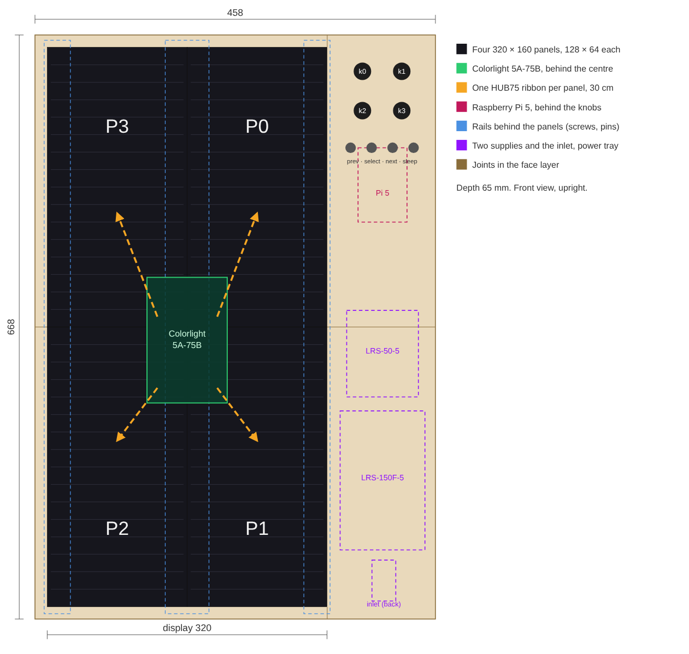
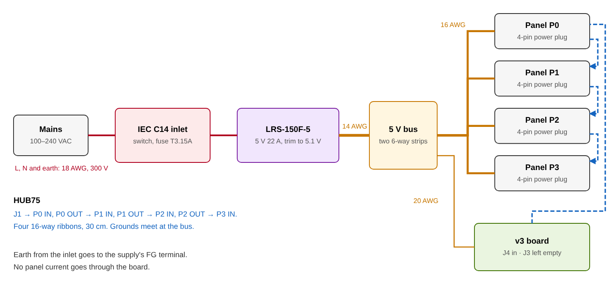
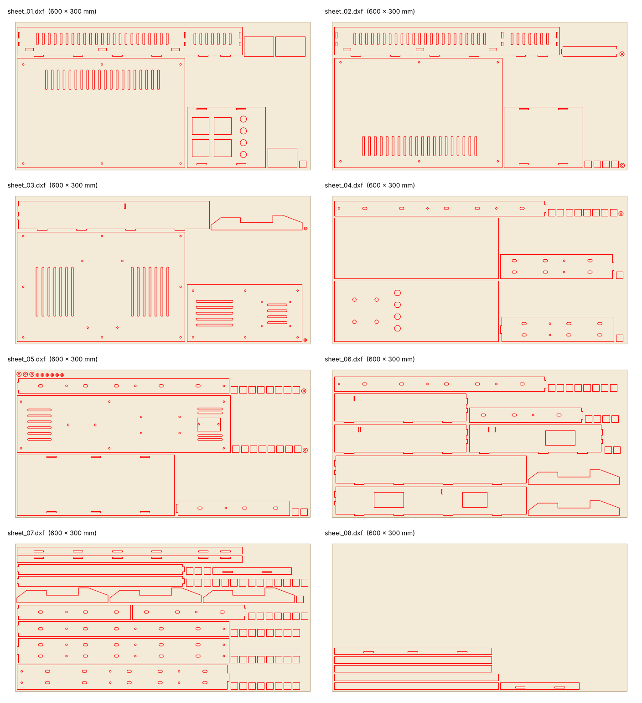

Author: Patternflow-lab, https://github.com/Patternflow-lab  
License: CC-BY-SA-4.0  
Based on: original design, with what [patternflood](https://github.com/jof/patternflood) by Jonathan Lassoff (CC BY-SA 4.0) worked out for holding four panels from behind, and its inlet cut-out  
Fits: v3 board (v3.9 and v3.0 share the outline) and four 320 × 160 mm, 128 × 64 P2.5 panels with the hole pattern on page 6 of [Simone's drawing](../simonepda-lasercut/lasercut_layout.pdf)  
Material: 3 mm birch plywood, laser cut. Every part fits a 480 × 270 mm bed; the nested sheets are 600 × 300 mm  
Verified: not built yet. Drawn 2026-11-07, and `source/big_2x2.py --check` measures the DXFs against the panel drawing, the board's KiCad file and the supply's datasheet

# 2 × 2

Four of the standard panels, two across and two down, make a display of 320 × 640 mm and 128 × 256 LEDs. That is a Patternflow twice over in both directions. It stands upright like the printed case: the panels on the left, and on the right a column with the board and its four knobs at the top and a mains supply below them. The box is 458 × 668 × 65 mm, cut from eight sheets of 3 mm birch plywood.

Nobody has built it yet. Start with the bench test below: it shows whether the board drives four panels well enough before any wood is cut.

## Bench test before you cut

Lay the four panels face down in their places, chain them as in the next section, and power them from the supply on the bench, with the bus wired as under Power. The firmware needs the four-panel test build described under Firmware, which this folder does not contain. Then check four things.

1. The display starts. Four panels need 512 KB of DMA buffers, against 128 KB today, so the test build puts them in PSRAM. The serial log prints the chain the driver picked; expect `chain scheme 2: 8 buffers per row, 122 Hz refresh rate`.
2. A corner marker lands in the right corner. A pattern that lights canvas (0, 0) shows whether the chain mapping needs its rotation or its row order turned round.
3. The picture holds still. Look at a slow gradient by eye and through a phone camera at 122 Hz.
4. The current stays inside the supply. A clamp meter on the 14 AWG lead with a white screen should read under 19.2 A.

If the first or third fails, the way out is patternflood's: a Raspberry Pi 5 renders and a Colorlight 5A-75B card drives the panels. The card (about 100 × 152 mm) and the Pi (85 × 56 mm) fit in the 42 mm behind the panels, so the box stays, but the board and its four bores in the column would be replaced.

## Panels and the chain

The panels sit at their own pitch, 160 mm across and 320 mm down. Their bodies are 159.8 × 319.8 mm, so 0.2 mm is left between them and the LEDs keep their 2.5 mm spacing across both seams. Each panel hangs on rails behind it by eight M4 screws into its blind nuts, and two of its 3.48 mm pins drop into holes in the rails. The pins set where a panel sits in both directions, because both seams show: a row that steps by a fraction of a pixel at the vertical seam is visible across a room, and so is a column at the horizontal one. The screw holes are slots and only clamp. The panel faces end flush with the front of the box, as in patternflood, so nothing presses on the outermost LEDs.

| Panel | Where, from the front | Fed from | Turned | Ribbon |
| :--- | :--- | :--- | :--- | :--- |
| P0 | top right | `J1` on the board | no: HUB-75E IN toward the top, as in the standard build | 30 cm |
| P1 | bottom right | P0 OUT | no | 30 cm |
| P2 | bottom left | P1 OUT | 180° | 30 cm (the hop is about 16 cm) |
| P3 | top left | P2 OUT | 180° | 30 cm |

Turning the left column round puts each OUT next to the next IN, which keeps every ribbon to one hop. The screw pattern is the same either way round. The pins are not: the drawing has them on opposite corners, and a turned panel puts them on the other pair, so the rails carry all four positions and each panel uses two.

## Controller: the v3 board

The board stays, and with it the 2 × 2 is a Patternflow: the same firmware, the same `.pfm` patterns from the decks and the Pattern Lab, the console, the Wi-Fi updates, and the four knobs on their 31 × 30.5 mm grid. patternflood went the other way for its own 2 × 2 and moved to a Raspberry Pi 5 with a Colorlight card, and its notes say what that cost: the box no longer runs Patternflow firmware.

The board has one HUB75 output, so the four panels make one chain, and the chain is where the cost lands. Today the driver shifts 128 pixels into each row; four panels make it 512. These are the driver's own numbers, from the arithmetic in `setupDMA()` in `firmware/patternflow/src/hub75/`, at the shipped 16 MHz clock and 8 bits:

| | One panel, today | Four panels |
| :--- | :--- | :--- |
| Pixels shifted per row | 128 | 512 |
| Refresh, brightest chain | 326 Hz | 81 Hz |
| Refresh, the chain the driver falls back to | (not needed) | 122 Hz |
| DMA buffers, double-buffered | 128 KB | 512 KB |
| At 6 bits instead of 8 | 391 Hz, 96 KB | 163 Hz on the fallback chain, 384 KB |

The driver takes the brightest bit-plane chain that clears the 240 Hz floor in `core_display.h`. At 512 pixels none does, so it falls back to the shortest chain, which lights less of each row: the panels are dimmer for the same setting, and the 300 Hz padding that keeps a phone camera from banding cannot apply. 122 Hz looks steady to the eye. A phone video will band.

The buffers are the other half. Today's 128 KB of buffers live in internal RAM, and the shipped build leaves about 98 KB of it free once its services are up (the note at the top of `platformio.ini`). 512 KB does not fit in internal RAM at all. The vendored driver already has the switch for it, `SPIRAM_DMA_BUFFER`, which moves the buffers into the board's 8 MB PSRAM. Whether the PSRAM keeps pace with a 16 MHz clock is the question the bench test answers.

## Power

| Load | at 5 V |
| :--- | :--- |
| One panel, full white (measured: root README, Power & runtime) | 4.8 A |
| Four panels, full white | 19.2 A |
| Four panels, an ordinary bright pattern (1.9 A each, same measurement) | 7.6 A |
| The board | under 0.5 A |
| Mean Well LRS-150F-5 | 22 A |

The supply carries four white panels without help from the firmware's power clamp. It is the 5 V model of the LRS-150F: 85 to 264 VAC with no selector switch, 159 × 97 × 30 mm, which fits the 109 mm column. The LRS-100-5 stops at 18 A, and the LRS-200-5 has a 115/230 V switch, one more thing to set wrong. The 4.8 A comes from the standard build, one panel on its own chain. The fallback chain lights less of each row, so four panels on one chain draw less than four times that, and the supply is sized for the full figure anyway.

Mains comes in through an IEC C14 inlet with a rocker switch and a 5 × 20 mm fuse, the AC-14-F16A that patternflood uses (cut-out 46.75 × 27.25 mm, flange screws 40 mm apart). The fuse is time-delay: the supply's cold-start inrush is 60 A at 230 VAC, and its typical input is 1.7 A at 230 V and 3 A at 115 V. Fit a T3.15A on 220 to 240 V mains and a T5A on 100 to 120 V.

| Run | Wire | Longest | Why that size |
| :--- | :--- | :--- | :--- |
| Inlet to supply: L, N, earth | 18 AWG (0.75 mm²), rated 300 V, insulated spades and forks | 15 cm | mains |
| Supply to the bus | 14 AWG (2.0 mm²), red and black | 30 cm | up to 20 A; 0.6 m of loop drops 0.1 V |
| Bus to each panel | 16 AWG (1.3 mm²), or the cable the panel ships with where it reaches | 50 cm, to P3 | 4.8 A; 1 m of loop drops 63 mV |
| Bus to `J4` | 20 to 22 AWG | 50 cm | under 0.5 A |

The bus is two 6-way barrier strips on the power tray, one for +5 V and one for GND, each with its positions bridged: one place for the supply, four for the panels and one for the board. Trim the supply to 5.1 V at the bus with its SVR1 while the panels show white.

`J4` stays the board's one power input, fed from the bus like a panel. `J3` feeds one panel on the standard build. Four panels draw up to four times that, so each takes its 5 V from the bus and `J3` stays empty. The grounds meet at the bus, and the ribbons tie the board's ground to the panels'.

This box has mains inside it. The supply's L and N screws are bare, so cover them: heatshrink over the forks and a boot over the terminal block. Earth the inlet to the supply's FG terminal. If mains wiring is new to you, have someone who knows it check the power tray before the first switch-on.

## The box

Every part is 3 mm plywood. The face is two layers glued together. The outer layer is what you see; the inner layer has a mortise for every wall's front tab, so the outer layer hides all the joints. Their seams are staggered, and the outer layer's seams sit where the display has its own: across the middle, and at the column's corners. Behind the face, the walls and the divider stand 56 mm deep, inset 3 mm, so the face and the back overhang them by a small lip.

Three vertical rails run between the top and bottom walls, 14 mm behind the face, on the panels' screw faces. Each rail is two layers glued with their cuts 200 mm apart, so the glued rail is one piece 662 mm long; its end tabs go through the top and bottom walls. Three stiffeners across the back carry the back cover's joints. The back comes off in five pieces, held by 32 M3 screws into blocks glued inside, and the lower right piece is the power tray: the inlet, the supply and the bus are all on it, so the mains wiring lives on one piece and is done flat on a bench.

| Files | Pieces | What |
| :--- | :--- | :--- |
| `bezel-outer-*` | 6 | The face. The column's upper piece has the four knob bores |
| `bezel-inner-*` | 8 | Behind the face: mortises, and a 52 mm pocket round the knobs |
| `wall-*`, `divider-*` | 8 | Top and bottom walls with vents, and the left, right and divider walls in two halves each |
| `splice` | 3 | Glued inside across each long wall's cut |
| `rail-*` | 12 | Three rails, two layers, two pieces per layer |
| `stiffener-*` | 3 | Across the back: two in the display bay, one in the column |
| `back-*` | 5 | The back cover, with vents. `back-column-lower` is the power tray |
| `screw-block` | 96 | 32 blocks of three squares |
| `cradle` | 6 | Two cradles of three profiles; the box stands in them |

The sheets in `sheets/` nest everything onto eight 600 × 300 mm sheets, and `sheets/manifest.csv` says which part is on which. A smaller bed takes the single parts in `parts/` instead; none is bigger than 480 × 270 mm. Every line is a cut, on one layer named `CUT`, in millimetres.

### Test cuts

`test_cuts/all-test-cuts.dxf` holds four small pieces. Cut them on the plywood you will use, before anything else.

1. `test-01-kerf-comb`: five slots from T − 0.2 to T + 0.2 mm, narrow end at the small hole. Push a strip of the same sheet into each. If T is not the slot that fits snugly, measure the sheet and change `T` in `source/big_2x2.py`.
2. `test-02-knob-bores`: the four 7.3 mm bores on the board's grid. The encoders should drop through all four at once.
3. `test-03-panel-rail`: one long side of a panel, with its four screw slots and its pin holes. Screw it to a real panel. If the holes miss, change `PANEL_SCREWS` and `PANEL_PINS`; the rails follow.
4. `test-04-inlet`: the inlet cut-out and its two flange holes.

### Order of assembly

1. Glue each rail's front and back layers together, with 3.5 mm drill bits through the pin holes to line them up.
2. Glue the inner face layer onto the outer one, face down on a flat table.
3. Fit the top and bottom walls, with the three rails' end tabs through them, and the left wall, the divider and the right wall between them, all into the inner layer's mortises. Glue the splices across the long walls' cuts.
4. Fit the stiffeners into the left wall, the divider and the right wall.
5. Glue the screw blocks. Screw each block loosely to its back cover piece, set the piece in place, and glue the blocks to the walls and stiffeners where they land.
6. Seat the panels from the front, one at a time, with their cables plugged in first or reached through the gaps between the rails. Screw them on from behind.
7. Fit the board: encoders through the bores and nuts from the front, as in the standard build.
8. Build the power tray on the bench, then screw it onto the column and connect the bus.
9. Glue three profiles per cradle and stand the box in the two cradles.

## Knobs

The column carries the knobs where the board has them: K2 top left, K1 top right, K4 bottom left, K3 bottom right, 31 × 30.5 mm apart, their centre 54 mm below the top edge and 59 mm in from the right one. The bushings clamp the outer 3 mm layer alone; the inner layer is pocketed 52 mm square round them. The board hangs on its encoder nuts, as in the standard build, and the knobs are the printed ones in [`knobs/`](../../knobs/).

## Parts to buy

[`bom.csv`](bom.csv) lists every part with where to get it. Beyond the v3 board and its knobs, the 2 × 2 needs four panels and their ribbons, the LRS-150F-5, the inlet with its fuse and cord, two barrier strips, about 6 m of wire in four sizes, ten sheets of plywood (eight for the box, one for the test cuts, one spare), PVA glue, 32 M4 × 10 screws for the panels, 32 M3 × 10 self-tapping screws for the back and eight more M3 screws for the supply, the inlet and the bus. The prices in it come from the build guide and from patternflood's list of 2026-10-30; the supply, the ribbons and the barrier strips are not priced.

## Firmware

Nothing in the firmware changes in this folder. This is what the four panels ask of it.

There are two ways to fill 256 × 128 LEDs. The first keeps the 128 × 64 canvas and draws each canvas pixel as 2 × 2 LEDs. Every pattern, every module, every deck and the Pattern Lab work as they are, and the change is the step that copies the canvas to the panels, `present()` in `src/core_canvas.h`, plus the chain mapping. The second gives the panels a 256 × 128 canvas. A pattern then computes four times the pixels and takes four times as long, so one at 48.5 fps today runs near 12. A module is built for one panel size (`-DPF_PANEL_W`, `-DPF_PANEL_H`), and the loader refuses a module built for another, so every `.pfm` is rebuilt; `firmware/toolchain/build_module.py` takes the size from the geometry instead of its 128 and 64; the Pattern Lab and the deck installs learn a second size; and `PFCanvas::buffer`, which is static in internal RAM, grows from 24 KB to 96 KB and has to move to PSRAM. Start with the first.

Either way, these change:

| What | Where | Change |
| :--- | :--- | :--- |
| Geometry | `shared/constants.json`, `config.h` | A fourth entry: 128 × 64 modules, chain 4, two rows. The two checks in `config.h` (`PANEL_RES_W == PANEL_PHYS_W * PANEL_CHAIN`, `PANEL_RES_H == PANEL_PHYS_H`) assume one row of panels |
| Chain mapping | `src/hub75/ESP32-HUB75-VirtualMatrixPanel_T.hpp` | Already there: `CHAIN_TOP_RIGHT_DOWN`, with P0 as the grid's top right in panel coordinates. The corner marker in the bench test sets its rotation |
| DMA buffers | `src/hub75/` build flag | `SPIRAM_DMA_BUFFER`, 512 KB in PSRAM |
| Refresh | `core_display.h` | `min_refresh_rate` from 240 to about 120, and `PF_TARGET_REFRESH_HZ` padding off for this geometry |
| Power clamp | `/api/display` `power_budget` and its estimate | The estimate counts four panels (four LEDs per canvas pixel in the first way), and the budget goes to 18 A of the supply's 22 |

The panel geometry is the device, like the two-panel 64 × 64 entry already in `shared/constants.json`, so all of this is core and none of it is a feature. `./firmware/bundles/build.sh all` and `check_boundaries.py` apply as they do to any core change.

## Files

| Path | What |
| :--- | :--- |
| [`source/big_2x2.py`](source/big_2x2.py) | Draws every file below from the numbers at its top. `--check` reads the DXFs back and measures them; `--render` draws `preview/sheets.png` from the sheet DXFs. Needs `ezdxf` (and `matplotlib` for `--render`) |
| [`parts/`](parts/) | One DXF per part, and `manifest.csv` with each part's size and count |
| [`sheets/`](sheets/) | Eight nested 600 × 300 mm sheets, and `manifest.csv` |
| [`test_cuts/`](test_cuts/) | The four test pieces, singly and on one sheet |
| [`preview/`](preview/) | Front view, wiring and the sheets, as SVG and PNG |
| [`bom.csv`](bom.csv) | What to buy |

## Credits

The way the panels hang is patternflood's: rails behind the panels on their own screw faces, pins that locate and slots that only clamp, and faces flush with the front ([enclosure notes](https://github.com/jof/patternflood/blob/main/docs/desktop/enclosure-lasercut.md)). So is the inlet and its cut-out, and the habit of a bench test before the cutting. The panel's holes and pins come from the maker's drawing on page 6 of [Simone Majocchi's laser-cut case](../simonepda-lasercut/README.md). The supply's size, holes, inrush and input current come from Mean Well's LRS-150F datasheet of 2025.
