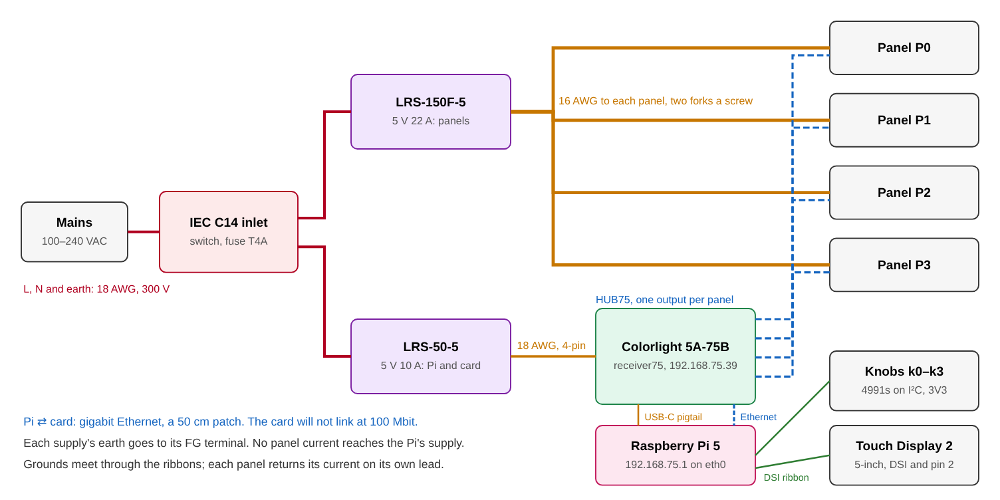

Author: Patternflow-lab, https://github.com/Patternflow-lab  
License: CC-BY-SA-4.0  
Based on: original design, with what [patternflood](https://github.com/jof/patternflood) by Jonathan Lassoff (CC BY-SA 4.0) worked out for its own 2 × 2: the Raspberry Pi and Colorlight controller, the panels held from behind, the knobs, the web remote the screen shows, and the inlet cut-out  
Fits: a Raspberry Pi 5, a Colorlight 5A-75B receiving card and four 320 × 160 mm, 128 × 64 P2.5 panels with the hole pattern on page 6 of [Simone's drawing](../simonepda-lasercut/lasercut_layout.pdf). No Patternflow board  
Material: 3 mm birch plywood, laser cut. Every part fits a 480 × 270 mm bed; the nested sheets are 600 × 300 mm  
Verified: not built yet. Drawn 2026-11-07, and `source/big_2x2.py --check` measures the DXFs against the panel drawing, the card's and the Pi's hole positions and the supplies' datasheets

# 2 × 2

Four of the standard panels, two across and two down, make a display of 320 × 640 mm and 128 × 256 LEDs. That is a Patternflow twice over in both directions. It stands upright like the printed case: the panels on the left, and on the right a column with four knobs and a 5-inch touch screen at the top and two mains supplies below them. A Raspberry Pi 5 draws the frames and sends them over Ethernet to a Colorlight 5A-75B, a receiving card made for LED walls, which drives the four panels. The box is 458 × 668 × 65 mm, cut from eight sheets of 3 mm birch plywood.

Nobody has built it yet. The controller is the one patternflood runs, so most of what follows has been done once on a 2 × 2 of smaller panels. Start with the bench test: it shows the card driving these panels before any wood is cut.

## Bench test before you cut

Lay the four panels face down in their places and plug each into its own output on the card. Power the panels from the big supply and the card, the Pi and the screen from the small one, wired as under Power, and connect the Pi to the card with the patch cable. Then check five things.

1. The card answers. After receiver75 is flashed (Software, below), it answers ARP at 192.168.75.39 on the Pi's wired link. It does not answer ping.
2. Each panel half lights where it should. patternflood's `r75_slot_ids.py` draws each slot's number. A 128 × 64 panel is electrically two 64 × 64 panels in a chain, so each one fills both slots of its connector, and the numbers say which half is which and which way up.
3. The seams line up. patternflood's seam test (border, diagonals, a ring, a centre cross) should run straight across both seams once the slot table is right.
4. The current. A clamp meter on one panel's lead with a white screen gives the figure the renderer's power cap needs. The standard build measures 4.8 A per panel; this card may drive the panels harder.
5. The touch screen. A Pi 5 finds the Touch Display 2 on its own; the web remote should come up on it and answer a finger.

## Panels and the card

The panels sit at their own pitch, 160 mm across and 320 mm down. Their bodies are 159.8 × 319.8 mm, so 0.2 mm is left between them and the LEDs keep their 2.5 mm spacing across both seams. Each panel hangs on rails behind it by eight M4 screws into its blind nuts, and two of its 3.48 mm pins drop into holes in the rails. The pins set where a panel sits in both directions, because both seams show: a row that steps by a fraction of a pixel at the vertical seam is visible across a room, and so is a column at the horizontal one. The screw holes are slots and only clamp. The panel faces end flush with the front of the box, as in patternflood, so nothing presses on the outermost LEDs.

The card has eight HUB75 outputs, in two columns of four, and each panel gets its own: no chain between panels, and nothing to remap when one is turned round. The card sits behind the centre of the display, 15 mm below it, so the four ribbons are the same 30 cm. The headers in the card's left column go to the left panels, the right column to the right ones.

| Panel | Where, from the front | Card output | Ribbon |
| :--- | :--- | :--- | :--- |
| P0 | top right | right column, top | 30 cm |
| P1 | bottom right | right column, bottom | 30 cm |
| P2 | bottom left | left column, bottom | 30 cm |
| P3 | top left | left column, top | 30 cm |

All four stand the same way up. The pin holes are cut at all four corner positions anyway, because the drawing puts the pins on opposite corners and a panel turned round puts them on the other pair.

## Controller: a Raspberry Pi 5 and a Colorlight 5A-75B

This box does not use a Patternflow board. The Pi 5 renders, and the card does the panel timing on its FPGA, one output per panel, at whatever refresh the panels can take. patternflood came to the same pair for its 2 × 2 after giving up on an ESP32, and its [design notes](https://github.com/jof/patternflood/blob/main/docs/desktop/driver-colorlight.md) carry the reasons and the measurements this follows.

The card is the cheap end of the LED-wall world, about 22 USD. Out of the box it is set up from Colorlight's Windows software and fed by a sending card. With [receiver75](https://github.com/dgym/receiver75), Jim Bailey's open gateware, flashed once, it becomes a framebuffer that takes UDP packets: sixteen slots of 64 × 64, two per output. A 128 × 64 panel fills both of its connector's slots, so four panels use four outputs and four stay free. A frame of 128 × 256 at 60 fps is about 47 Mbit/s, and the card links only at gigabit, which the Pi 5's own port is.

Two other routes stay open and are not drawn. The card's stock firmware, set up once from Colorlight's Windows software, takes frames from Falcon Player on a Pi with nothing flashed; patternflood began there and moved to receiver75 so the whole path is open. And a Pi 5 can drive HUB75 itself, with no card; then the Pi does the panel timing, which here is the card's job.

## Power

| Load | at 5 V | Supply |
| :--- | :--- | :--- |
| One panel, full white (standard build: root README, Power & runtime) | 4.8 A | |
| One panel, its rating (30 W) | 6 A | |
| Four panels | up to 24 A, 7.6 A for an ordinary bright pattern | Mean Well LRS-150F-5, 22 A |
| Raspberry Pi 5 with its Active Cooler, no USB devices | plan 1.6 A (patternflood) | Mean Well LRS-50-5, 10 A |
| Colorlight 5A-75B | about 0.8 A (patternflood) | the same LRS-50-5 |
| Touch Display 2, 5-inch | 0.3 A (1.4 W, Raspberry Pi's brief) | the same LRS-50-5, through the Pi's pin 2 |

The Pi and the card have a supply of their own. Four white panels can ask for more than 22 A, and on a shared rail that dip would reach the Pi, which throttles and can reset when its 5 V sags. On its own supply, nothing the panels do reaches it. The big supply still needs the renderer's per-frame power cap, set from the bench test's measurement to keep the four panels under 20 A; its overload protection is the backstop. Both supplies run from 85 to 264 VAC with no selector switch, and both fit the 109 mm column.

Mains comes in through an IEC C14 inlet with a rocker switch and a 5 × 20 mm fuse, the AC-14-F16A that patternflood uses (cut-out 46.75 × 27.25 mm, flange screws 40 mm apart). The two supplies draw 2.3 A together at 230 V and 4 A at 115 V (their datasheets, typical), and their cold-start inrush is 60 A and 45 A. Fit a time-delay fuse: T4A on 220 to 240 V mains, T6.3A on 100 to 120 V.

| Run | Wire | Longest | Why that size |
| :--- | :--- | :--- | :--- |
| Inlet to the big supply, and on to the small one: L, N, earth | 18 AWG (0.75 mm²), rated 300 V, insulated spades and forks | 20 cm | mains |
| Big supply to each panel | 16 AWG (1.3 mm²), or the cable the panel ships with where it reaches | 50 cm, to P3 | 6 A; 1 m of loop drops 79 mV |
| Small supply to the card's 4-pin input | a spare panel power cable | 50 cm | 2.7 A, the Pi's and the screen's included |
| Card's 5 V terminal to the Pi | 5 V to USB-C pigtail, 20 AWG | 20 cm | the Pi |

The big supply has two +V and two −V screws, and each takes the forks of two panels: P0 and P1 on one pair, P2 and P3 on the other. The small supply's one pair feeds the card's 4-pin input, and the card passes 5 V on to the Pi from its screw terminal, as in patternflood. The pigtail does no USB-PD, so set `PSU_MAX_CURRENT=5000` with `sudo rpi-eeprom-config -e`, or the Pi warns about its supply and limits its USB ports. Trim the small supply to 5.15 V with its SVR1 so the Pi sees at least 5.0 V. The two supplies share a ground through the ribbons' ground wires; no panel current takes that path, because each panel returns its current on its own lead.

This box has mains inside it. The supplies' L and N screws are bare, so cover them: heatshrink over the forks and a boot over each terminal block. Earth the inlet to both supplies' FG terminals. If mains wiring is new to you, have someone who knows it check the power tray before the first switch-on.

## The box

Every part is 3 mm plywood. The face is two layers glued together. The outer layer is what you see; the inner layer has a mortise for every wall's front tab, so the outer layer hides all the joints. Their seams are staggered, and the outer layer's seams sit where the display has its own: across the middle, and at the column's corners. Behind the face, the walls and the divider stand 56 mm deep, inset 3 mm, so the face and the back overhang them by a small lip.

Three vertical rails run between the top and bottom walls, 14 mm behind the face, on the panels' screw faces. Each rail is two layers glued with their cuts 200 mm apart, so the glued rail is one piece 662 mm long; its end tabs go through the top and bottom walls. Three stiffeners across the back carry the back cover's joints. The back comes off in five pieces, held by 32 M3 screws into blocks glued inside.

Three of the back pieces carry the electronics, each on its inside face. The middle display piece holds the card, behind the centre of the panels, on two 3 mm rings per screw. The column's upper piece holds the Pi, on end with its ports up, behind the screen. The column's lower piece is the power tray, with the inlet and both supplies, so the mains wiring lives on one piece and is done flat on a bench. Lifting a piece off means unplugging its board's cables at the board. Vents in the top and bottom walls and in those three pieces let the box breathe like a chimney.

| Files | Pieces | What |
| :--- | :--- | :--- |
| `bezel_outer_*` | 6 | The face. The column's upper piece has the four knob bores and the screen's window, 63.1 × 111.4 mm |
| `bezel_inner_*` | 8 | Behind the face: mortises, a 35 mm pocket round each knob, and a pocket the screen's glass sits in |
| `wall_*`, `divider_*` | 8 | Top and bottom walls with vents, and the left, right and divider walls in two halves each. The divider has windows for the Ethernet cable and the power leads |
| `splice` | 3 | Glued inside across each long wall's cut |
| `rail_*` | 12 | Three rails, two layers, two pieces per layer |
| `stiffener_*` | 3 | Across the back: two in the display bay, one in the column |
| `back_*` | 5 | The back cover, with vents. `back_display_middle` carries the card, `back_column_upper` the Pi, `back_column_lower` is the power tray |
| `ring_card`, `ring_pi` | 16 | Spacer rings, two under each of the card's and the Pi's screws |
| `display_bracket` | 1 | Screws to the screen's four standoffs and to its two posts, and holds the glass against the face; a notch clears its ribbon and power sockets |
| `display_post` | 8 | Two posts of four layers, glued into the column's corners beside the screen |
| `screw_block` | 96 | 32 blocks of three squares |
| `cradle` | 6 | Two cradles of three profiles; the box stands in them |

The sheets in `sheets/` nest everything onto eight 600 × 300 mm sheets, and `sheets/manifest.csv` says which part is on which. A smaller bed takes the single parts in `parts/` instead; none is bigger than 480 × 270 mm. Every file comes twice, as DXF and as SVG at 1:1 in millimetres, for cutters that take one and not the other. Every line is a cut: on one layer named `CUT` in the DXFs, a red hairline in the SVGs.

### Test cuts

`test_cuts/all_test_cuts.dxf` (and `.svg`) holds four small pieces. Cut them on the plywood you will use, before anything else.

1. `test_01_kerf_comb`: five slots from T − 0.2 to T + 0.2 mm, narrow end at the small hole. Push a strip of the same sheet into each. If T is not the slot that fits snugly, measure the sheet and change `T` in `source/big_2x2.py`.
2. `test_02_knob_and_display`: a 7.3 mm knob bore, and the four holes of the screen's bracket. An encoder's bushing should go in without forcing, and the screen's standoffs should sit on the four holes. Raspberry Pi calls its drawing approximate, so check the screen's outline against the face's pocket too.
3. `test_03_panel_rail`: one long side of a panel, with its four screw slots and its pin holes. Screw it to a real panel. If the holes miss, change `PANEL_SCREWS` and `PANEL_PINS`; the rails follow.
4. `test_04_inlet`: the inlet cut-out and its two flange holes.

Print `parts/back_display_middle.svg` and `parts/back_column_upper.svg` at 1:1 and hold the card and the Pi against them before cutting the back. Their holes come from patternflood's scan of a v8.2 card and from the Pi 5's drawing.

### Order of assembly

1. Glue each rail's front and back layers together, with 3.5 mm drill bits through the pin holes to line them up.
2. Glue the inner face layer onto the outer one, face down on a flat table.
3. Fit the top and bottom walls, with the three rails' end tabs through them, and the left wall, the divider and the right wall between them, all into the inner layer's mortises. Glue the splices across the long walls' cuts.
4. Fit the stiffeners into the left wall, the divider and the right wall.
5. Glue the screw blocks. Screw each block loosely to its back cover piece, set the piece in place, and glue the blocks to the walls and stiffeners where they land.
6. Seat the panels from the front, one at a time, with their power cables and ribbons plugged in first or reached through the gaps between the rails. Screw them on from behind.
7. Fit the knobs from the front, chain the 4991s and run their cable toward the Pi's corner. Glue the screen's two posts into the column's corners, set the screen face down into its pocket, and screw the bracket to its standoffs and to the posts.
8. Build the power tray on the bench: inlet, both supplies, mains wiring, covers on the terminals.
9. Screw the card to the middle back piece and the Pi to the column's upper piece, each on its rings. Plug in the ribbons, the Ethernet cable, the power, the knob lead and the screen's ribbon and power lead, and screw the pieces on.
10. Glue three profiles per cradle and stand the box in the two cradles, one under each end of the display.

## Knobs and the touch screen

The four knobs are EC11 encoders on Adafruit 4991 I²C breakouts, as in patternflood, 45 mm apart so the breakouts clear each other. The encoder is the standard build's PEC11R-4220F-S0024, so the 24 detents and the printed knobs in [`knobs/`](../../knobs/) are the same as on any Patternflow. Each bushing clamps the outer 3 mm layer alone; the inner layer is pocketed 35 mm square round it. Set the breakouts' address jumpers to 0x37, 0x38, 0x39 and 0x3A for k0 (top left), k1 (top right), k2 (bottom left) and k3 (bottom right). They chain on STEMMA QT cables, and the last one goes to the Pi's 3V3, SDA, SCL and ground on pins 1, 3, 5 and 9. Never 5 V: each breakout pulls SDA and SCL up to its own supply, and the Pi's pins are not 5 V tolerant.

Below them is a Raspberry Pi Touch Display 2, the 5-inch one: 720 × 1280, portrait like the column, capacitive five-finger touch, 40 USD. Its glass sits in a pocket in the inner face layer, behind a window in the outer one cut to its viewing area, and a bracket screwed to its four M2.5 standoffs and to two posts in the column's corners holds it there. Its ribbon goes to the Pi's DSI port, the narrow 22-way end at the Pi, and its power lead to the Pi's 5 V and ground on pins 2 and 6. That is why the knobs' ground is on pin 9.

The knobs and the screen do different jobs. The knobs are the pattern's four parameters, always, as on any Patternflow: turning one never opens a menu. The screen is everything that is not turning: a shelf and a pattern to pick, with a picture of each, a search, brightness, a random pick, sleep and wake, and the name of what is playing with its knob values. That is what patternflood's four buttons did, and why this box has no buttons.

## Software

The card needs receiver75 flashed once, over its JTAG pads. patternflood keeps a patched build, `receiver75-splash-5f2185b.bit` (MIT), and the tools and notes for flashing it from a Glasgow; any probe openFPGALoader drives does the same job. That build's boot splash has patternflood's own panel map compiled in, so it draws in the wrong places on these panels until the Pi takes the display over. The card then sits at 192.168.75.39, takes pixels on UDP port 4343 and register writes on 4344, and needs nothing more.

The Pi runs patternflood's appliance image (Raspberry Pi OS Lite, arm64): its wired port at 192.168.75.1 with no route, I²C at 100 kHz, and a service that starts the renderer at 60 fps on every boot. The renderer reads the knobs over I²C and sends each frame to the card. It also runs all 34 of Patternflow's preset patterns natively: their headers compile unchanged against a small stand-in for the firmware's hardware layer, and the canvas size is a build flag (`-DPANEL_RES_W/H`). The community's patterns come along too, compiled where they have a firmware header and in Patternflow's own JavaScript harness under node where they do not.

The screen needs no new interface. patternflood's renderer already serves a web remote (`PF_WEB=:80`): the panel live, the knobs, the four buttons' jobs, every shelf with a picture of each pattern, a search, brightness and a random pick, laid out for a phone held upright. On the Pi it opens full screen in a kiosk browser, Chromium under the cage compositor, pointed at the Pi's own address. The screen is portrait and so is that page, so nothing needs rotating.

patternflood's renderer is written for its 128 × 128. For this box, four things change in it:

| What | In patternflood | For this box |
| :--- | :--- | :--- |
| Frame | 128 × 128 | 256 × 128 in panel coordinates, which the upright box shows as 128 wide and 256 tall. Patterns written for 128 × 64 keep their 2 : 1 shape |
| Slot table | `QUADRANT_SLOTS` in `firmware/colorlight/r75_frame.py`: four 64 × 64 quadrants, one slot each | eight 64 × 64 tiles, two per panel, read off `r75_slot_ids.py` in the bench test |
| Power cap | assumes 2.4 A per panel at full white | the bench test's figure for these panels, with 20 A for the four |
| Menu | four buttons on GPIO, the only way into the menu | the web remote on the screen. Sleep should also switch the screen's backlight off |

What a Patternflow board brings and this box does not: the `.pfm` modules the Pattern Lab and the decks install over Wi-Fi, the device console at `patternflow.local`, firmware updates over the air, and the REST, OSC and MIDI contracts in `docs/`. They are all firmware for the ESP32. patternflood has its own web remote instead, the panel live with its knobs, buttons and shelves in a browser.

## Parts to buy

[`bom.csv`](bom.csv) lists every part with where to get it. The 2 × 2 needs four panels and their ribbons, the Pi 5 with its cooler and card, the Colorlight 5A-75B and a JTAG probe to flash it once, a patch cable and a USB-C pigtail, four 4991 breakouts with their encoders, cables and the printed knobs, the 5-inch Touch Display 2, the two supplies, the inlet with its fuse and cord, about 5 m of wire, ten sheets of plywood (eight for the box, one for the test cuts, one spare), PVA glue, and screws. The prices in it come from the build guide and from patternflood's list of 2026-10-30; the big supply, the probe, the encoders, the ribbons, the fuse, the wire and the screws are not priced.

## Files

| Path | What |
| :--- | :--- |
| [`source/big_2x2.py`](source/big_2x2.py) | Draws every file below from the numbers at its top. `--check` reads the DXFs back and measures them; `--render` draws `preview/cuts.png` from the sheet DXFs. Needs `ezdxf` (and `matplotlib` for `--render`) |
| [`parts/`](parts/) | One DXF and one SVG per part, and `manifest.csv` with each part's size and count |
| [`sheets/`](sheets/) | Eight nested 600 × 300 mm sheets as DXF and SVG, and `manifest.csv` |
| [`test_cuts/`](test_cuts/) | The four test pieces, singly and on one sheet, as DXF and SVG |
| [`preview/`](preview/) | Front view, wiring and the sheets, as SVG and PNG |
| [`bom.csv`](bom.csv) | What to buy |

## Credits

The controller is patternflood's: the Pi 5 and the Colorlight card with receiver75, the knobs on 4991 breakouts, the supply feeding the Pi through the card, and the renderer, with its web remote, that runs Patternflow's patterns on a Pi ([driver notes](https://github.com/jof/patternflood/blob/main/docs/desktop/driver-colorlight.md), [wiring](https://github.com/jof/patternflood/blob/main/docs/desktop/wiring.md)). So is the way the panels hang: rails behind them on their own screw faces, pins that locate and slots that only clamp, and faces flush with the front ([enclosure notes](https://github.com/jof/patternflood/blob/main/docs/desktop/enclosure-lasercut.md)). So are the card's measured holes, the inlet and its cut-out, and the habit of a bench test before the cutting. receiver75 is Jim Bailey's. The panel's holes and pins come from the maker's drawing on page 6 of [Simone Majocchi's laser-cut case](../simonepda-lasercut/README.md). The supplies' sizes, holes, inrush and input currents come from Mean Well's LRS-150F and LRS-50 datasheets, and the screen's outline, viewing area, standoffs and power from Raspberry Pi's Touch Display 2 product brief.
