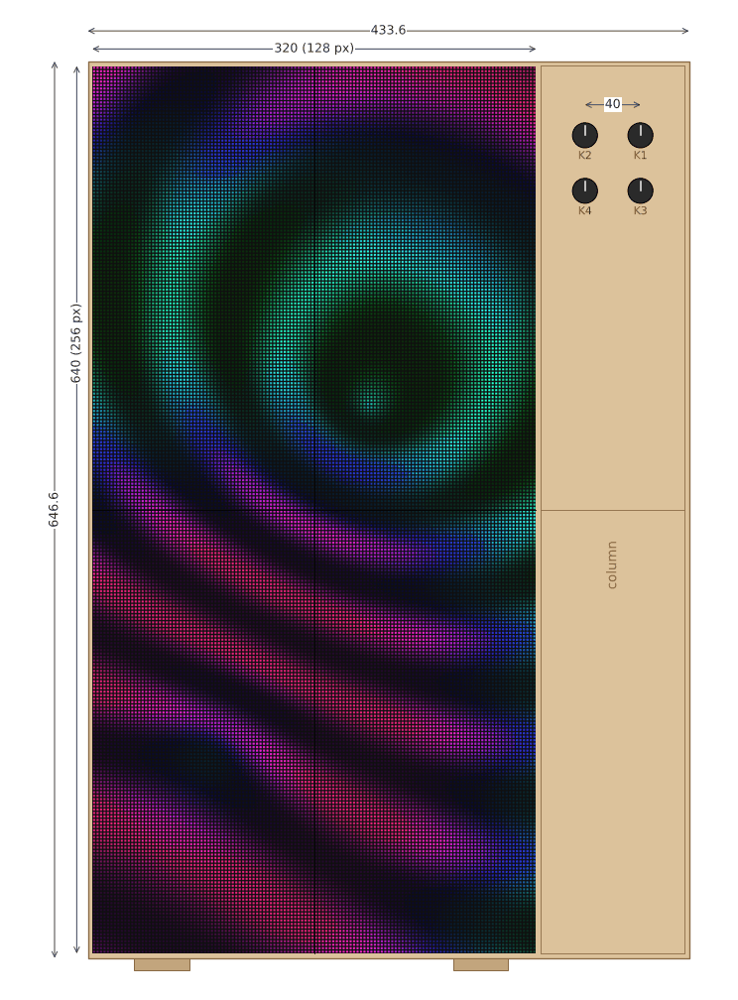
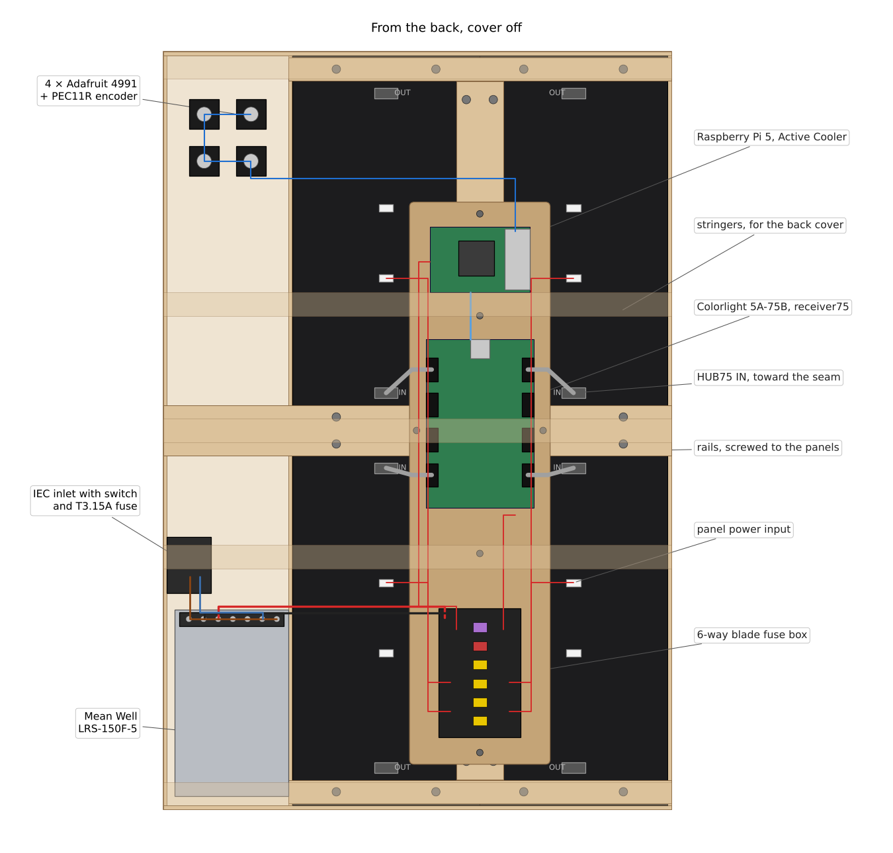
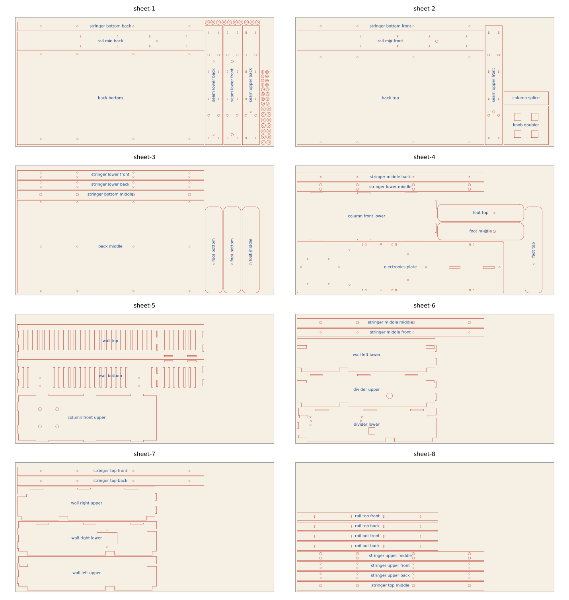
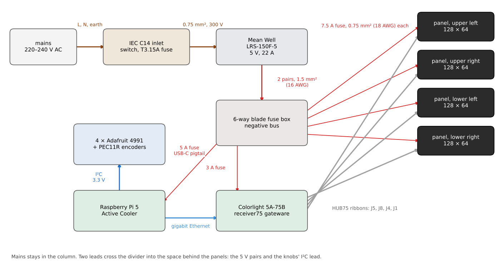
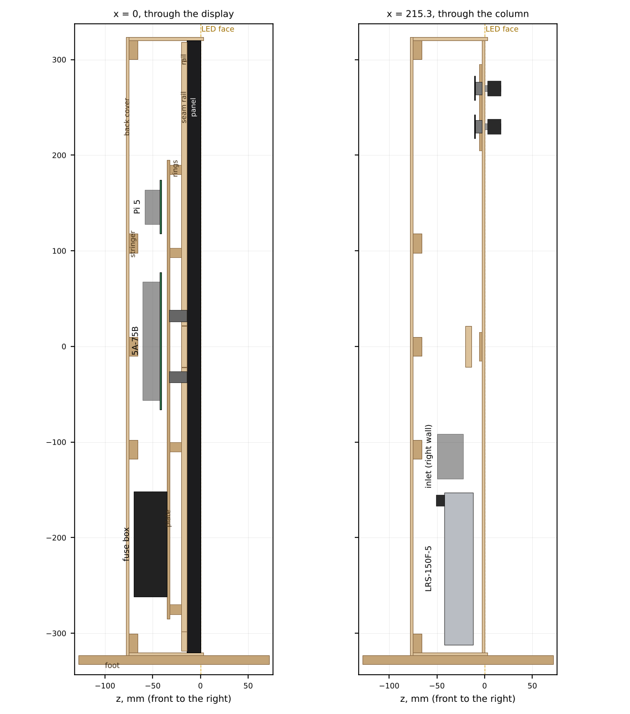

Author: Patternflow, https://patternflow.work
License: CC-BY-SA-4.0
Based on: Patternflood desktop Rev 2.7 by jof, https://github.com/jof/patternflood (CC BY-SA 4.0)
Fits: no Patternflow board; four 320 × 160 mm P2.5 panels driven by a Raspberry Pi 5 with a Colorlight 5A-75B
Material: 3 mm plywood, laser cut, 0.15 mm kerf compensated; eight 600 × 300 mm sheets
Verified: not built yet. Drawn 2026-11-07, and `source/check.py` measures the cut files against the panel's drawing

# Patternflow 2 × 2

 

Four of the panels the [build guide](../../../../BUILD_GUIDE.md#1-bill-of-materials-bom) links, two across and two down. That is 320 × 640 mm of LEDs, 256 × 128 of them, twice the stock Patternflow in each direction. The box stands the way the stock one does: panels upright, and a column on the right with the four knobs at its top. It is 433.6 mm wide, 646.6 tall and 81 deep, on two feet 200 mm long.

It started from [Patternflood](https://github.com/jof/patternflood), jof's desktop build: four P2 64 × 64 panels in a laser-cut birch box 256 mm square, run by a Raspberry Pi 5 and a Colorlight 5A-75B card off mains. This one keeps those electronics. What four 128 × 64 panels change is drawn again here: where everything sits, how much power it takes, and the box around it.

Nothing here has been cut. The drawings are checked against the panel's own drawing (the last section), and the first build is the one that says whether they fit.

## Files

| Path | What |
| --- | --- |
| `sheets/sheet-1.dxf` to `sheet-8.dxf` | The box, every part nested on eight 600 × 300 mm sheets. The `.svg` beside each has the same cuts in red and the part names in blue, in a group not to cut |
| `sheets/test-cuts.dxf` | Cut this first: a coupon with the box's holes, a slot with its key, and templates of one panel's back and of the 5A-75B |
| `dxf/` | One file per part: the box's 47 and the four test pieces. Each is drawn as seen from outside the box, or from the back for the parts behind the panels |
| [`bom.csv`](bom.csv) | Everything to buy, fasteners included |
| `images/` | The pictures on this page |
| `source/big2x2.py` | Draws all of the above. `--thickness` and `--kerf` redraw it for your sheet and your laser |
| `source/check.py` | Opens every DXF and measures it against the panel |

## The panels and the card

Seen from the front, the panels are the stock Patternflow's panel turned upright, two side by side and two more below them. Each one gets its own HUB75 output on the card: upper left on `J5`, upper right `J8`, lower left `J4`, lower right `J1`, the map patternflood's card already has. A panel's IN and OUT connectors sit near its two short ends. Turn the top two so their IN is at the bottom, and the lower two so theirs is at the top, and every ribbon runs about 10 cm to the middle of the box, where the card is.

The card runs receiver75, Jim Bailey's open gateware, which patternflood builds and flashes once over JTAG. It is written for two 64 × 64 panels on each connector, refreshed at 500 Hz. To the card a 128 × 64 panel is those two panels chained, so each connector here should show two of its slots, `2n − 1` and `2n`. This is the least proven part of the design. Patternflood lit P2 panels with FM6124 drivers on it, and nobody has lit this panel on it yet. Try one panel on the card before buying four.

## Why a Raspberry Pi and not the Patternflow board

256 × 128 is 32,768 points of light. [rfc-any-resolution.md](../../../../docs/rfc-any-resolution.md#28-the-limits) puts what one ESP32-S3 drives at 8,192 at colour depth 8, the stock panel's own memory, and this is four times that. The driver keeps two buffers of every row in internal DMA RAM, 2 × W × H × 8 bytes: 524,288 bytes here, against 98,708 bytes of internal heap free on the stock panel, measured on 2026-08-18. One chain of four panels also shifts 512 pixels a row, so the refresh falls from the stock 325 Hz to 16,000,000 / (12 × 16,384) = 81 Hz. That flickers, and it bands on any phone.

The card has eight outputs and drives them all at once, so four panels refresh as fast as one. The Pi has the gigabit Ethernet the card needs on its own board.

What this gives up is the firmware. A `.pfm` module is ESP32-S3 machine code and does not run on a Pi, and the web console, OSC, MIDI and MQTT live in the firmware. [rfc-linux-player.md](../../../../docs/rfc-linux-player.md) is the plan for patterns on a Pi, and the Firmware section below lists what 256 × 128 needs from it. Until then, patternflood's own software runs here with a bigger frame map.

## Knobs

Four Adafruit 4991 I²C breakouts, each with the stock `PEC11R-4220F-S0024` soldered on, 24 detents a turn as on the board. Their bushings go through the column front in 7.2 mm holes on a 40 mm grid, and the nut that comes with each encoder clamps it from the front. A 3 mm doubler glued behind the front stiffens it, with a pocket for each encoder body. The stock printed knobs fit.

| Knob | Where | 4991 address | Jumpers |
| --- | --- | --- | --- |
| K1 | top right | 0x37 | A0 |
| K2 | top left | 0x38 | A1 |
| K3 | bottom right | 0x39 | A0 + A1 |
| K4 | bottom left | 0x3A | A2 |

The places are the stock board's. Its encoders go in from the back, so `SW1`, on the left of the board's drawing, ends up on the right. The addresses are the range patternflood's tools look in. The four chain on STEMMA QT cables, and the last one runs to the Pi's header at 3.3 V through a 14 mm hole in the divider.

## Power

| Load | Draw |
| --- | --- |
| Four panels, each capped at 3.5 A a frame | 14 A |
| Raspberry Pi 5 with the Active Cooler, and the four 4991s on its 3.3 V | 1.6 A, planned |
| Colorlight 5A-75B | 0.8 A |
| In all | 16.4 A of the supply's 22 A |

The stock panel draws about 1.9 A on an ordinary bright pattern and about 4.8 A on a white screen ([README, Power & runtime](../../../../README.md#power--runtime)). Four white screens and the boards come to about 22 A, all of a Mean Well LRS-150F-5, inside a closed box where its rating starts to fall at 40 °C. So whatever plays on it caps each frame's current before it goes out, as the stock firmware's power clamp does and as patternflood's renderer does. At 3.5 A a panel an ordinary pattern never meets the cap, and a white screen lands at about three quarters of full. The supply's hiccup mode is the backstop.

Mains comes in through an IEC C14 inlet with a switch and a fuse, low on the right wall, and stays in the column: about 10 cm of 0.75 mm² wire to the supply's terminals. The fuse is time-delay, T3.15A at 220–240 V and T5A at 100–120 V. It is sized for the supply's 60 A cold-start inrush, not for its load, and a fast fuse trips at switch-on. As on patternflood, four things are not optional:

1. A cover over the supply's input terminals. The back comes off with 28 screws, and L and N are open screws under it.
2. Earth from the inlet to the supply's FG terminal.
3. The time-delay fuse in the inlet.
4. The mains leads tied down at the inlet, away from the 5 V side and the I²C lead.

The supply lies on its side against the divider, base toward the front and terminals toward the back cover, with 33 mm of room above them for wiring. Its base stands 12 mm behind the LED face, so a screw head at any of its side inserts clears the panel on the other side of the divider. Two pairs of 1.5 mm² wire, one on each of its +V/−V terminal pairs, go through the divider to a 6-way blade fuse box with a negative bus on the electronics plate. That is the 5 V bus. It feeds the four panels through 7.5 A fuses on 0.75 mm² wire, the card through 3 A, and the Pi's USB-C pigtail through 5 A. Give the card 0.75 mm² as well: each ribbon carries ground between the card and its panel, so part of every panel's return current comes back through the card's lead. The longest branch, to an upper panel, is about 50 cm and drops 0.08 V at 3.5 A. Keep the run from the supply to the fuse box under 40 cm, which drops about 0.08 V more at 16.4 A. Trim the supply to 5.15 V at the fuse box with a pattern playing, not at idle, so the Pi sees at least 5.0 V. The pigtail does no USB-PD, so the Pi assumes a 3 A supply and warns: run `sudo rpi-eeprom-config -e` and add `PSU_MAX_CURRENT=5000`.

This build has no Patternflow board in it, so the board's rule that `J4` is its only power input does not come into it.

## The box

Everything is 3 mm plywood. The four outer walls stand around the panels and the column, finger-jointed at the corners, and their front edges stand 3 mm proud of the LEDs to keep a knock off the panel edges. The left wall, the right wall and the divider between the panels and the column are each cut in two halves that meet at the middle, because 646 mm does not fit a 600 mm bed. The middle rail and the middle stringer pass through both halves of each and hold the joint.

The panels hang on rails. Three run across the panel backs at the top, the middle and the bottom, each two sheets glued, through mortises in the left wall and the divider. The middle one goes on through the column to the right wall. Two more run down the vertical seam. M4 × 10 screws go through the rails into each panel's inserts: two at each short end, and four along the edge at the seam. The 3.48 mm pins on a panel's back drop into 5 mm holes in the seam rails. The screw holes are 6 mm slots, so an M4 can move 1 mm either way and each pair of panels can be pushed together before the screws are tightened. The seams are what shows most.

Behind the middle of the panels, the electronics plate stands 12 mm off the rails on stacks of laser-cut rings, held by six M3 × 20 screws, with no washers, into nuts in the rails' front sheets. A longer screw would reach the panel: the tip of this one stops 1 mm short. The card, the Pi and the fuse box go on its back face, components toward the back cover, where they can be reached with the cover off. The panel screws under the plate are reached with the plate off.

The back cover is three pieces across the whole width, held by 28 M3 × 10 screws into nuts trapped in five stringers. A stringer is three sheets with the nuts in the middle one, and drops into notches in the back edges of the walls. Two feet, built the same way, screw on underneath from inside, under the display and clear of the supply. Most of the weight is the panels at the front, so the box tips forward first: at about 5° without the feet, and about 16° with them, which reach 69 mm in front of it. Both are estimates, with 0.6 kg a panel. Air comes in through slots in the bottom wall and leaves through the top.

## Cutting and building

1. Measure the plywood in a few places. If it is not 3.0 mm, or your laser's kerf is not 0.15 mm, redraw everything with your numbers: `pip install -r source/requirements.txt`, then `python source/big2x2.py --thickness 3.18 --kerf 0.12`.
2. Cut `sheets/test-cuts.dxf`. The key should push through the coupon's slot and hold, an M3 nut should sit in the hexagon, and the 7.2 mm hole should take the encoder's bushing without play. Lay the panel template on a panel's back: all twelve inserts should show through, and the two pins should drop into their holes. Set the 5A-75B on its template, components up and RJ45 end at the top: all four M3 screws should go through card and template together. Then wire one panel to the card on the bench and get pixels on it.
3. Cut the eight sheets. Label the parts as they come off; `images/sheets.png` names each one.
4. Glue the layered parts: the rails, the seam rails, and the stringers and the feet with an M3 nut in each hexagon of their middle sheet. The rails' front sheets have nothing behind their nuts until the panels go on, so put a drop of glue on each.
5. Build the box on its front. Thread the rails through the left wall halves and the divider halves, and the middle rail through the right wall halves too. Fit the column fronts into the divider and the right wall, with the doubler and the splice glued behind them. Then the top and bottom walls go on over the finger joints and the tabs. Drop the stringers into their notches, check that it is square, and glue.
6. Panels in from the front, IN connectors toward the horizontal seam. Screw them to the rails with washers, pushing each pair together before tightening.
7. The electronics plate: the card and the Pi on two rings a screw, then the fuse box, then the plate onto the rails.
8. The column: the four knobs, the supply on the divider with two M3 × 6 into whichever two of its side inserts meet the holes (they take 5 mm at most), and the inlet.
9. Wire it as the picture shows, with the ribbons last. Trim the supply to 5.15 V before the back goes on, and fit the feet.

The supply's side inserts are taken from Mean Well's drawing, 22 and 139 mm from its terminal end, and the divider has holes for it both ways up. If neither set meets your supply, trust the supply and drill to it. The fuse box is held through two slots, since boxes differ.

## Firmware

What 256 × 128 asks of the software on this build:

- receiver75's map is compiled for four 64 × 64 panels, one slot a connector (`QUADRANT_SLOTS` in its BIOS, and in patternflood's `r75_frame.py`). Here it is eight slots, two a connector, and a 256 × 128 canvas. The lower two panels are turned a half turn, so their slots are written rotated.
- The current cap is patternflood's per-frame estimate with new numbers: 3.5 A a panel and 14 A in all, calibrated against one panel at full white on the card. The 4.8 A figure comes from the ESP32 driver, and the card may keep each row lit for longer.
- `PatternRuntime` already takes a width and a height, and 46 of the 48 JS presets read the size from what `draw` is given ([rfc-linux-player.md §2.2](../../../../docs/rfc-linux-player.md#22-the-engine)). `DeviceSim` is the one place fixed at 128 × 64, through `PANEL_W` and `PANEL_H`. That change is k16 in [rfc-any-resolution.md](../../../../docs/rfc-any-resolution.md#26-the-site).
- The Linux player's receiving-card output (rfc-linux-player.md §2.3, row 11) is written for the card's stock firmware: raw Ethernet frames that need `CAP_NET_RAW` and a helper program. With receiver75 on the card the frames are UDP, which Node's `dgram` sends on its own.
- The knobs arrive on I²C, not USB. The player plans for a USB knob box (question 7 of that RFC), so it needs an I²C input for the 4991s, or patternflood's reader.
- `.pfm` modules do not run here at all. The C++ presets do once compiled for the Pi, as patternflood does it, with `PANEL_RES_W` and `PANEL_RES_H` set to 256 and 128 for the presets that size their arrays by them.

On the Patternflow board, every number in the section on why this build uses a Pi has to move first. The row buffers go to PSRAM (`SPIRAM_DMA_BUFFER`, never tried in this tree), the refresh floor comes down to what four panels in one chain can reach, the 2 × 2 remap comes from `ESP32-HUB75-VirtualMatrixPanel_T.hpp` (vendored, and included by nothing), and the module ABI's 128 × 64 opens up. That is a firmware project of its own.

## Checking the files

`python source/check.py` opens every DXF with ezdxf, runs its audit, and checks the units, the layer, and that every part fits a 600 × 300 bed. Then it redraws the box with no kerf and measures the parts that touch a panel against the panel's drawing, typed into the script again rather than imported. The end inserts are 85 apart, 75 across the seam and 11.5 from the edge; the edge inserts 91, 63 and 91 apart; the pins 140 apart. The opening, measured from the top wall's mortises and the left wall, is 320.6 × 640.6, for two panels each way on a 160 × 320 pitch grid whose frames are drawn at 159.8 × 319.8. It also checks the knob grid, the Pi's 58 × 49, the inlet's cutout, and the card's holes against patternflood's measured template the right way round, so a mirrored plate fails. Last, it checks that every outline in the shipped files is the nominal one grown by the kerf, and every hole and slot shrunk by it. On 2026-11-07 it ended `all passed`.
