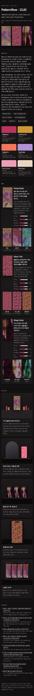
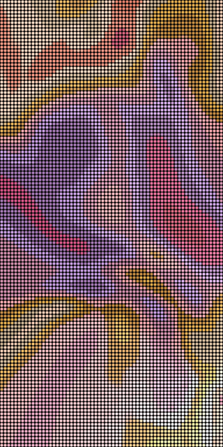
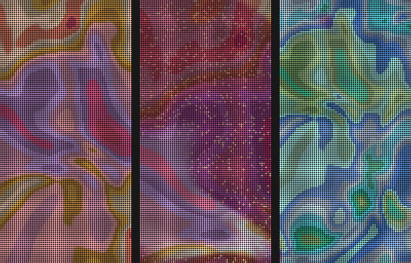
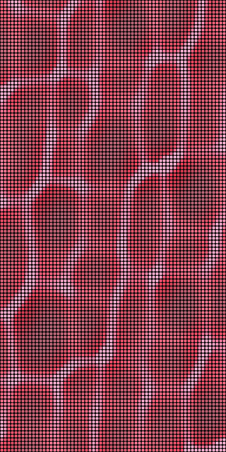
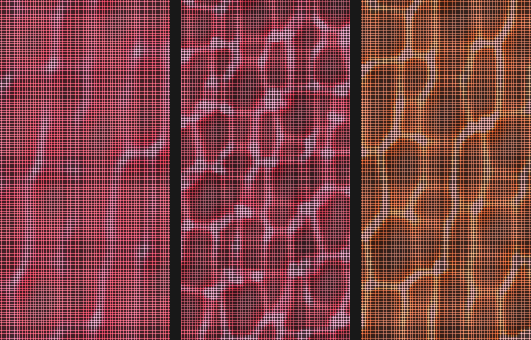
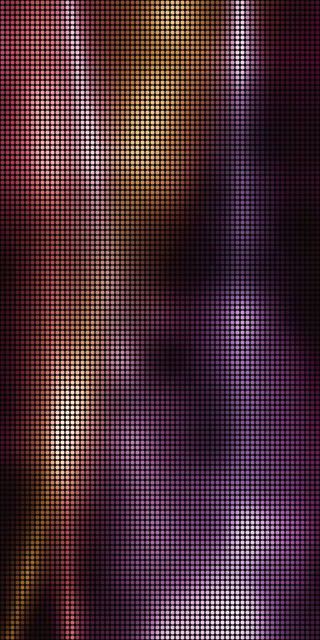
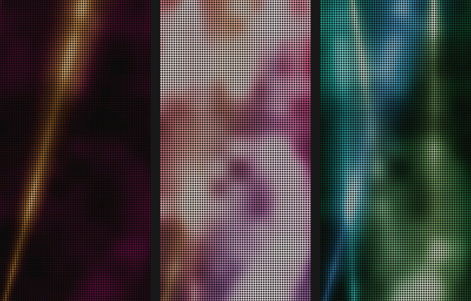

# Patternflow × CLIO

클리오에 들고 갈 패턴은 셋이에요. Finish Field 는 프로 아이 팔레트 에어의 마감에서, Glass Tint 는 크리스탈 글램 틴트의 유리 같은 광에서 왔어요. Stage Haze 는 올데이 프로젝트와 한 Express Yours 캠페인의 무대에서 왔어요. 셋을 한 장에 모은 것이 [reference.html](reference.html) 이에요. 파일 하나라서 디스크에서 바로 열리고, 그 안의 패널 스물다섯 대가 Pattern Lab 미리보기와 같은 엔진으로 돌아요.



## 클리오에서 찾은 것

클리오는 1993년 메이크업 아티스트용 라인 Clio Professional 로 시작했고, 지금도 스스로를 한국 첫 색조 전문 브랜드라고 소개해요 [6]. 슬로건은 'Express Your Own Confidence' 예요 [6]. 2025년 11월 18일에는 혼성 그룹 올데이 프로젝트를 새 모델로 발표했어요. 이 그룹이 뷰티 브랜드 모델을 혼자 맡은 것은 처음이고, 클리오는 고른 까닭을 "무대 위 강렬한 퍼포먼스와 자유분방한 에너지" 라고 적었어요 [1]. 화보의 베이스는 그해 신제품 킬커버 파운웨어 쿠션이었고, 서울 주요 랜드마크의 옥외 광고가 같이 나갔어요 [1].

요즘 클리오를 끌고 가는 것은 눈이에요. 프로 아이 팔레트 에어는 열두 칸에 매트와 시머와 글리터를 섞어 담은 팔레트예요 [5]. 2025년 9월 국가유산청과 낸 K-헤리티지 에디션 20호 매화빛 댕기와 21호 모감주 밑 서재는 출시 이틀 만에 올리브영 온라인몰에서 다 팔렸어요. 같은 기사는 에어 팔레트 매출이 한 해 전보다 115% 늘었다고 적었어요 [2]. 2026년 6월 올영세일에는 아기 고양이 콘셉트의 23호 베이비 밀크 냥냥이 나왔어요 [3]. 8월 14일 2분기 실적 기사는 국내 성장을 이끈 제품으로 코숏 에디션 팔레트를 꼽았고, 북미 매출이 58% 늘어난 까닭으로 아마존 아이 카테고리를 들었어요 [4]. 하반기에는 Nordstrom 과 Costco 입점이 잡혀 있어요 [4].

베이스는 킬커버예요. 미국 NewBeauty 의 2026년 어워즈가 킬커버 메쉬 글로우 에센셜 쿠션을 가장 좋은 쿠션 파운데이션으로 뽑았어요 [7]. 파운웨어 쿠션은 얇은 세미 매트 제형이고, 2026년 5월 기사는 여기에 땀 견딤 임상을 더했다고 적었어요 [3]. 립에서는 크리스탈 글램 틴트가 '색을 입힌 유리 한 겹' 같은 투명한 광으로 소개돼요 [6].

패키지는 공식 자료로 확인하지 못했어요. 클리오 공식 사이트(cliocosmetic.com)가 조사하는 동안 503 을 돌려줬어요. 확인한 것은 한정판 케이스가 철마다 바뀐다는 것뿐이에요. 토이 스토리 협업은 메쉬 글로우 쿠션을 포함한 다섯 제품에 캐릭터 패키지를 입혔고 [8], K-헤리티지 에디션은 전통 색과 문양에서 왔어요 [2]. 그래서 패턴은 케이스 모양을 따라 그리지 않고 색과 마감만 가져왔어요.

## 패턴

수치는 `check.ts` 가 Lab 엔진으로 잰 값이에요. recur 는 240초 동안 20초 넘게 떨어진 두 장면이 가장 가까울 때의 거리를 그런 거리의 중앙값으로 나눈 값이라서, 같은 장면으로 돌아오는 패턴은 0 이에요. dark 는 가장 어두운 16×16 칸이 칸 평균의 몇 배인지, still 은 가장 덜 변하는 칸의 변화가 평균의 몇 배인지예요. 잣대는 패턴 연구 [ROUND.md](../pattern-study/ROUND.md) 의 것과 같아요(recur 0.40, dark 0.40, still 0.30, 노브 반응 0.03).

### Finish Field

 

열두 셰이드가 한 판에 눌려 천천히 마블링하고, 조각마다 마감이 따로 있어요. 매트 조각은 평평하게 누워 있고, 시머 조각에는 패널 위를 떠도는 보이지 않는 램프를 따라 넓은 광이 미끄러져요. 글리터 조각은 LED 하나하나가 각자 돌아가는 작은 조각이라서, 램프 쪽으로 면이 돌 때만 흰 금빛으로 번쩍여요. 셰이드는 매화빛 댕기, 모감주, 코랄 달리아, 라일락 페탈, 피오니 미스트, 베이비 밀크라는 이름을 읽고 고른 색이에요. 패널 펌웨어가 채도를 1.62배로 올리기 때문에 0.68배로 낮춰 넣었어요. 처음 만든 판은 색이 이어지는 그러데이션이었는데 데모신 플라즈마처럼 보였어요. 열두 칸으로 끊고 칸 사이를 LED 한두 개 폭으로만 섞으니 팔레트처럼 읽혔어요.

K4 Finish 가 마감의 몫을 정해요. -1 에서 매트 87%, 시머 13% 이고, 처음 자리에서는 매트 47%, 시머 35%, 글리터 18%, 1 에서는 글리터가 69% 예요. recur 0.58, dark 0.97, still 0.77, 노브 반응 0.185 · 0.107 · 0.150 · 0.205, 한 장에 3.2 ms 예요. 900초를 돌려도 평균 밝기가 2% 안에서 머물렀어요.

### Glass Tint

 

물결치는 색유리 아래 옅은 바닥에 빛 그물이 맺혀요. 유리가 두꺼운 데는 진한 장미색, 얇은 데는 연한 장미색이고, 빛이 모이는 선은 희게 타요. 표면은 평면파 여덟 개를 더한 높이장이고, 파마다 각속도가 달라서 서로 나누어떨어지지 않아요. 빛은 LED 하나에 네 줄씩, 패널과 바깥 12 LED 띠에서 쏘아 내려요. 패널 둘레가 비지 않는 것은 바깥에서 꺾여 들어오는 빛 덕분이에요. 처음에는 파의 방향을 한 바퀴 360도에 흩었는데, 그러면 j 번째와 j+4 번째 파가 한 축에 놓여 그물 칸이 모두 한쪽으로 기울었어요. 180도에 흩어 고쳤어요.

K4 Depth 는 유리와 바닥 사이 거리예요. -1 에서는 빛이 부드럽게 일렁이기만 하고, 1 에서는 선이 접혀 겹치는 가는 그물이 돼요. recur 0.67, dark 0.99, still 0.72, 노브 반응 0.298 · 0.120 · 0.128 · 0.116, 한 장에 6.9 ms 예요. 실제 Pattern Lab 미리보기에서는 8.1 ms 였어요. 900초 뒤 평균 밝기는 처음과 같았어요.

### Stage Haze

 

패널 위아래에 숨은 조명 머리가 연기 속을 훑어요. 빔은 부드러운 원뿔이고, 둘이 겹치는 데서는 색이 더해져 하얗게 돼요. 연기는 위로 오르며 말려서 같은 빔도 닿는 자리마다 다르게 보여요. 빔 색은 매화빛 댕기, 코랄, 라일락, 모감주, 피오니이고 연기는 진한 매화빛이에요. 처음에는 머리를 패널 네 변에 두었는데, 64 LED 폭을 가로지르는 빔은 벌어질 자리가 없어 번진 얼룩으로 보였어요. 머리를 위아래로만 옮겼어요. 머리의 흔들림을 사인 둘로만 움직였을 때는 recur 가 0.37 로 잣대 아래였어요. 4분 안에 머리가 같은 자세로 돌아왔기 때문이에요. 흔들림과 미끄러짐을 부드러운 노이즈로 바꾸고, 머리마다 반쯤 어두워졌다 돌아오는 느린 큐를 넣고, 연기의 대비를 올려서 0.42 가 됐어요.

이 패턴만 바닥이 어두워요. 처음 자리의 dark 는 0.67 로 잣대를 넘지만, 노브를 모두 최솟값에 두면 still 이 0.11 로 떨어져요. 가는 빔 둘이 Sweep 0.2 로 거의 서 있는 어두운 무대라서, 무대 조명으로는 맞는 모습이라 그대로 뒀어요. recur 0.42, dark 0.67, still 0.57, 노브 반응 0.125 · 0.171 · 0.519 · 0.241, 한 장에 3.0 ms 예요. 900초 뒤 평균 밝기는 4% 낮았어요.

## 쓰일 자리

| 자리 | 패턴 | 어떻게 |
| --- | --- | --- |
| 아이 팔레트 매대 | Finish Field | 프로 아이 팔레트 에어 테스터 사이에 한 대를 세워요. 손등에 바르기 전에 세 마감이 빛을 어떻게 받는지 패널이 먼저 보여 줘요. 신제품이 나오면 K1 으로 색을 돌려 맞춰요. |
| 틴트 거울 옆 | Glass Tint | 크리스탈 글램 틴트 테스트 거울 옆 조명이에요. 거울 앞 얼굴에도 장밋빛이 은은하게 닿아요. |
| 팝업 입구 벽 | Stage Haze | 패널 셋이 같은 조명 배치를 서로 다른 순간으로 비춰요. Express Yours 의 무대로 들어서는 입구예요. |
| 숏폼 영상 바탕 | Glass Tint, K1 0.07 | 64×128 은 세로 1:2 라 9:16 화면에 거의 꽉 차요. 코랄로 돌린 그물을 틴트 영상 뒤에 깔아요. |
| 쇼윈도 | Finish Field, K4 0.95 | 밤에 멀리서 가장 잘 보이는 것은 글리터예요. 네 대를 창 안에 세워요. |

한 장의 「쓰일 자리」 장면은 회색 도형으로만 그렸어요. 매대의 테스터도 색을 칠한 막대예요.

## 돌려 보기

`web/` 에서 `npm ci` 를 한 뒤예요.

```sh
npx tsx ../incoming/collab-kit/check.ts clio --soak    # 머리 줄, 금지 이름, recur, 채움, 노브 반응, 900초
npx tsx ../incoming/collab-kit/shoot.ts clio           # shots/<slug>.png, .webp, -looks.png
npx tsx ../incoming/collab-kit/sheet.ts clio --png     # reference.html 과 shots/reference-1440.png, -390.png
npx tsx ../incoming/collab-kit/lab-shot.ts clio        # npm run dev 를 켠 채로, 진짜 Pattern Lab 에서 연 화면
```

Pattern Lab 에 직접 넣으려면 `patterns/` 의 파일을 열어 통째로 복사하고 Code 패널의 Paste 를 눌러요. 머리의 `@matrix` 와 `@knobs` 줄이 해상도와 노브 범위를 맞춰요. Lab 이 이미 열려 있었다면 노브는 그 자리를 새 범위로 당겨 오니, [lab-glass-tint.png](shots/lab-glass-tint.png) 처럼 Scale 과 Depth 가 끝에 가 있을 수 있어요.

## 하지 않은 것

클리오에 연락하지 않았고, 어디에도 올리지 않았어요. 로고와 워드마크는 그리지도 옮기지도 않았고, 제품 사진은 내려받지 않았어요. 팔레트의 색값은 셰이드 이름을 읽고 고른 것이라 제품을 잰 값이 아니에요. 패턴에는 글자와 숫자와 기호가 없고 제품 모양도 없어요.

## 조사한 곳

1. [클리오, '올데이 프로젝트' 모델로 발탁](https://magazine.hankyung.com/job-joy/article/202511178175d), 한경매거진, 2025-11-18. 모델, Express Yours, 킬커버 파운웨어 쿠션, 고른 까닭.
2. [클리오, 국가유산청과 협업 'K-헤리티지 에디션' 완판](https://www.smarttoday.co.kr/ko-kr/articles/91510), 스마트투데이, 2025-09-17. 20호와 21호, 이틀 만의 완판, 에어 팔레트 115% 성장.
3. [클리오 6월 올영세일 기사](https://www.segye.com/newsView/20260529512523), 세계일보, 2026-05-29. 23호 베이비 밀크 냥냥, 블러쉬 탭 셰이드 이름, 쿠션 셰이드.
4. [클리오, 2분기 영업이익 116억원 '역대 최대'](https://www.cosinkorea.com/mobile/article.html?no=58087), 코스인코리아, 2026-08-14. 코숏 에디션, 북미 58%, 입점 계획.
5. [CLIO Pro Eye Palette Air 2026 review](https://www.joybuy.de/blog/clio-pro-eye-palette-air-2026-review/Z3VcAsgk), Joybuy, 2026년 11월. 열두 셰이드, 매트와 시머와 글리터.
6. [CLIO, la marque K-beauty makeup professionnelle fondée en 1993](https://mapetitecoree.com/en/blogs/le-blog-mpc/clio-marque-coreenne-professional-kill-lash-kill-cover), Ma Petite Corée. 시작, 슬로건, 크리스탈 글램 틴트의 광.
7. [Kill Cover Mesh Glow Essential Cushion](https://www.newbeauty.com/awards/2026/makeup/kill-cover-mesh-glow-essential-cushion), NewBeauty Awards 2026.
8. [클리오 6월 신상](https://glowpick.com/casts/1794), 글로우픽. 토이 스토리 협업 다섯 제품.

닿지 못한 곳은 cliocosmetic.com(503), 화해와 Watsons, Skinsort 의 제품 페이지(403)예요. 블로그 리뷰 둘은 404 였어요. 그래서 패키지 재질과 색은 확인한 것으로 적지 않았어요.
