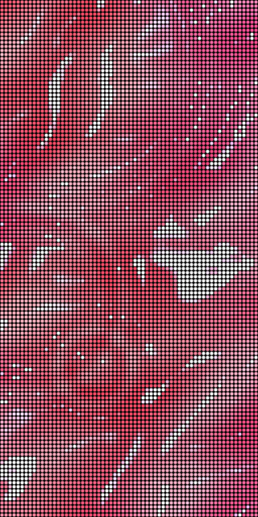
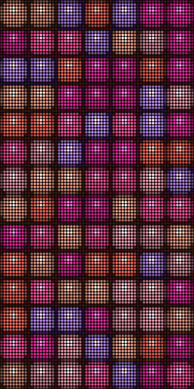
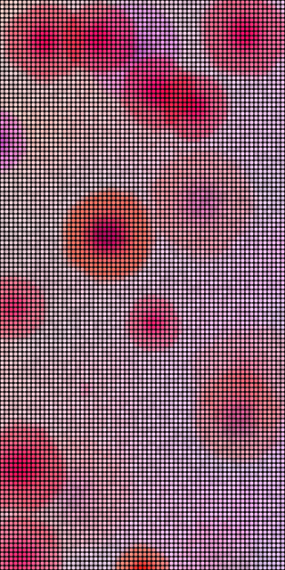

# 페리페라 × Patternflow

페리페라에 들고 갈 패턴 셋과 한 장짜리 레퍼런스예요. 한 장은 [reference.html](reference.html) 이고, 파일 하나라 디스크에서 바로 열려요. 패널은 그 안에서 Pattern Lab 엔진으로 돌아요. 화면은 [shots/reference-1440.png](shots/reference-1440.png) 와 [shots/reference-390.png](shots/reference-390.png) 에 찍어 뒀어요.

## 페리페라에서 찾은 것

페리페라는 클리오가 2005년에 연 두 번째 메이크업 브랜드예요. 처음부터 온라인에서 10대와 20대를 겨눴고, 2025년에 스무 해가 됐어요 [1]. 클리오가 프로 메이크업의 단단한 쪽이라면 페리페라는 막내 자리예요. 프랑스의 한국 화장품 블로그는 "클리오의 알록달록한 막내"라고 불렀고 [1], 마닐라 클리오 매장 투어 기사는 매장에서 가장 알록달록하고 파스텔인 포장이 페리페라 쪽에 있다고 적었어요 [6].

이름은 페르시아 신화의 요정 페리에서 왔어요. 브랜드는 페리를 뷰티 연금술사라고 불러요. 2015년 3월 첫 잉크 틴트 페리스 잉크가 나온 뒤로 잉크병 모양 용기가 상징이 됐고, 키보드 키캡 모양 블러셔 케이스와 하트 케이스도 냈어요 [1]. 대표 제품은 진한 매트의 잉크 더 벨벳에서 지금은 잉크 무드 글로이 틴트로 옮겨 왔어요. 글로이 틴트의 마무리를 기사는 "맑은 물먹 광택"이라고 써요 [4]. 사용자 평도 윤기 나는 마무리부터 말해요 [7].

장난기는 색 이름에 있어요. 2025년 10월 1일 나온 핑크하구마 컬렉션은 "달콤하고 부드러운 고구마맛 핑크색"을 내걸고 틴트에 햇꿀구마, 갓기구마, 제철핑구마를 붙였어요. 치크는 우유머금은복숭아와 포도우유샷추가예요 [3]. 2026년 2월 1일 올리브영 망곰 에디션에는 말랑물복, 자두뿜뿜, 코랄 위 벚꽃 필터가 있어요 [4]. 2025년 6월 궁 콜라보 화보는 키키의 키야를 모델로 "발랄하고 톡톡 튀는 이미지"를 내세웠어요 [2]. 2025년 12월 31일 보도에서는 브랜드가 스스로를 "뷰티 얼리어들을 위한 감성 치트키 브랜드"라고 했어요 [5].

Glassy Ink 는 글로이 틴트의 물먹은 윤기를 옮겼고, Blur Bloom 은 잉크 틴트를 입술 안쪽부터 번지게 바르는 그라데이션 립을 옮겼어요. Jelly Keys 의 리듬은 키캡 케이스와 "톡톡 튀는"이라는 말에서 왔어요. 색은 제품 사진을 재지 않고 색 이름과 기사 설명에서 골랐어요. 로고와 캐릭터는 패턴에도 한 장에도 넣지 않았고, 패턴 안에는 글자도 없어요.

1. [Ma Petite Corée, PERIPERA: the Korean brand behind Ink Velvet](https://mapetitecoree.com/en/blogs/le-blog-mpc/peripera-marque-coreenne-ink-velvet-lip-tint-clio)
2. [코스모닝, 페리페라 궁 콜라보 컬렉션, 2025-06-26](https://www.cosmorning.com/mobile/article.html?no=50750)
3. [코스모닝, 페리페라 핑크하구마 컬렉션, 2025-10-01](https://www.cosmorning.com/mobile/article.html?no=51360)
4. [위키트리, 페리페라 올리브영×망그러진 곰 기획세트, 2026-02-02](https://www.wikitree.co.kr/articles/1114649)
5. [위키트리, 페리페라 스피디 라인 새 컬러, 2025-12-31](https://www.wikitree.co.kr/articles/1106526)
6. [Project Vanity, Club Clio store tour](https://projectvanity.com/projectvanity/club-clio)
7. [K Beauty Hobbit, Peripera Ink Mood Glowy Tint review, 2022-10-26](https://www.kbeautyhobbit.com/post/peripera-ink-mood-glowy-tint-review)

페리페라 공식몰(peripera.co.kr)과 클리오 회사 소개, 연혁 페이지는 11월 14일에 503 을 돌려줘서 읽지 못했어요. 2005년 시작과 브랜드 소개는 그래서 [1] 과 보도 기사에서 왔어요.

## 패턴

셋 다 64×128 세로 패널에 맞췄고, 노브는 K1 색, K2 움직임, K3 크기, K4 패턴마다 고른 성질이에요. K1 이 0 일 때 페리페라의 핑크에서 열려요. 숫자는 `check.ts` 가 Lab 엔진으로 잰 값이에요. recur 는 240초 동안 같은 장면으로 돌아오는지(0.40 이상이면 되풀이가 안 보여요), dark 와 still 은 16×16 칸 서른두 개 가운데 가장 어둡고 가장 덜 움직이는 칸의 몫이에요.

### Glassy Ink



위에서 내려다본 얕은 틴트 웅덩이예요. 바닥은 밀크빛이고, 그 위를 긴 너울과 짧은 물결이 방향을 바꿔 가며 지나가요. 코랄 방울이 1초에 한 번쯤 떨어져 고리로 번지고, 그 자리에 둘째 색이 섞여요. 물결은 물의 분산 관계(중력과 표면 장력)대로 길이마다 다른 속도로 달려서 같은 모양으로 돌아오지 않아요. 골에서는 빛이 틴트를 더 오래 지나서 색이 진하고 마루는 옅어요. 그게 그라데이션 립처럼 보여요. 윤기는 길쭉한 창문 하나가 비탈마다 비친 반사예요. 가장자리를 짧게 끊어서 젖은 광택으로 읽혀요. K4 Pearl 을 올리면 LED 하나하나가 천천히 도는 펄 조각이 되어 창문을 마주할 때 반짝여요. 핑크하구마 틴트의 꿀빛 펄을 떠올리며 넣었어요.

잰 값은 recur 0.65, dark 1.00, still 0.97 이에요. 노브 반응은 K1 0.294, K2 0.116, K3 0.099, K4 0.031 이고, 마지막 4분의 1 도 1.00/0.95 예요. 900초를 돌려도 평균 밝기(가장 밝은 채널)가 241.5 에서 움직이지 않았어요. 한 장에 8.78ms 로 셋 가운데 가장 무거워요.

### Jelly Keys



젤리 키가 일곱 칸, 열네 줄로 패널을 채워요. 보이지 않는 손끝이 키를 하나씩 톡 치기도 하고, 줄을 따라 드럼 롤로 달리기도 해요. 두세 개를 한꺼번에 누르는 화음도 있어요. 눌린 키는 줄어들며 빛나고 튕겨 올라오고, 그 출렁임이 스프링으로 이어진 이웃 키에 번져요. 세게 눌린 키는 카드의 다음 색으로 넘어가요. 그래서 판의 색 배치가 계속 바뀌고 같은 판이 다시 나오지 않아요. 키캡 블러셔 케이스와 궁 화보의 "톡톡 튀는"에서 왔어요. 키 위의 하이라이트는 천천히 도는 조명을 따라 미끄러져서, 아무도 두드리지 않는 자리도 가만있지 않아요. K4 Wobble 을 올리면 젤리가 말랑해지고 한 번의 탭이 판 전체로 고리를 그려요.

잰 값은 recur 0.63, dark 0.88, still 0.82 예요. 노브 반응은 K1 0.214, K2 0.038, K3 0.264, K4 0.048 이에요. 노브를 모두 최솟값, 모두 최댓값, 무작위 두 자리에 놓아도 dark 0.85 와 still 0.61 아래로 내려가지 않았고, 900초 뒤 평균 밝기는 149.6 에서 150.2 였어요.

### Blur Bloom



밀크 바탕 위에 틴트 얼룩이 하나씩 톡 피어나요. 얼룩마다 작은 그라데이션 립이에요. 진한 속색(자두, 고구마 핑크, 포도, 코랄, 로즈)이 밝은 겉색(복숭아, 딸기우유, 라일락)으로 번지다가 경계에서 밀크로 사라져요. 얼룩은 떠다니다 겹치고, 겹친 곳은 틴트를 덧바른 것처럼 곱해져 깊어져요. 열 초쯤 살다가 퍼지며 녹고, 밀크가 가장 많이 보이는 자리에 새 얼룩이 피어요. 오버 블러 틴트의 흐린 경계와 잉크 틴트를 바르는 그라데이션 립에서 왔고, 바탕의 고운 결은 에어리 벨벳의 가루 느낌이에요. 핑크 계열이 자주, 포도는 가끔 나오게 무게를 줬어요. K4 Blur 를 올리면 또렷한 점이 경계가 해진 안개가 돼요.

잰 값은 recur 0.70, dark 0.99, still 0.80 이에요. 노브 반응은 K1 0.186, K2 0.134, K3 0.210, K4 0.038 이에요. 노브를 모두 최솟값에 두면 still 이 0.25 로 선(0.30) 아래예요. Bloom 0.2 에서는 얼룩이 열 배 느리게 살아서, 빈 밀크 칸이 반 초 사이에 거의 안 바뀌어요. 900초 뒤 평균 밝기는 233.6 에서 233.7 이었어요.

## 쓰일 자리

매대 테스터 줄 가운데 패널 한 대를 세우고 Glassy Ink 를 틀면, 손님이 K1 을 돌려 웅덩이의 틴트 색을 바꿔 보는 테스터가 돼요. 팝업 입구 벽에는 큰 키로 놓은 Jelly Keys 를 세 대 세워요. 패널마다 따로 돌아서 탭이 대마다 다른 자리에 떨어져요. 64×128 은 9:16 영상에 세워 넣기 좋아서, 신상 틴트 색에 K1 을 맞춘 Blur Bloom 을 찍으면 릴스와 쇼츠의 제품 컷 뒤에 깔 바탕이 돼요. 메이크업 거울 옆에 세운 Blur Bloom 은 밝은 밀크 바탕이라 분홍빛 옆 조명이 돼요. 넷 다 한 장의 「쓰일 자리」에 장면으로 그려 뒀어요.

## 돌려 보기

`web/` 에서 `npm ci` 다음이에요. 도구는 [../collab-kit/](../collab-kit/README.md) 에 있어요.

```sh
npx tsx ../incoming/collab-kit/check.ts peripera --soak    # 머리 줄, 금지 이름, 되풀이, 채움, 노브, 900초
npx tsx ../incoming/collab-kit/shoot.ts peripera           # shots/<slug>.png, .gif, -looks.png
npx tsx ../incoming/collab-kit/sheet.ts peripera --png     # reference.html 과 그 화면
npx tsx ../incoming/collab-kit/lab-shot.ts peripera        # npm run dev 를 켠 채로, 진짜 Pattern Lab 에서 연 화면
```

패턴 파일을 Pattern Lab 의 CODE 패널에 붙여 넣어도 그대로 돌아요. `shots/lab-<slug>.png` 가 그 화면이에요. Lab 은 첫 프리셋의 노브를 들고 열려서, 그 사진들은 K3 과 K4 가 맨 위에 있는 모습이에요.

## 하지 않은 것

페리페라나 클리오에 연락하지 않았고, 어디에도 올리지 않았어요. 이 폴더는 제안 초안이고 두 회사와 함께 만들거나 승인받은 것이 아니에요. 로고, 워드마크, 제품 사진, 캐릭터는 쓰지 않았고 이미지는 링크로만 남겼어요. 색 값은 측정한 브랜드 색이 아니에요. 기기에는 올려 보지 않았어요. Blur Bloom 과 Glassy Ink 는 바탕이 밝아요. 펌웨어는 패널을 2.4 A 안에 묶고 흰색에 가까운 프레임은 절반쯤 밝기로 내려서, 이 둘은 기기에서 한 번 봐야 해요. Glassy Ink 는 브라우저에서 한 장에 9ms 남짓 걸려서 ESP32-S3 에서는 다른 둘보다 느릴 거예요. 기기로 옮길 때 물결 수를 여덟에서 줄이는 것이 먼저예요. `shots/glassy-ink.gif` 는 패널 전체가 매 장 바뀌는 그림이라 3 MB 쯤이에요.
