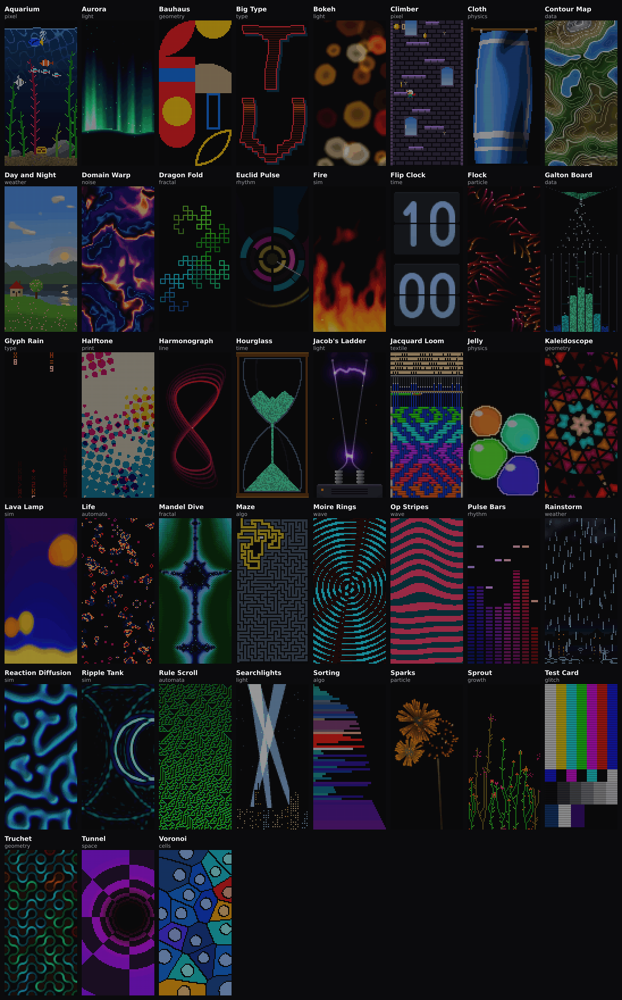

# 패턴 연구 2026-10

새 패턴 43개를 스물세 갈래로 나눠 만들었어요. 1판에서 열세 갈래로 23개를 만들고, 2판에서 1판에 없던 아홉 갈래로 16개를, 3판에서 하나를, 4판에서 새 갈래인 직물로 하나를 더했어요. 5판은 새 패턴 없이 1판의 Euclid Pulse 를 다시 짰고, 6판은 세운 패널의 128줄을 위아래로 다 쓰는 패턴 하나를 더했어요. 7판은 또렷한 모양이 멀리 흘러가는 지도 칸에 패턴 하나를 더했어요. [index.html](index.html) 을 브라우저로 열면 전부 한 장에서 돌아가요. 맨 위 지도에서 점을 누르면 그 패턴으로 가고, 카드의 슬라이더가 노브 넷이에요. 마음에 드는 것은 「코드 복사」로 가져가 Pattern Lab 의 CODE 칸에 붙여 넣으면 같은 그림이 나와요. 페이지는 파일 하나라서 바깥에서 받아 오는 것이 없어요.

패널은 세로로 서요. 64 LED 너비에 128 LED 높이가 기본이라서 모든 패턴의 머리에 `@matrix 64x128` 이 있어요. 레포의 패널 설정은 그대로예요. `shared/constants.json` 의 `PANEL_GEOM_DEFAULT` 는 `128x64_SINGLE` 이고, 패턴이 가로세로를 바꾼 판을 적으면 펌웨어의 `firmware/patternflow/src/core_canvas.h` 가 90도 돌려 패널을 꽉 채워요. 1판 23개는 처음에 가로 128×64 로 만들었다가 2판에서 세로로 다시 짰어요.

기본 패턴이나 사이트에는 하나도 넣지 않았어요. 이 폴더 밖은 건드리지 않았고, 고른 것을 어디에 둘지는 고른 다음 일이에요.

3판부터는 hub 의 패턴 바퀴가 한 바퀴에 한 판씩 더해요. 1바퀴가 3판이에요. 한 바퀴의 절차는 [ROUND.md](ROUND.md) 에 있어요.



## 패턴

패턴마다 `patterns/` 에 코드 파일 하나, `shots/` 에 3초짜리 GIF 와 노브 시트가 있어요. 노브 시트는 노브 하나씩 최솟값, 가운데, 최댓값으로 돌린 화면이에요. 나머지 셋은 연구의 처음 값에 둬요. 처음 값은 Lab 의 기본 노브 값 0, 2, 0, 0.06 을 패턴의 범위 안으로 당긴 자리예요. 2판 파일의 머리에는 `// Round: 2` 줄이 있어서, 페이지는 그 줄로 1판과 2판을 나눠 표시하고 거를 수 있어요. 가장 새 판의 점과 카드는 흰 테두리로 따로 보여요. 갈래의 한국어 이름과 색은 [families.json](families.json) 에 있어요.

### 1판

| 패턴 | 갈래 | 한 줄 |
| --- | --- | --- |
| [Aurora](patterns/aurora.js) | 빛 | 떠도는 선에 빛 커튼이 걸리고, 빛줄기는 커튼이 흔들리는 것보다 느리게 일렁여요. |
| [Bauhaus](patterns/bauhaus.js) | 기하·대칭 | 바우하우스 포스터처럼 납작한 원반과 막대가 2×4 칸에 놓이고, 한 칸씩 천천히 다른 모양이나 색으로 바뀌어요. |
| [Big Type](patterns/big-type.js) | 글자 | 화면을 꽉 채운 낱말 하나가 자석을 댄 옛 텔레비전 화면처럼 휘어요. |
| [Bokeh](patterns/bokeh.js) | 빛 | 초점이 나간 밤거리 불빛이에요. 여섯 모 진 빛 원반이 피었다 흘러가며 겹친 자리만 부드럽게 밝아져요. |
| [Domain Warp](patterns/domain-warp.js) | 노이즈·흐름 | 노이즈가 제 자신을 비틀어서 어두운 쪽빛 돌에 금빛 결이 흘러요. 대리석을 붓는 것처럼 천천히 뒤섞여요. |
| [Euclid Pulse](patterns/euclid-pulse.js) | 리듬·펄스 | 유클리드 리듬 셋이 고리 셋에서 함께 돌아요. 바깥 두 고리의 박은 고리 밖 제 조각을 따라 빛으로 퍼져서 세운 패널의 위아래 끝까지 닿아요. 처음은 E(3,8) 이에요. |
| [Fire](patterns/fire.js) | 시뮬레이션 | 데모신의 불이에요. 바닥의 열이 올라가며 식고, K1 을 돌리면 나무 불에서 가스 불, 붕소 불까지 색이 바뀌어요. |
| [Flock](patterns/flock.js) | 입자 | 새 90마리가 가까운 이웃만 보고 날아요. 보이지 않는 매가 무리를 쫓아 자꾸 갈라놓아요. |
| [Glyph Rain](patterns/glyph-rain.js) | 글자 | 3×5 글자가 줄마다 떨어지며 바뀌어요. 아무 말도 하지 않는 글이 화면을 채워요. |
| [Harmonograph](patterns/harmonograph.js) | 선·궤적 | 단순한 비에서 조금씩 어긋난 진자 셋이 닫히지 않는 그림을 그리고, 멎어 가며 가운데로 감겨 들어가요. |
| [Kaleidoscope](patterns/kaleidoscope.js) | 기하·대칭 | 움직이는 선 세 벌이 유리 한 조각을 자르고 거울이 그 조각을 꽃으로 접어요. 조각 사이에 1 LED 검은 납선이 있어요. |
| [Life](patterns/life.js) | 셀룰러 오토마타 | 같은 여덟 이웃에 법칙이 여섯이에요. 세포가 나이만큼 색을 입어서 법칙마다 무엇이 남는지 보여요. |
| [Moire Rings](patterns/moire-rings.js) | 물결·간섭 | 동심원 두 벌이 서로 지나가고, 어긋나는 자리에 아무도 그리지 않은 무늬가 생겨요. |
| [Op Stripes](patterns/op-stripes.js) | 물결·간섭 | 브리짓 라일리 식의 두 색 가로줄이에요. 밑으로 지나가는 넓은 부풂 둘이 줄 간격을 벌려서 평평한 패널이 부푸는 것처럼 보여요. |
| [Pulse Bars](patterns/pulse-bars.js) | 리듬·펄스 | 음악 없는 하이파이 미터예요. 작은 드럼 머신이 혼자 치고 막대는 그 소리를 듣는 듯 춤춰요. |
| [Reaction Diffusion](patterns/reaction-diffusion.js) | 시뮬레이션 | 두 물질이 번지고 먹고 먹히며 산호와 미로와 점박이를 길러요. K3 가 종을 바꿔요. |
| [Ripple Tank](patterns/ripple-tank.js) | 시뮬레이션 | 빗방울이 떨어진 자리마다 고리가 퍼지고 벽에 부딪혀 되돌아와 서로 겹쳐요. |
| [Rule Scroll](patterns/rule-scroll.js) | 셀룰러 오토마타 | 64칸 한 줄이 이웃을 보고 다음 줄을 써 내려가요. 8비트 숫자 하나가 삼각형이 될지 잡음이 될지 정해요. |
| [Sparks](patterns/sparks.js) | 입자 | 불꽃마다 흰빛에서 식어 가는 색이 제 나이를 보여 줘요. 꽃불 세 가지가 느슨한 박자로 터져요. |
| [Sprout](patterns/sprout.js) | 자라남 | 한 LED 씩 자라는 픽셀 들꽃밭이에요. 꽃이 시들어 꽃잎이 한 점씩 떨어지면 그 자리에 새 싹이 올라와요. |
| [Test Card](patterns/test-card.js) | 글리치 | 텔레비전 컬러 바를, 수직 동기를 잃어 가는 수상기가 보여 주는 대로 그려요. |
| [Truchet](patterns/truchet.js) | 기하·대칭 | 타일마다 같은 사분원 둘이 있어요. 한 장을 90도 돌리면 길 둘이 하나로 이어지거나 하나가 둘로 끊겨요. |
| [Tunnel](patterns/tunnel.js) | 공간·원근 | 가운데서 떨어진 거리로 나누면 평평한 체크무늬가 날아 들어가는 관이 돼요. |

### 2판

| 패턴 | 갈래 | 한 줄 |
| --- | --- | --- |
| [Aquarium](patterns/aquarium.js) | 픽셀 아트 | 높은 수조에 흰동가리, 블루탱, 엔젤피시, 네온테트라 떼가 꼬리를 흔들며 헤엄쳐요. 모래 위 보물상자가 몇 초마다 뚜껑을 열어 공기 방울을 뱉고, K1 을 누르면 먹이가 떨어져 물고기가 몰려와요. |
| [Climber](patterns/climber.js) | 픽셀 아트 | 빨간 목도리를 맨 꼬마가 혼자서 끝없는 탑의 턱을 뛰어올라요. K4 를 돌리면 한낮에서 노을을 지나 횃불 켜진 밤이 돼요. |
| [Cloth](patterns/cloth.js) | 물리·스프링 | 12×22 매듭 천이 나무 봉의 집게에 걸려 있고, 뒤에서 부는 돌풍이 천을 앞으로 들어 올려요. LED 마다 그 자리 천이 빛에서 기운 만큼 밝아서 주름이 등고선처럼 읽혀요. |
| [Contour Map](patterns/contour.js) | 데이터 그림 | 천천히 솟고 가라앉는 땅의 지형도예요. 다섯째 등고선마다 밝고, 바닷물이 차오르면 선은 땅에 그대로 남은 채 물 밑으로 들어가요. |
| [Day and Night](patterns/day-cycle.js) | 날씨·자연 | 호수 위 작은 집이 하루를 지켜봐요. 해가 언덕 뒤로 지면 하늘이 노을을 지나 별과 달로 넘어가고 창에 하나씩 불이 켜져요. |
| [Dragon Fold](patterns/dragon.js) | 프랙탈 | 종이띠를 반으로 접기를 열 번 되풀이하면 헤이웨이 드래곤이 돼요. 세대마다 선 전체의 복사본이 끝점을 축으로 90도 돌아 나오고, 다 접히면 거꾸로 닫혀요. |
| [Flip Clock](patterns/flip-clock.js) | 시계·시간 | 세워 둔 넘김 시계예요. 위에 시, 아래에 분 카드가 있고, 바뀔 때마다 옛 카드의 윗장이 앞으로 넘어가 그 뒷면이 새 카드의 아랫장으로 내려앉아요. |
| [Galton Board](patterns/galton.js) | 데이터 그림 | 깔때기에서 떨어진 공이 못마다 동전 던지듯 왼쪽이나 오른쪽으로 튀어 칸에 쌓이고, 종 모양이 서요. 칸 색은 가운데에서 표준편차 몇 개만큼 떨어졌는지를 보여 줘요. |
| [Halftone](patterns/halftone.js) | 망점·인쇄 | 떠도는 등불 넷이 비추는 저녁 하늘을 잉크마다 각도가 다른 망점으로 찍어요. 점은 농도만큼 자라고 줄며, K1 이 CMY, 리소, 벤데이, 신문 잉크를 골라요. |
| [Hourglass](patterns/hourglass.js) | 시계·시간 | LED 하나가 모래 한 알이에요. 두 LED 목으로 흘러 위 더미는 가운데부터 꺼지고 아래에는 원뿔이 쌓이며, 위가 비면 유리가 반 바퀴 돌아 뒤집혀요. |
| [Jelly](patterns/jelly.js) | 물리·스프링 | 젤리마다 질량 18개를 용수철과 안쪽 압력으로 묶은 고리예요. 키 큰 병에 떨어져 눌린 채 쌓여 출렁이다가, 하나씩 통 튀어 올라 다른 젤리 위로 굴러떨어져요. |
| [Mandel Dive](patterns/mandelbrot.js) | 프랙탈 | 망델브로 집합 전체가 서 있다가 가장자리의 한 점으로 끝없이 떨어져 들어가요. 처음 자리는 안테나 위의 미니 망델브로라서, 다 들어가면 처음과 같은 그림으로 녹아들어 다시 떨어져요. |
| [Maze](patterns/maze.js) | 알고리즘 | 미로를 한 칸씩 파고 나면 입구에서 너비 우선 물결이 퍼져 복도마다 거리만큼 색을 입혀요. 가장 짧은 길이 밝게 그어지고, 미로가 부서진 자리에 다음 미로가 파여요. |
| [Rainstorm](patterns/rainstorm.js) | 날씨·자연 | 빗줄기가 128줄을 다 떨어져 물웅덩이에 고리를 남기고, 가끔 갈라진 번개가 구름을 찢으며 쏟아지는 비를 한순간 밝혀요. |
| [Sorting](patterns/sorting.js) | 알고리즘 | 막대 64개를 알고리즘 하나가 한 번에 한 동작씩 줄 세워요. 비교하는 막대는 희게, 바꾸는 막대는 붉게 켜지고, 다 서면 위에서 아래로 훑어 확인한 뒤 다시 섞어요. |
| [Voronoi](patterns/voronoi.js) | 보로노이·셀 | 흐름을 타고 도는 씨앗마다 가장 가까운 LED 를 제 유리 색으로 칠하고, 조각 사이에 1 LED 납선이 서요. K4 로 거리를 재는 법을 바꾸면 조각 가운데 둥근 유리가 원에서 마름모를 지나 정사각형이 돼요. |

### 3판

| 패턴 | 갈래 | 한 줄 |
| --- | --- | --- |
| [Lava Lamp](patterns/lava-lamp.js) | 시뮬레이션 | 전구 위 웅덩이에서 데워진 왁스가 목을 늘이며 떨어져 나와 방울로 떠오르고, 위에서 식으면 다시 가라앉아요. 파란 물속에서 식은 왁스는 주황, 뜨거운 왁스는 노랑이에요. |

### 4판

| 패턴 | 갈래 | 한 줄 |
| --- | --- | --- |
| [Jacquard Loom](patterns/jacquard.js) | 직물·짜임 | 구멍 뚫린 카드가 한 장씩 내려와 날실을 들어 올리면 북이 씨실을 끌고 지나가고, 바디가 그 씨실을 쳐 넣어요. 아래로 짜여 내려가는 천에 카드 구멍이 적어 둔 다이아몬드가 서요. |

### 6판

| 패턴 | 갈래 | 한 줄 |
| --- | --- | --- |
| [Jacob's Ladder](patterns/jacobs-ladder.js) | 빛 | 두 막대가 가장 가까운 목에서 보랏빛 아크가 튀어, 벌어지는 V 를 타고 막대 끝까지 올라가 끊어져요. 위의 아크가 끝에 닿기 전에 목에서 다음 아크가 튀고, K4 를 올리면 지나간 아크가 사다리 가로대로 쌓여요. |

### 7판

| 패턴 | 갈래 | 한 줄 |
| --- | --- | --- |
| [Searchlights](patterns/searchlights.js) | 빛 | 밤 도시의 지붕 뒤에서 탐조등 세 대가 가장자리가 또렷한 빛기둥을 천천히 휘둘러요. 기둥 둘이 겹친 자리는 하얗게 타고, K1 을 누르면 하늘을 가로지르는 비행기를 모든 기둥이 붙잡았다가 놓아줘요. |

## 1판 갈래마다

노브 넷의 자리는 갈래가 달라도 거의 같아요. K1 은 색이고 K2 는 빠르기예요. K3 은 모양을 바꾸고, K4 는 그 갈래만의 손잡이예요. 그래서 처음 보는 패턴도 K1 과 K2 는 손이 먼저 알아요.

### 노이즈·흐름

Domain Warp 는 fbm 노이즈를 노이즈로 한 번 더 비틀어요. 노이즈를 매 프레임 새로 만들지 않고 setup 에서 128×128 이음매 없는 결을 한 번 구워 두고 읽어서, 한 픽셀에 표 읽기 다섯 번이면 돼요. K3 Warp 가 느슨한 대리석에서 촘촘한 소용돌이까지 가요. 이 패널에서 부드러운 결은 잘 보이지만, Warp 6 쪽에서는 한 LED 짜리 계단이 보여요.

### 시뮬레이션

Reaction Diffusion, Ripple Tank, Fire 는 버퍼에 상태를 두고 dt 에 묶인 횟수만큼 한 걸음씩 풀어요. 그래서 화면 갱신이 빠르든 느리든 같은 빠르기로 자라요. Reaction Diffusion 은 접시가 죽거나 꽉 차면 스스로 다시 심어요. 씨앗 18개를 √D 크기로 심어야 살아남았어요. 반지름 5 LED 씨앗은 사라졌고 촘촘한 7 LED 씨앗은 서로 굶겼어요. Ripple Tank 는 9점 라플라시안이라 고리가 네모로 일그러지지 않아요. 골은 어느 색에서나 짙은 파랑으로 두었어요. 어두운 주황 골은 갈색으로 보였거든요.

### 물결·간섭

Moire Rings 는 줄 두 벌만 그리고, 둘이 어긋나는 자리에 세 번째 무늬가 생겨요. Rings 를 5 LED 아래로 내리면 LED 격자 자체와 또 간섭해서 패널에서는 반짝이는 모래처럼 보여요. 그래서 범위를 5..16 으로 잡았어요. Op Stripes 는 줄 위치를 줄 밀도를 쌓아서 정해요. 그래서 부풂이 아무리 커도 줄이 접혀 얇은 조각이 되지 않아요. LED 를 전부 켜고 그 절반이 밝은 분홍이라 다른 고요한 패턴보다 전류를 많이 써요.

### 입자

Flock 의 새와 Sparks 의 불티는 한 점을 2×2 이웃에 나눠 찍고 꼬리를 Float32Array 에 남겨요. 한 LED 짜리 점은 움직일 때 깜박이지만, 나눠 찍으면 미끄러지듯 움직여요. Flock 의 K3 Scatter 는 -1 에서 정어리 떼처럼 뭉치고 1 에서 하루살이처럼 흩어져요. Sparks 는 Gravity 가 0 에서 시작해서 처음 화면은 떨어지지 않고 공중에 걸린 꽃불이에요. 떨어지는 불꽃을 처음 화면으로 원하면 범위를 0..1 쪽으로 옮기면 돼요.

### 선·궤적

Harmonograph 는 진자가 멎는 데 시간이 걸리는 그림이라서, 처음 화면이 빈 선 한 줄이 되지 않게 지난 6초를 미리 그려 놓고 시작해요. 시작 값의 Damping 이면 한 그림이 43초쯤 가요. 3초짜리 GIF 로는 감겨 드는 모습이 잘 안 보여서, 이 패턴은 페이지에서 보는 것이 맞아요.

### 기하·대칭

Kaleidoscope 와 Truchet 는 모양은 기하인데 빛은 부드러워요. 유리 조각에 명암이 있고 네온 관에 번짐이 있어서, 지도의 가장자리 축에서는 가운데쯤에 서요. Truchet 는 타일 6 LED 에서 길이 읽히지 않는 그물이 되어서 8 부터 시작해요. Bauhaus 는 반대로 빛까지 딱 끊겨서 가장자리가 0.88 이에요. 한 칸이 제 앵커 쪽으로 오그라들었다가 새 모양으로 자라거나, 딱 끊기는 닦기로 색을 바꿔요. Grid 12 에서는 칸이 10 LED 가 되는데, 읽히지만 꽤 붐벼요.

### 셀룰러 오토마타

한 LED 가 한 세포라서 법칙이 그대로 보이는 갈래예요. 그만큼 패널이 엄격해요. Life 의 Seeds(B2/S) 는 이 크기에서 하얀 잡음이었고 Coral 은 패널을 꽉 채워서 뺐어요. Rule Scroll 은 세포 색을 그 세포를 낳은 이웃 셋으로 정하고, 000 과 111 처럼 고른 이웃은 어둡게 둬요. 그러자 45, 73, 105, 182 처럼 바탕이 번쩍이던 규칙이 살아났어요. 64칸 고리에서 규칙 90 은 32세대에 죽어서, 죽으면 한 칸을 뒤집어 다시 시작해요.

### 글자

글자는 픽셀을 숨길 수 없어요. Glyph Rain 은 3×5 글꼴을, Big Type 은 5×7 글꼴을 Scale2x 로 한 번 키워 써요. Scale2x 덕분에 TV 의 V 같은 대각선이 이어지고 모서리는 네모로 남아요. Big Type 의 Warp 를 끝까지 돌리면 낱말은 읽히지 않고 지그재그 모양만 남아요.

### 리듬·펄스

소리 없이 박자를 보여 주는 갈래예요. Euclid Pulse 는 박마다 고리 밖으로 물결을 보내서 고리 위아래의 빈 자리를 채우고, Pulse Bars 는 작은 드럼 머신이 막대를 움직여요. 두 패턴의 Tempo 는 80, 90 에서 시작해요. 범위 아래 끝이 처음 값이 되기 때문이에요.

### 공간·원근

Tunnel 은 화면 위치를 가운데까지 거리의 역수로 바꿔 체크무늬를 관에 감아요. 가운데로 갈수록 무늬가 한 LED 보다 잘아지는데, 거기는 안개로 어둡게 덮었어요.

### 글리치

Test Card 는 컬러 바를 찢고 밀고 굴려요. 흰색은 255 가 아니라 235 예요. 화면 대부분이 밝은 패턴이라 전류를 조금 덜 써요. Damage 를 0.45 넘게 올리면 조용할 때도 화면이 다 가라앉지 않아요.

### 빛

Aurora 는 setValue 로 0..1 값만 그리고 색은 `@ramp` 가 입혀요. 그래서 Lab 의 COLOR RAMP 칸에서 색을 통째로 바꿀 수 있어요. Bokeh 는 빛 원반을 더해서 그리고, 많이 켤수록 하나하나를 조금 어둡게 해서 겹친 자리가 흰색으로 타지 않아요.

### 자라남

Sprout 의 줄기는 한 행에 한 LED 씩 올라가고, 다른 가지에 닿는 픽셀로는 자라지 않아요. 꽃은 피었다가 갈색으로 시들고, 꽃잎을 한 점씩 떨군 뒤 가장 늦게 자란 LED 부터 땅으로 돌아가요. 씨 뿌리는 쪽이 패널의 10~15% 만 켜 두어서 꽉 차지도 비지도 않아요. 첫 update 에서 1600 걸음을 미리 돌려서 처음 화면부터 한철 자란 꽃밭이에요. ESP32 에서는 그 첫 프레임에 한 번 멈칫할 수 있어요. 바람은 행을 LED 단위로 밀어서 흔들림이 한 칸씩 끊겨요.

## 세로로 다시 짠 1판

1판 23개는 가로 128×64 로 만들었어요. 세로로 세울 때 그림을 90도 돌리지 않고 구도를 다시 짰어요. 크기를 `display.width` 와 `display.height` 에서 읽는 패턴은 고칠 데가 거의 없었어요. Moire Rings 와 Domain Warp 는 `@matrix` 줄만 바꿨고, Ripple Tank 와 Flock 은 코드에 박혀 있던 W 와 H 만 바꿨어요.

가로에서 높이 64 에 맞춰 둔 크기는 이제 너비 64 에 맞아서 그대로 둘 수 있었어요. Sparks 의 꽃불 반지름 25 LED 가 그렇고, Kaleidoscope 는 가장 먼 모서리까지 71 LED 로 같아서 거울 가운데만 (31.5, 63.5) 로 옮겼어요. 시뮬레이션은 칸 수가 8192 로 같아서 Reaction Diffusion 과 Life 의 씨앗 밀도를 그대로 뒀어요.

방향이 있는 그림은 다시 놓았어요. Harmonograph 는 느린 진자를 세로축에 둬서 1:2 가 누운 ∞ 가 아니라 숫자 8 이 돼요. Op Stripes 는 줄을 눕혀 가로줄로 바꿨어요. 세로줄로 두면 64 LED 안에서 위상을 쌓아야 해서 한 쌍이 4.6 LED 로 가늘어졌거든요. Tunnel 은 가로 패널에 맞춰 y 에 곱하던 1.6 을 빼서 관이 둥글어요. Bauhaus 의 Grid 는 이제 긴 변의 칸 수를 세요. 가로 칸 수를 그대로 세면 처음 화면이 16 LED 칸 4×8 로 잘게 부서져서, 지금은 32 LED 칸 2×4 로 열려요. Euclid Pulse 의 고리는 한 중심에 겹쳐 있어서 그대로 들어갔어요. 다만 3시와 9시 쪽에서 나간 물결이 세 LED 만에 화면 밖으로 나가서, 나이가 들수록 위아래로 휘게 했어요. Test Card 는 위 60% 에 컬러 바를 두고 그 아래에 뒤집힌 띠, 회색 계단, 방송용 카드의 맨 아랫줄을 놓았어요. 128줄을 바와 회색 계단만으로 나누면 아래가 넓은 회색 판이었어요.

글자는 다시 썼어요. Big Type 은 낱말을 줄로 나눠 세워요. TV 는 T 위에 V 를 55×56 LED 로 얹고, LIGHT 와 HELLO 는 호텔 간판처럼 다섯 줄로 내려 써요. 다섯 줄이면 글꼴 한 행이 3 LED 로는 작아서 배율을 3.2 로 두었어요. Glyph Rain 은 16줄 22행이 돼서 칸 수 352개가 가로일 때와 같아요.

키가 커져서 손본 것도 있어요. Fire 는 줄마다 식는 양을 절반으로 줄여서 불꽃이 90줄쯤 올라가요. Pulse Bars 는 같은 세기로는 막대가 128줄의 40% 에서 멈춰서 세기를 1.7 에서 2.1 로 올렸어요. 64칸에 막대 48개를 놓으면 폭이 0인 막대가 생겨서 Bars 범위도 16..48 에서 8..32 로 줄였어요. 노브 범위를 바꾼 것은 이것 하나예요.

Sprout 는 줄기를 74~120 LED 로 늘렸다가 가로 패널에서도 있던 잘못을 찾았어요. 막힌 줄기가 기운 쪽이 아니라 반대쪽 칸을 먼저 봐서, 옆가지가 이미 차지한 칸에 부딪혀 첫 갈라짐 뒤에 멈췄어요. 가로에서는 줄기가 짧아서 드러나지 않았어요. 고친 뒤로는 패널의 4분의 3 높이까지 자라요. Rule Scroll 은 64칸 한 줄로 128줄을 써 내려가요. 규칙 54 와 62 가 64칸 고리에서 주기 4 와 주기 3 격자로 굳어서, 새 줄이 지난 여덟 줄 가운데 하나와 같으면 한 칸을 뒤집어요. 그러자 54 에 작은 글라이더가 생겨요. 62 는 여전히 거의 격자예요.

## 2판 갈래마다

2판은 1판에 없던 갈래로만 만들었어요. 처음부터 세로 64×128 에 맞춰 그렸고, 1판 지도가 비워 둔 칸을 몇 개는 겨냥했어요.

### 물리·스프링

Cloth 는 12×22 매듭을 Verlet 으로 풀고, Jelly 는 젤리마다 질량 18개를 용수철과 안쪽 압력으로 묶어요. Cloth 의 집게는 천 너비의 0.73 안에 모여 있어서, 집게가 둘이면 늘어진 자락이 되고 열둘이면 커튼 주름이 저절로 생겨요. 빛은 다섯 단으로 나눠 칠하고 단 사이만 짧게 이어요. 그러자 가장자리가 0.18 에서 0.40 으로 올라서 주름이 반쯤 또렷하게 읽혔어요. Jelly 는 질량끼리 밀어내기만 두었을 때 남의 고리 안에 들어간 질량이 갇혀서 홈이 패였어요. 다각형 안에 든 점을 가장 가까운 변으로 내보내자 12개를 넣어도 엉키지 않아요.

### 프랙탈

Mandel Dive 는 한 프레임에 LED 넷 가운데 하나만 새로 풀고, 나머지는 지난 프레임에서 같은 자리를 가져와요. 그래서 Node 에서 한 프레임 1.4 ms 예요. 가져온 값의 나이를 세지 않았더니 값이 줌을 따라 밀려나 가로줄 얼룩이 생겨서, 세 프레임까지만 가져와요. 경계의 레이스는 64×128 에서 색종이 조각처럼 흩어져서, 이웃 LED 사이에서 색 띠가 빨리 바뀌는 곳일수록 어둡게 눌렀어요. K3 로 고르는 다른 자리는 한 프레임 2 ms 언저리이고, 해마 골짜기와 나선의 가장 깊은 곳에서는 3.5 ms 까지 올라요.

Dragon Fold 는 한 단위를 64 LED 로 둬요. 그러면 다 접힌 용의 선분이 8세대에 4 LED, 10세대에 2 LED 로 LED 위에 딱 떨어져서 선이 또렷해요. 11세대부터는 선 사이에 빈 LED 가 남지 않아 면이 돼서 Generations 를 8..10 으로 잡았어요. 둘째 용은 90도가 아니라 180도 돌려 놓아야 64 LED 폭에서 두 마리가 위아래로 다 보여요.

### 보로노이·셀

Voronoi 의 납선은 두 거리의 차이가 아니라 오른쪽이나 아래 LED 의 주인 씨앗이 다른지로 그려요. 맨해튼과 체비쇼프 거리에서는 두 씨앗의 x 가 거의 같을 때 거리 차이가 넓은 면에서 한결같아서, 차이로 그리면 면이 통째로 검어졌거든요. 경계만 그렸을 때 K4 는 납선 각도를 조금 바꿀 뿐이라 노브 반응이 0.07 이었어요. 씨앗 둘레에 같은 거리로 잰 둥근 유리를 넣자 원이 마름모와 네모로 바뀌어 0.15 가 됐어요.

### 망점·인쇄

Halftone 의 K3 은 처음에 점 간격 3..8 LED 였어요. K3 은 범위 아래 끝에서 열리니 3 LED 잡음으로 시작했어요. 그래서 64 LED 에 들어가는 점 수 Screen 8..13 으로 바꿔 굵은 점에서 열려요. K4 Turn 은 0 이 로제트이고, 30 이면 세 잉크가 같은 각도로 겹쳐 거의 검정이 돼요. 연한 종이 위 노랑과 마젠타 점은 가장 밝은 채널이 종이와 거의 같아서, 지도에서는 가장자리가 0.64 에 머물러요. 눈으로는 또렷한데 지도는 반쯤 또렷하다고 재는 패턴이에요.

### 날씨·자연

Rainstorm 의 빗줄기는 머리를 꼬리보다 51/255 밝게 그려요. 구름 결에 3 LED 짜리 잔 옥타브를 넣었을 때는 어두운 구름이 잡음으로 보였고, 그 옥타브를 빼자 가장자리가 0.79 에서 0.88 이 됐어요. 웅덩이 고리는 한 번에 8개까지만 두고 열마다 위아래 점만 찍어야 고리로 읽혔어요. 바람에 기운 비는 양옆으로 감겨 돌아요. 그렇지 않으면 위쪽 귀퉁이에 비 없는 삼각형이 생겨요.

Day and Night 의 하루는 1분이에요. 지도가 재는 2~8초가 마침 해 지는 때라 처음에는 움직임이 0.084 였어요. 해 뜰 때와 질 때 시계를 늦추고 한낮과 한밤에 서두르게 하니 하루 길이는 그대로이고 움직임이 0.055 로 내려왔어요. 해가 낮을 때 먼 언덕에 따뜻한 빛을 입히면 갈색으로 보여서, 해를 등진 차가운 실루엣으로 바꿨어요.

### 픽셀 아트

Aquarium 의 물고기는 손으로 찍은 스프라이트이고 꼬리를 두 장으로 흔들어요. 처음에는 돌에서 공기 방울이 쉬지 않고 올라왔는데, 그 한 줄기가 움직임 0.39 가운데 절반이 넘었어요. 몇 초마다 열리는 보물상자로 바꾸자 0.15 가 됐어요. 테트라 떼는 다른 물고기 뒤에 그려야 깊이로 읽혀요. 앞에 그리면 겹친 자리가 한 덩어리 얼룩이에요.

Climber 의 꼬마는 혼자 놀아요. 점프를 다음 턱 높이에서 거꾸로 계산해서, 버튼을 누르지 않으면 1분을 돌려도 떨어지지 않아요. 벽돌을 밝기가 조금씩 다른 돌로 칠했을 때는 이웃 차이가 40/255 아래라 가장자리가 0.53 이었어요. 벽돌을 한 색으로 칠하고 줄눈만 어둡게 하자 0.93 이 됐어요. 벽은 턱의 절반 빠르기로, 창 너머 하늘은 5분의 1 빠르기로 지나가요.

### 데이터 그림

Galton Board 는 쌓인 공 하나가 LED 한 칸이에요. 못 8줄이면 가운데 칸을 채우는 데 공이 1375개쯤 들어서, Rate 를 초당 30개부터 잡고 첫 화면은 공의 55% 를 미리 쌓아 두고 열어요. Rows 는 범위 아래 끝에서 열리기 때문에 6 이 아니라 8 부터 잡았어요.

Contour Map 의 등고선을 한 LED 굵기로 그렸을 때는 선이 한 칸씩 뛰었고 가장자리가 0.9 였어요. 높이 차이를 기울기로 나눈 거리로 선을 흐리게 그리자 0.42 가 됐어요. 노이즈 넷째 옥타브는 패널이 그릴 수 없는 잔물결을 선마다 넣어서 셋만 써요.

### 알고리즘

Sorting 은 같은 초당 동작이면 막대 16개가 0.6초 만에 다 서서 화면 대부분이 정렬된 삼각형이었어요. 그래서 막대가 적을수록 빠르기도 같이 줄여요. 켜진 막대는 64개 기준 동작 11개 동안 남아서, 느릴 때는 한 걸음씩 보이고 빠를 때는 짧은 꼬리로 보여요.

Maze 는 다 파인 순간 너비 우선 탐색을 한 번에 끝내 두고, 화면에서는 한 층씩 드러내기만 해요. 그래서 가장 먼 거리를 미리 알고 금색에서 보라까지를 미로 하나에 고르게 펴요. 맨 복도 색을 K1 에 묶었더니 Hue 0.5 에서 복도가 어두운 주황, 곧 갈색으로 보여서 맨 미로는 색상과 상관없는 회청색으로 두었어요.

### 시계·시간

Hourglass 는 LED 하나가 모래 한 알이에요. 한 행에서 옆으로 미끄러지는 알이 곧장 떨어질 알보다 먼저 구멍을 차지하면 위 더미가 양옆부터 꺼져 봉우리가 돼요. 곧장 떨어지기를 먼저 풀자 가운데가 꺼지는 분화구가 생겼어요. 목 근처 유리는 모래가 설 수 있는 45도보다 눕혀 있어서, 유리 위의 알을 목 쪽으로 한 칸씩 기게 해야 위가 끝까지 비어요. 알이 목을 지나는 차례로 띠를 칠해서 아래 원뿔에 갈매기 무늬가 쌓여요.

Flip Clock 은 지금 시각을 모르는 시계예요. 패턴에는 시각이 들어오지 않아서 09:59:20 에서 시작해 Rate 만큼 빨리 가요. 연구의 GIF 는 2초부터 찍혀서, 처음 값이면 네 자리가 한꺼번에 10:00 으로 넘어가는 장면이 들어와요. 숫자를 획까지의 거리로 매 프레임 그렸을 때는 한 프레임 2.3 ms 였어요. 카드 크기마다 열 글자를 마스크로 한 번 구워 두고 읽자 0.8 ms 가 됐어요.

## 3판 — 지도의 빈 칸

3판은 가장자리 × 색 지도의 1,4 칸을 겨눴어요. 번지는데 여러 색인 자리예요. 가장자리가 0.305 아래인 패턴 가운데 색이 가장 높은 것은 Fire 의 0.496 이었고, 그 지도의 윗줄은 0.509 부터라 비어 있었어요. Lava Lamp 는 가장자리 0.184, 색 0.566 으로 그 칸에 서요. 복잡도 × 색의 3,4 칸과 복잡도 × 모양 바뀜의 3,1 칸도 같이 찼어요. 새로 빈 칸은 없어요.

왁스 방울은 메타볼이에요. 방울마다 반지름의 1.55배까지 닿는 (1 − d²/R²)³ 값을 더하고, 합이 0.22 를 넘는 자리가 왁스예요. 바닥 웅덩이는 표면 위로 몇 LED 에 걸쳐 사라지는 벽이라서, 떠나는 방울과 합이 이어져 목이 생겨요. 처음에는 물의 온도가 아래로 갈수록 올라가게 뒀어요. 그러자 방울이 가운데 높이에서 물과 같은 온도가 되어 떠 있기만 했고, 움직임이 0.029 로 Halftone 만큼 낮았어요. 물은 어디서나 왁스보다 차고 웅덩이만 데우게 바꾸자 방울이 6초쯤에 바닥에서 꼭대기까지 오르고, 거기서 식어 다시 가라앉아요. 움직임은 0.114 가 됐어요.

색은 두 번 바꿨어요. 보라 물에 분홍에서 호박색으로 가는 왁스는 가운데 온도에서 빨강을 지나서, 처음 화면이 보라 위의 빨간 덩어리였고 색은 0.407 이었어요. 파란 물에 주황에서 노랑으로 가는 왁스로 바꾸자 0.497 이 됐어요. 왁스를 밝기 끝까지 올리고 방울을 키우자 0.566 이에요. 왁스와 물을 F 로 섞는 폭이 가장자리를 정해요. 처음 판은 넓게 섞어서 가장자리가 0.070 이었고 방울이 흐렸어요. 지금은 그 폭의 절반쯤이고 가장자리는 0.184 라, 0.305 아래 칸에 그대로 있어요.

방울이 6초쯤에 화면 높이를 거의 다 오르는데 모양 바뀜은 0.068 이에요. 지도는 LED 의 가장 밝은 채널만 보는데, 왁스는 255 이고 그 둘레 물은 아래쪽에서 200 안팎이에요. 색이 다른 것이 움직여도 밝기가 같으면 모양 바뀜에는 거의 안 잡혀요. 처음 화면이 20초쯤 켜 둔 램프가 되게 첫 update 에서 600걸음을 미리 돌려요. 그림 없이 물리만 돌아서 Node 에서 12 ms 예요. 한 프레임은 1.2 ms 이고, 픽셀마다 방울 열 개까지와 `exp` 하나를 셈해요.

## 4판 — 아직 없는 갈래

4판은 `families.json` 에 없던 직물 갈래를 열었어요. 「다음 판 감」의 네 감 가운데 직물을 고른 것은 움직임 × 색 지도의 3,4 칸 때문이에요. 움직임이 0.37~1.63 인 패턴 가운데 색이 가장 높은 것은 Fire 의 0.496 이었고, 그 지도의 윗줄은 0.509 부터라 비어 있었어요. 직기는 쉬지 않고 천을 내려 보내서 움직임이 그 사이에 들고, 씨실 색을 바꿔 가며 짜면 색이 올라가요. Jacquard Loom 은 움직임 1.006, 색 0.543 으로 그 칸에 서요.

자카드 직기는 구멍 뚫린 카드로 날실을 한 올씩 따로 들어 올려요. 맨 위 20줄에 카드 다섯 장이 걸려 있고, 씨실 한 올마다 한 장씩 내려와 바늘에 닿아요. 구멍 자리의 날실이 올라가서 그 아래 잉아 눈이 두 높이로 갈리고, 그 사이로 북이 지나가요. 카드의 구멍은 천에 짜일 다음 줄과 같은 그림이라서, 내려오는 카드를 읽으면 천에 무엇이 나올지 미리 보여요. 날실은 32올이고 한 올이 2 LED 예요. 씨실도 한 올이 두 줄이라 실이 2×2 칸으로 만나요. 떠 있는 실은 한쪽이 밝고 다른 실 밑으로 들어가는 끝이 어두워서, 칸이 짠 결로 읽혀요.

처음 판은 무늬 자리를 다섯 올에 한 번 묶는 수자직으로 짰어요. 2×2 칸에서는 묶는 점마다 반대 색 칸이 하나씩 박혀서 다이아몬드가 잡음에 묻혔어요. 여덟 올에 한 번 묶고 고리를 날실 세 올에서 네 올로 넓히자 다이아몬드가 읽혔어요. 그 그림에 처음 색을 그대로 두면 색은 0.442 예요. 쪽빛 날실이 천의 반을 덮는데 밝기를 0.6 으로 눌러 두었거든요. 날실을 0.8 로 올리면 0.494, 씨실 채도를 올리면 0.496 이라 하나씩으로는 0.509 에 모자랐고, 둘을 같이 하자 0.543 이 됐어요.

하운즈투스는 카드가 그리는 무늬가 아니에요. 2/2 능직에 날실과 씨실을 넷씩 두 색으로 걸면 저절로 생겨요. 처음에는 밝은 날실을 크림, 밝은 씨실을 줄무늬 색으로 걸었더니 이빨 모양이 끊기고 크림 사선만 남았어요. 밝은 쪽을 둘 다 크림으로 두자 이빨이 섰어요. 그래서 K4 는 하운즈투스에서 아무것도 바꾸지 않아요.

천은 1초에 4 LED 씩 내려가는데 모양 바뀜은 0.041 이에요. 씨실 여섯 색이 다 밝기 끝까지라서, 가장 밝은 채널로 보면 줄무늬가 지나가도 밝기가 거의 같아요. 3판의 Lava Lamp 에서 본 것과 같은 일이에요. 한 프레임은 Node 에서 0.5 ms 예요. 첫 update 에서 미리 짜 두는 것은 카드 45장뿐이라 켤 때 멈칫하지 않아요.

## 5판 — 멋진 것 더 멋지게

5판은 1판의 Euclid Pulse 를 다시 짰어요. 41개 가운데 노브 넷이 다 약한 패턴이었어요. 노브 반응이 0.04, 0.06, 0.04, 0.02 였고, K4 Steps 의 0.02 는 Sprout 의 Hue 와 함께 가장 낮았어요. 처음 화면의 바깥 고리는 빨강이었고, 색은 0.113 으로 Rainstorm 과 Glyph Rain 다음으로 낮았어요. 고리가 패널 가운데 57 LED 높이에 모여 있어서 위와 아래 3분의 1은 2~8초 동안 LED 가 10.4% 와 12.6% 만 켜졌어요.

이제 고리 밖은 바깥 두 고리의 스텝이 나눠 가져요. 스텝마다 패널의 한 조각이 있고, 박이 치면 그 조각을 따라 호 네 개가 0.09초 간격으로 1초에 64 LED 씩 나가요. 호가 지나간 자리는 번쩍 밝았다가 세 박 동안 어두워져요. 가운데 고리의 조각은 바깥 고리 넷에 셋이라 더 넓고, 두 고리의 빛이 겹친 자리는 색이 더해져요. 바깥 고리의 쉼표는 흐린 호 하나를 보내서, 손이 스텝을 지날 때마다 패널이 째깍여요. 고리 안의 쉼표도 가는 줄에서 흐린 칸이 돼서 스텝을 셀 수 있어요. 안쪽 고리의 네 박은 예전처럼 원 하나와 호 셋을 보내요.

조각을 가운데에서 곧게 뻗으면 3시와 9시 쪽 조각은 세 LED 안에 옆벽에 닿아요. 그래서 조각은 고리를 떠나 24 LED 를 가는 동안 12시와 6시 쪽으로 휘어요. 옆 조각이 위아래로 벌어지는 만큼 위아래 조각은 좁아져서, 어느 스텝에서 박이 쳐도 빛이 갈 자리가 있어요. 휜 조각의 자리는 setup 에서 한 번 구워 두고 읽어요.

바깥 고리의 조각만 빛나게 했을 때 K4 는 0.04 였어요. Pulses 가 3 이면 Steps 를 8 에서 16 까지 돌려도 E(3,n) 의 세 박은 늘 고리를 셋으로 나눈 자리 가까이에 서요. 빛이 나가는 자리는 거의 같고 조각 폭만 바뀌었어요. 가운데 고리의 조각도 빛나게 하자 0.05 가 됐어요. 빛을 세 박 내내 밝게 두면 0.06 까지 올랐지만, 넓은 조각이 판을 물들여서 호가 묻혔어요. 그래서 빛은 첫 호 뒤로만 차고 금방 가라앉아요.

Hue 0 은 이제 하늘색 바깥 고리, 분홍 가운데 고리, 금색 가운데 점이에요. 세 색의 색상 간격도 0.12 와 0.5 에서 0.33 과 0.6 으로 벌렸어요.

노브 반응은 0.07, 0.09, 0.07, 0.05 가 됐어요. 색은 0.150, 채움은 0.200 에서 0.407, 모양 바뀜은 0.087 에서 0.127 이에요. 위와 아래 3분의 1은 34.9% 와 34.4% 가 켜져요. 움직임은 0.678 에서 0.584 로 조금 내려왔어요. 한 프레임은 Node 에서 0.7 ms 에서 1.4 ms 가 됐어요. 고리 밖 LED 마다 두 고리에서 제 조각을 찾기 때문이에요.

Euclid Pulse 의 점은 지도에서 옮겼지만, `--gaps` 가 찍는 빈 칸은 하나도 바뀌지 않았어요.

## 6판 — 세로 64×128 에서 잘 읽히는 것

6판은 Jacob's Ladder 를 더했어요. 고압 실험에서 보여 주는 불꽃 틈이에요. 두 막대가 가장 가까운 목에서 아크가 튀고, 아크가 데운 공기가 아크를 위로 밀어요. 막대가 V 로 벌어져서 올라갈수록 아크가 길어지고, 너무 길어지거나 막대 끝에 닿으면 끊어져요. 장치가 원래 키가 커서 세운 패널에 그대로 들어가요. 목은 94번 줄, 막대 끝은 8번 줄이라 아크가 한 번에 86줄을 올라가요. 맨 아래 24줄에는 애자 둘과 변압기 상자가 있고, 끊어진 아크의 남은 빛은 맨 위 8줄로 떠올라 꺼져요.

처음 값이면 아크가 1초에 1.17번 튀고, 목에서 막대 끝까지 1.13초 걸려요. 위의 아크가 79% 높이를 지나면 목에서 다음 아크가 튀어서 프레임의 23% 에는 아크 둘이 함께 떠 있어요. 2~8초 동안 위, 가운데, 아래 3분의 1에서 켜지는 LED 는 27.0%, 21.4%, 35.1% 예요. Power 를 0.3 으로 내리면 아크가 2.18초에 걸쳐 오르다 82% 높이에서 끊어지고, 거기서 Spread 를 1 로 열면 54% 에서 끊어져요. 넓은 V 에서는 아크가 일찍 길어지기 때문이에요.

처음 판의 아크는 1 LED 굵기의 흰 심에 가는 보랏빛 테였어요. 가운데 3분의 1이 7.4% 만 켜졌고 색은 0.045 였어요. K1 Hue 는 노브 반응 0.0076 으로 검사에 걸렸어요. 판이 거의 다 검어서 색을 돌려도 바뀌는 LED 가 적었어요. 심을 3 LED 로 굵히고 테를 넓힌 다음, 아크 둘레 공기가 10 LED 넘게 옅게 빛나게 하자 가운데가 21.4%, Hue 가 0.048 이 됐어요. 그 넓은 빛은 LED 마다 셈하지 않아요. 4 LED 칸 격자의 점마다 아크까지의 거리를 구하고 칸 사이를 이어요. 한 프레임은 Node 에서 1.5 ms 예요.

Spread 는 처음에 막대만 옮겼어요. 1 LED 선 두 줄이 움직이는 것으로는 노브 반응이 0.0295 였어요. 다음 아크가 튀는 때를 위 아크의 길이에도 묶자, 넓은 V 에서는 아크가 일찍 길어져 다음 아크도 일찍 튀고 0.070 이 됐어요.

Exposure 는 셔터를 열어 둔 카메라처럼 지나간 빛을 붙잡아 둬요. 아크는 1초에 10번 밝아지는데 밝을 때 남긴 빛이 오래 남아서, 셔터를 길게 열면 V 안에 가로대가 9 LED 쯤 간격으로 쌓여요. 이름이 왜 사다리인지가 그때 보여요.

아크가 튈 때 판 전체를 밝히자 상자 몸통이 37/255 에서 103/255 로 뛰었어요. 패널에서는 고장 난 것처럼 번쩍여서 그 몫을 55/255 까지로 줄였어요. 목 둘레는 튀는 아크의 빛이 밝혀요. GIF 는 15 fps 3초에 442 KB 예요. 450 KB 에 가까운 것은 아크 밝기가 프레임마다 16% 안에서 흔들리기 때문이에요.

지도에서는 가장자리 0.277, 색 0.084 로 가장자리 × 색의 1,1 칸에 서요. 번지면서 한 색인 자리이고, `*` 없이 비어 있던 칸이에요. 판이 어두운데도 움직임 × 채움의 4,1 에는 들지 못했어요. 움직임이 0.810 이라 그 칸이 바라는 1.63 의 절반이에요.

## 7판 — 지도의 빈 칸

7판은 가장자리 × 모양 바뀜 지도의 4,4 칸을 겨눴어요. 또렷한 모양이 멀리 흘러가는 자리예요. 가장자리가 0.815 를 넘는 패턴 가운데 모양 바뀜이 가장 큰 것은 Rainstorm 의 0.265 였고, 그 지도의 윗줄은 0.332 부터라 비어 있었어요. Searchlights 는 가장자리 0.975, 모양 바뀜 0.357 로 그 칸에 서요. 같은 점이 움직임 × 모양 바뀜 2,4, 복잡도 × 모양 바뀜 1,4, 색 × 모양 바뀜 1,4, 움직임 × 채움 2,2 도 채웠어요. 겨눈 칸까지 다섯 칸에 `*` 가 붙어 있었어요. 채움 × 모양 바뀜 2,4 도 찼고, 새로 빈 칸은 없어요.

탐조등 세 대가 지붕 뒤에 서서 빛기둥을 하늘로 쏴요. 기둥은 램프에서 3 LED 너비로 나와 패널 꼭대기에서 11 LED 가 돼요. 기둥마다 제 범위를 둥근 삼각파로 오가서, 범위를 고른 빠르기로 건너고 끝에서 멈추지 않고 돌아서요. 처음 값이면 1초에 2.5도쯤 돌아서, 2초부터 8초 사이에 꼭대기가 제 너비의 세 배쯤을 옮겨 가요. 패널 아래 18~22줄은 건물이고, 탑 두 채는 35줄 높이까지 올라와요. 1 LED 창이 2 LED 간격으로 서고, 건물마다 불 켜진 창이 30~75% 예요. 창은 노란 등불, 옅은 사무실 불, 푸른 형광등 가운데 하나로 켜지고, 0.8초마다 어딘가의 창 하나가 켜지거나 꺼져요. 탑 위 돛대의 붉은 경고등은 1.6초마다 0.5초 켜져요.

모양 바뀜은 화면을 16×8 칸으로 뭉개서 재요. 칸 하나가 4 LED 너비에 16 LED 높이라, 옆으로 4 LED 옮겨 간 것이 위아래로 16 LED 옮겨 간 것만큼 잡혀요. 빛기둥은 옆으로 쓸어서 이 축에 잘 맞았어요.

가장자리는 기둥의 테두리가 정해요. LED 마다 기둥이 덮은 몫을 셈하되 3분의 1 단위로 끊어요. 기둥 밝기가 0.8 이면 한 단이 68/255 라, 테두리는 LED 사이를 미끄러지면서도 이웃 LED 사이 차이가 거의 다 40/255 을 넘어요. 기둥 둘이 겹친 자리는 더한 빛이 255 에서 잘려 하얘져요. 기둥을 0.92 까지 밝히자 겹친 자리와 기둥 하나의 차이가 20/255 뿐이라 가장자리가 0.975 에서 0.913 으로 내려갔어요. 기둥 하나는 0.8 언저리에 둬요.

모양 바뀜은 기둥이 서로 엇갈릴수록 줄었어요. 기둥 셋이 거의 나란히 같은 쪽으로 쓸던 판은 0.377 이었지만, 4초 화면이 세로줄 셋이었어요. 4초에 셋이 엇갈리게 출발점을 옮기자 0.290 으로 떨어졌어요. 처음 화면과 나중 화면에서 다른 기둥이 같은 자리를 지나기 때문이에요. 쓰는 빠르기를 두 배로 올려도 0.335 에서 멈췄어요. 기둥이 이미 제 너비보다 멀리 옮겨 가서, 그다음은 기둥이 판을 얼마나 덮느냐가 정해요. 꼭대기 너비를 9 LED 에서 11 LED 로 넓히고 빠르기를 1.6배로 올리자 0.357 이 됐어요. 채움은 0.283 이라 채움 × 모양 바뀜 1,4 에는 들지 못했어요. 그 칸은 0.257 아래를 바라는데, 기둥을 좁히면 모양 바뀜도 함께 줄어요.

K4 Haze 를 올리면 기둥에 부드러운 빛무리가 서고, 낮은 하늘이 나트륨등 주황으로 밝아져 지붕선이 드러나요. 처음 값 0.06 에서는 그 빛이 5/255 아래라 보이지 않고 테두리를 무르게 하지도 않아요. K1 을 누르면 비행기가 한쪽 끝에서 들어와 1초에 5~8 LED 씩 가로질러요. 기둥이 1.2초에 걸쳐 그쪽으로 돌아 붙잡고, 5초 뒤 1.5초에 걸쳐 놓아줘요. 비행기는 검은 실루엣이라 빛 속에서만 보이고, 꼬리의 흰 섬광이 1초에 한 번 깜박여요. 한 프레임은 Node 에서 1.2 ms 이고, 탐조등 일곱 대면 1.7 ms 예요.

## 지도

지도의 자리는 손으로 매긴 점수가 아니라 잰 값이에요. 패턴마다 처음 노브 값으로 Lab 엔진에서 8초를 돌리고, 2초부터 6초 동안의 화면을 재요. LED 하나의 밝기는 세 채널 가운데 가장 밝은 값으로 봐요.

| 축 | 재는 것 |
| --- | --- |
| 가장자리 | 이웃 LED 사이 밝기 차이 가운데 40/255 를 넘는 날카로운 차이의 몫. 0 쪽은 번지고, 1 쪽은 딱 끊겨요. |
| 움직임 | 1초에 LED 밝기가 바뀌는 양의 평균. 로그 눈금이에요. |
| 촘촘함 | 이웃 LED 사이 밝기 차이의 평균. 굵은 모양은 낮고 잔 결은 높아요. |
| 복잡도 | 한 화면을 deflate 로 압축한 크기를 LED 수로 나눈 값. 줄무늬는 작게, 잡음은 크게 눌려요. |
| 채움 | 24/255 보다 밝은 LED 의 몫. |
| 색 | Hasler 와 Süsstrunk 의 colourfulness. |
| 모양 바뀜 | 화면을 16×8 칸으로 뭉개서 첫 화면에서 가장 멀어진 정도. 반짝임은 칸 안에서 지워지고, 흘러가거나 자라는 모양만 남아요. |

처음 15개를 놓고 보니 가장자리 × 움직임 지도에서 두 귀퉁이가 비어 있었어요. 번지면서 바쁜 자리와 또렷하면서 고요한 자리예요. 두 번째 묶음은 그 자리를 겨냥했어요. Bokeh 와 Fire 가 번지고 바쁜 자리에, Bauhaus 와 Op Stripes 와 Sprout 가 또렷하고 고요한 자리에 가요.

가로로 잰 1판 스물세 개는 4×4 칸 가운데 다섯을 비웠어요. 세로로 다시 짜고 재니 빈 칸이 셋으로 줄었어요. 맨 윗줄의 두 귀퉁이와, 아랫줄에서 가장자리가 반쯤 또렷한 칸이에요. 2판은 그 셋을 겨냥했어요. Mandel Dive 가 번지고 바쁜 귀퉁이에, Rainstorm 과 Voronoi 가 또렷하고 바쁜 귀퉁이에 서요. Halftone 과 Hourglass 와 Contour Map 이 고요하고 반쯤 또렷한 자리에 들어가요. 서른아홉 개를 다 놓으면 16칸 모두에 패턴이 있어요. 몇은 칸 경계에 걸쳐 있어요. Climber 는 움직임 1.52, Sorting 은 1.53 이라 맨 윗줄 바로 아래 선에 서고, Hourglass 는 0.069 로 고요한 칸의 위 끝이에요.

가장자리 축은 기하와 유기를 가르는 축이 아니에요. Kaleidoscope 는 모양이 기하인데 0.41 이고, Moire Rings 는 1.00 이에요. 이 축은 빛이 계단처럼 끊기는지 번지는지를 재요. Ripple Tank 의 움직임 4.75 는 다른 패턴과 멀리 떨어져 있어요. 깜박임이 아니라 고리가 1초에 47 LED 쯤 실제로 퍼지는 값이에요.

## 이 패널에서 본 것

Lab 의 기본 노브 값은 [0, 2, 0, 0.06] 이에요. 새 프로젝트의 노브는 그 값을 패턴의 범위 안으로 당긴 자리에 서고, 이 연구의 처음 값도 그 자리예요. K1 과 K3 은 범위가 0 을 품지 않으면 최솟값에 서요. 그래서 그 자리의 화면이 좋은 범위를 고르는 것이 노브 설계의 절반이었어요. -1..1 처럼 0 을 가운데 둔 범위는 가운데에 서고, Flock 의 Scatter 와 Fire 의 Wind 가 그렇게 해요. 2판에서도 이 규칙이 노브 둘을 바꿨어요. Halftone 의 점 간격 3..8 은 3 LED 잡음에서 열려서 점 수 Screen 8..13 이 됐고, Galton Board 의 Rows 는 6 이 아니라 8 부터 시작해요.

그런데 붙여넣기는 노브를 새로 놓지 않아요. 그때 Lab 에 있던 값을 새 범위로 당길 뿐이에요. 새로 연 Lab 은 첫 프리셋의 노브 0, 2, 10, 2 를 들고 있어서, 거기에 붙여 넣으면 K3 은 10 쪽에, K4 는 대개 최댓값에 서요. 새로 연 Lab 에 Fire 를 붙여 넣으면 Wind 1 과 Crackle 1 로 열려요. 패턴 코드만으로는 처음 노브 값을 정할 수 없어요. `@knobs` 줄에는 범위만 있고 처음 값을 적는 자리가 없거든요. 그래서 노브마다 범위 전체를 다섯 점에서 검사하고 시트로 찍어서, 어느 자리에서 열려도 볼 만한지 봤어요.

K1 을 색으로 쓰면 처음 화면이 거의 다 빨강이에요. 색상 0 이 빨강이라서요. 처음 15개 가운데 열두 개가 빨강에서 금색 사이의 색으로 열렸어요. Moire Rings, Tunnel, Truchet, Rule Scroll 은 색상에 덧셈을 넣어 청록과 보라와 녹색에서 열리게 바꿨어요.

색 노브는 양 끝이 같은 색이에요. 노브가 그림을 바꾸는지 처음에는 양 끝 둘만 비교했더니 Moire Rings 의 Hue 가 「안 바뀌는 노브」로 나왔어요. 그래서 범위 위 다섯 점을 서로 비교해요. 그 검사가 Moire Rings 의 Spread 에서 진짜 잘못도 하나 잡았어요. -1 과 1 이 cos 대칭 때문에 같은 그림이었어요.

밝기를 처음에는 휘도로 쟀어요. 그러자 Moire Rings 의 색만 빨강에서 청록으로 바꿨는데 움직임이 0.38 에서 0.85 로 뛰었어요. 빨강의 휘도는 녹색의 5분의 1이에요. 지도는 모양을 보는 것이라서 가장 밝은 채널로 바꿨고, 이제는 색만 돌려서는 점이 움직이지 않아요.

어두운 값은 사라지거나 색이 바뀌어요. 20/255 아래는 패널에서 거의 보이지 않고, 어두운 주황은 갈색으로 보여요. Ripple Tank 의 골과 Life 의 유령 색이 여기서 걸렸어요. 2판에서는 Maze 의 복도와 Day and Night 의 저녁 언덕이 걸렸어요.

세운 패널에서는 옆벽이 가까워요. 가운데에서 옆벽까지 32 LED 라서 옆으로 퍼지는 것은 금방 벽에 닿아요. Ripple Tank 의 고리는 0.7초 만에 닿고, Euclid Pulse 의 물결은 3시 쪽으로 세 LED 만에 화면 밖이었어요. 위아래로는 64 LED 씩 남아서, 세로로 다시 짠 그림 여럿이 그 자리를 채우는 쪽으로 바뀌었어요. Sparks 는 터지는 높이를 위쪽 40 LED 에 모았더니 아래 60% 가 빈 하늘이라 70 LED 로 넓혔어요.

ESP32-S3 로 옮길 때 걸릴 것도 있어요. Reaction Diffusion 은 Node 에서 한 프레임 2 ms 를 넘기도 하고, 한 프레임에 8192칸을 여덟 번 풀어요. S3 에서 무거우면 32×64 로 풀고 키우는 길이 있어요. Flock 과 Sparks 는 96 KB Float32 버퍼를 쓰는데, C++ 에서는 8비트나 16비트면 충분해요. Mandel Dive 는 float64 로 풀어요. 코끼리 골짜기는 17.5번 두 배로 들어가 LED 하나가 2.5e-7 이 되는데, float32 로는 거기서 모자라서 S3 에서는 덜 깊이 들어가야 해요. Contour Map 은 Node 에서 한 프레임 1.5~2.1 ms 로 2 ms 언저리예요. 나머지는 모두 2 ms 아래예요.

첫 화면부터 그림이 자리를 잡게 첫 update 에서 걸음을 미리 돌리는 패턴이 넷이에요. Sprout 1600걸음, Cloth 와 Jelly 90걸음, Hourglass 260걸음이에요. 그 첫 프레임이 Node 에서 Cloth 65 ms, Jelly 39 ms, Hourglass 33 ms 라서 ESP32 에서는 켤 때 한 번 멈칫할 수 있어요.

## 다음 판 감

10월 23일 `dev`(`c42c0fc`)의 42개에 7판의 Searchlights 를 더해 43개를 잰 값이에요. 패턴 바퀴는 주제 안에서 무엇을 할지 고를 때 이 절을 읽고, 한 것은 빼고 새로 본 것을 더해요.

### 지도의 빈 칸

`study.ts --check --gaps` 가 `*` 를 붙인 칸 가운데 그림이 떠오르는 칸이에요. 칸은 가로와 세로를 낮은 쪽부터 1~4 로 세요. 페이지 기본 지도(가장자리 × 움직임)는 16칸이 다 차 있어요.

| 지도 | 칸 | 그 자리 |
| --- | --- | --- |
| 움직임 × 모양 바뀜 | 1,4 | 고요한데 모양이 멀리 흘러가요. 아주 느리게 미끄러지거나 자라는 큰 모양이에요. |
| 가장자리 × 색 | 2,4 | 반쯤 또렷하면서 여러 색이에요. 가장자리 0.31~0.56 에서 색이 가장 높은 것은 Tunnel 0.486 이에요. |
| 가장자리 × 모양 바뀜 | 3,4 | 꽤 또렷한 모양이 멀리 흘러가요. 가장자리 0.56~0.815 에서 모양 바뀜이 가장 큰 것은 Life 0.139 예요. 4,4 에는 7판의 Searchlights 가 섰어요. |
| 채움 × 모양 바뀜 | 1,3 과 1,4 | 거의 비어 있는데 모양이 흘러가요. 어둠 속을 지나가는 작은 것이에요. 7판의 Searchlights 는 채움 0.283 이라 바로 옆 2,4 에 섰어요. |
| 움직임 × 채움 | 4,1 | 가장 바쁜데 거의 비어 있어요. 움직임이 1.63 을 넘고 채움이 0.26 아래여야 해요. 6판의 Jacob's Ladder 는 판이 거의 검은데도 움직임이 0.810 이에요. |
| 색 × 모양 바뀜 | 4,3 과 4,4 | 여러 색이 멀리 흘러가요. 색이 0.509 넘는 여섯 패턴은 모양 바뀜이 모두 0.12 아래예요. |

모양 바뀜이 높은 칸을 겨누면 움직이는 것과 바탕의 밝기가 달라야 해요. 3판의 Lava Lamp 는 방울이 화면 높이를 다 오르는데도 왁스와 물이 둘 다 밝아서 모양 바뀜이 0.068 이에요. 4판의 Jacquard Loom 도 천이 1초에 4 LED 씩 내려가는데, 씨실 여섯 색이 모두 밝기 끝까지라 0.041 이에요. 모양 바뀜의 칸은 4 LED 너비에 16 LED 높이라서, 옆으로 쓸고 가는 것이 위아래로 오르내리는 것보다 네 배 잘 잡혀요. 7판의 Searchlights 가 그렇게 0.357 까지 갔어요.

### 아직 없는 갈래

`families.json` 의 스물세 갈래에 없는 것 가운데 세운 패널에 맞을 것을 적어 둬요. 톱니와 캠이 맞물려 도는 기계, 궤도와 달의 위상 같은 천체, 신호등과 지하철 노선 같은 도시예요. 4판이 연 직물 갈래에는 아직 Jacquard Loom 하나예요.

### 멋진 것 더 멋지게

노브 반응이 0.03 이하인 노브는 일곱이에요. Sprout 의 K1 Hue 가 0.02 로 가장 낮아요. 꽃은 패널의 몇 LED 뿐이고 줄기와 잎은 Hue 를 따르지 않아서, 색을 돌려도 바뀌는 자리가 적어요. Glyph Rain 의 K1 Hue 와 K4 Mutate, Sparks 의 K1 Spread, Hourglass 의 K2 Flow 와 K4 Layers, Flip Clock 의 K4 Light 가 0.03 이에요. 5판의 Euclid Pulse 는 K4 Steps 가 0.05 로 넷 가운데 가장 낮아요. 처음 자리의 Pulses 3 에서는 Steps 가 빛 조각의 폭만 바꿔요.

Flock, Harmonograph, Big Type 은 처음 화면이 빨강이에요. Glyph Rain 은 패널의 5.9% 만 켜고 열려서 처음 화면이 거의 까매요.

GIF 다섯이 450 KB 를 넘어요. Mandel Dive 647 KB, Domain Warp 558 KB, Ripple Tank 520 KB, Bokeh 481 KB, Kaleidoscope 474 KB 예요.

### 세로 64×128

2~8초 동안 켜진 LED 가 5% 아래인 3분의 1이 있는 패턴이 다섯이에요. Jelly 4.5%, Pulse Bars 2.6%, Sprout 0.6% 는 위 3분의 1이 비고, Sparks 2.0% 와 Dragon Fold 4.9% 는 아래 3분의 1이 비어요. Dragon Fold 는 문턱 바로 아래예요. 6판의 Jacob's Ladder 는 위, 가운데, 아래가 27.0%, 21.4%, 35.1% 예요. 남은 감은 폭포, 덩굴, 층층이 쌓이는 블록, 햇빛층에서 심해까지 내려가는 바다예요. 어두운 판 위의 가는 빛 하나는 128줄을 다 지나가도 3분의 1마다 10% 를 넘기 어려워요. 6판의 처음 아크는 가운데 3분의 1을 7.4% 켰어요.

## 다시 돌리기

`web/` 에서 실행해요. `web/node_modules` 가 있어야 해요.

```sh
npx tsx ../incoming/pattern-study/tools/study.ts            # 검사, 재기, index.html 다시 짓기
npx tsx ../incoming/pattern-study/tools/study.ts --shots    # 거기에 GIF, 노브 시트, overview.png 까지
npx tsx ../incoming/pattern-study/tools/study.ts --check    # 아무것도 쓰지 않고, 패턴이나 index.html 이 어긋나면 실패
npx tsx ../incoming/pattern-study/tools/study.ts --check --gaps   # 거기에 지도 21장의 빈 칸까지
npx tsc --noEmit -p ../incoming/pattern-study/tools         # 도구의 타입 검사
```

검사는 패턴마다 이것을 봐요. Lab 이 `@knobs` 노브 넷과 `@matrix` 를 읽는지, 그 판이 세운 패널 64×128 인지, setValue 를 쓰면 `@ramp` 가 있는지 봐요. 처음 노브 값으로 8초를 오류 없이 도는지, 모든 노브를 최솟값으로 놓고 3초, 최댓값으로 놓고 3초를 버튼을 눌러 가며 도는지도 봐요. 그리고 패널의 3% 넘게 켜는지, 움직이는지, 노브마다 그림을 바꾸는지 봐요. 코드에 네트워크나 페이지, 시계에 닿는 이름(`fetch`, `document`, `window`, `Date`, `performance` 같은 것, 목록은 `study.ts` 의 `OFF_LIMITS`)이 있으면 실패예요. 주석은 읽지 않아요. 갈래는 `families.json` 에 있어야 하고, `// Round:` 가 3 이상인 파일은 `Author`, `Date`, `Lineage` 줄과 `// Knob 1:`~`// Knob 4:` 줄도 있어야 해요. `Math.random` 은 도는 동안 패턴마다 씨앗이 정해진 생성기로 바뀌어서, 같은 패턴은 몇 번을 찍어도 같은 GIF 가 나와요.

실제 Pattern Lab 에서도 봤어요. `web/` 의 개발 서버를 띄우고 23개를 차례로 CODE 칸의 Paste 로 붙여 넣으면, 모두 Knobs 칸에 제 노브 이름 넷이 서고 미리보기에 오류 상자가 뜨지 않아요.

`index.html` 은 `tools/page.html` 에 `tools/gallery.ts` 를 esbuild 로 묶어 넣은 것이에요. 카드는 `web/src/lib/lab/engine.ts` 의 LabEngine 으로 돌고, 레이어는 Lab 이 코드에서 레이어를 만들 때 쓰는 `codeLayerFromSource` 가 만든 것을 그대로 실어요. 손으로 고치지 말고 위 명령으로 다시 지어요. 카드 옆의 한국어 한 줄은 위 패턴 표에서 읽어요.

## 라이선스

`patterns/` 의 패턴은 그림이라서 파일마다 CC BY-SA 4.0 이에요. `tools/` 의 코드는 MIT 예요. `index.html` 에는 둘이 함께 들어 있어요.
