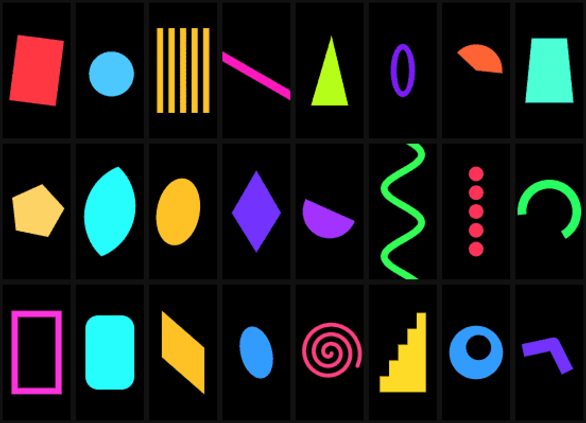
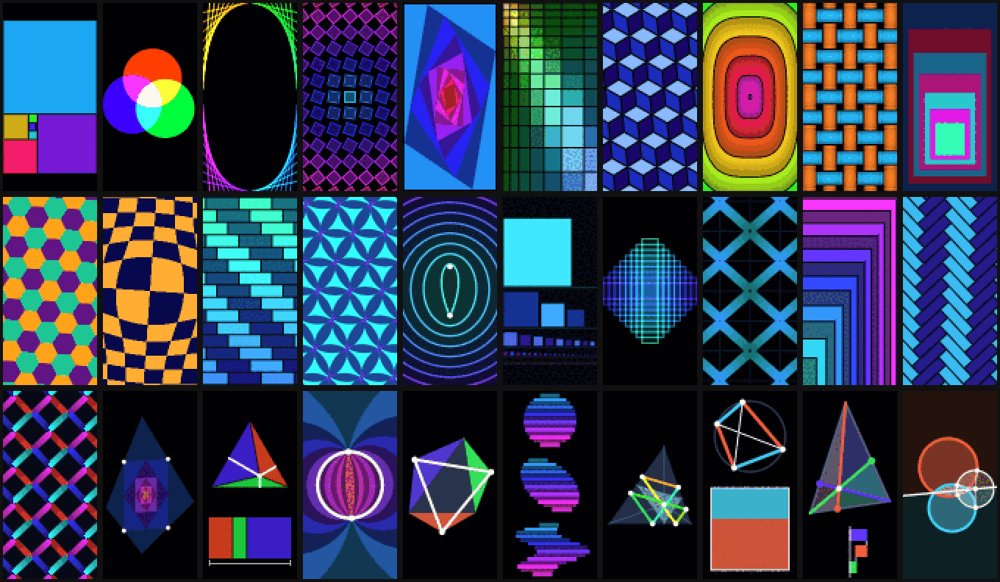
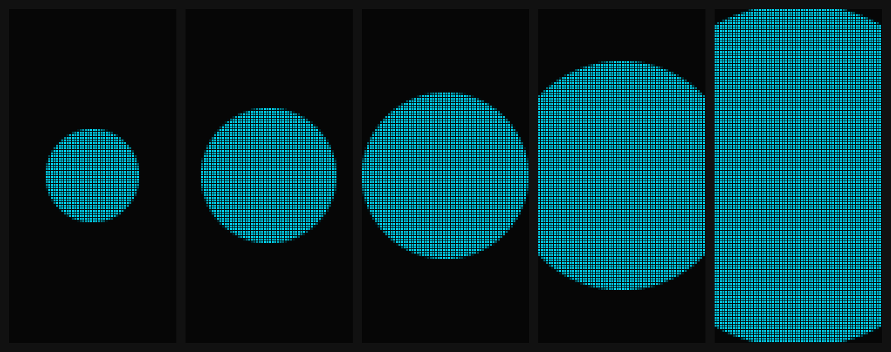
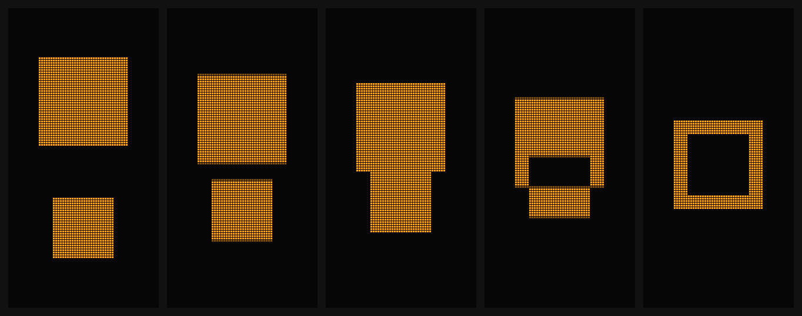
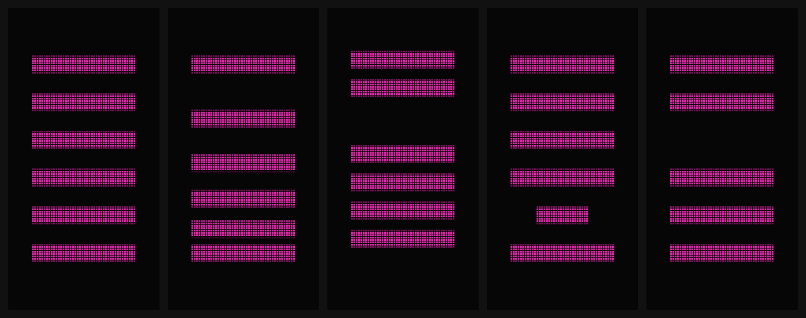
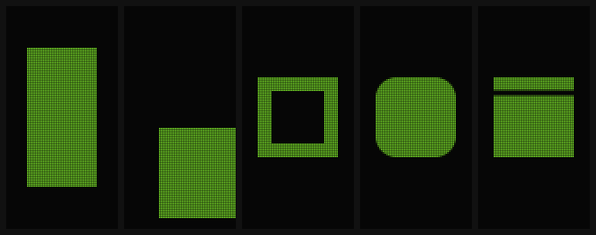
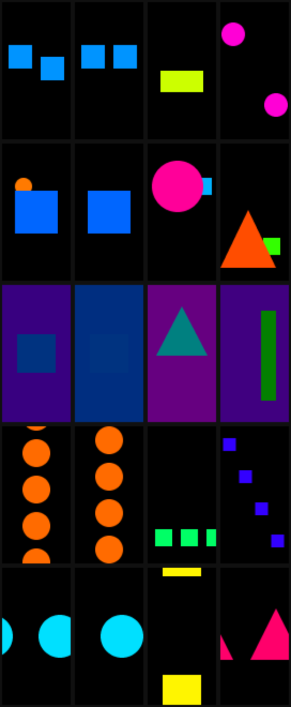
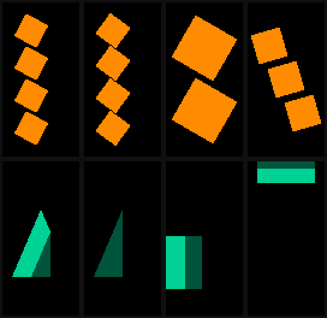

# 기초도형 연구, 다음 열 바퀴

160바퀴부터 쓰는 표는 맨 아래 「다음 스물네 바퀴」에 있어요. 그 위는 148바퀴부터 157바퀴까지 쓴 표와 그 표를 고른 까닭이에요.

140판부터 147판까지 여덟 바퀴가 패턴 스물네 개를 만들었어요. 연구 페이지가 여는 자리 그대로 나란히 놓으면 이래요.

첫 줄이 Slab, Disc, Bars, Stroke, Triangle, Ring, Sector, Trapezoid 이고, 둘째 줄이 Polygon, Lens, Conic, Rhombus, Segment, Sine, Dots, Arc, 셋째 줄이 Frame, Pill, Parallelogram, Ellipse, Spiral, Steps, Eccentric, Angle 이에요. 스물네 장이 카드 한 벌처럼 보여요. 11월 16일 저녁에 창작자가 「패턴 그렇게 만든것들 계속 똑같이만 하면 의미가 없어」라고 한 것이 이 그림이에요.

고를 것은 아래 「갈래 넷」에 있고 추천은 갈래 1 이에요. 패턴은 하나도 만들지 않았어요. 갈래마다 붙인 그림은 패턴 파일 없이 따로 그린 스케치예요.

## 무엇이 같았나

스물네 개 모두 꺼진 바탕에 색 하나이고 K1 이 Hue 예요. 나머지 노브 일흔둘을 하는 일로 나누면 이래요.

| 노브가 하는 일 | 개수 | 예 |
| --- | --- | --- |
| 길이 하나를 늘이고 줄여요 | 37 | Slab 의 Width, Frame 의 Wall |
| 도형을 돌려요 | 12 | Polygon 의 Turn, Stroke 의 Angle |
| 도형 안의 비나 각을 바꿔요 | 13 | Ring 의 Squash, Sector 의 Opening |
| 개수를 바꿔요 | 5 | Bars 의 Count, Polygon 의 Sides |
| 도형을 패널 위에서 옮겨요 | 3 | Disc 의 Across 와 Down, Stroke 의 Place |
| 간격을 바꿔요 | 2 | Bars 의 Gap, Dots 의 Reach |

길이가 반을 넘고, 스물네 패턴 가운데 열둘이 돌림 노브를 들고 있어요. Slab 을 돌려 본 손은 Pill 에서도 Frame 에서도 같은 일을 해요. 도형이 길어지거나 돌아요. 도형끼리의 사이를 정하는 노브는 간격 둘이 전부이고, 도형과 틀의 사이를 묻는 노브는 없어요.

바퀴가 새로 고른 것은 도형의 이름이었어요. README 의 계열 줄에 140판이 「이 바퀴부터는 계열이 아니라 서로 다른 기본 도형을 골라요」라고 적었고, 147판은 「140판에서 145판까지의 열여덟 도형과 같이 도는 146판의 셋 어디에도 없는 기본 도형 셋」이라고 적었어요. 이름이 앞 판에 없으면 새 패턴이었어요.

이름은 바닥을 보이고 있어요. Lens 는 K3 을 끝까지 돌리면 원이 돼서 Disc 와 같은 그림이에요. Rhombus 는 Triangle 이 되지 않게 대각선이 만나는 자리를 5분의 1 에서 멈췄고, Polygon 은 변이 셋과 넷인 자리를 뺐어요. Eccentric 의 Shift 는 -1 에서 Ring 과 같은 그림이에요. 147판이 다음 바퀴에 넘긴 후보는 점선과 꺾은선과 동심원인데, 셋 다 Bars 나 Sine 이나 Ring 과 갈리는지부터 재라는 말이 붙어 있어요.

같이 도는 바퀴끼리도 부딪혔어요. 141판 바퀴는 Slab 과 Disc 를 짰다가 140판이 먼저 들어와서 버렸어요. 142판 바퀴는 삼각형과 고리를 짜서 전체 검사까지 돌린 뒤에 141판에 내줬어요. 고를 것이 짧은 목록 한 줄이면 두 바퀴가 같은 것을 집어요.

### 앞의 열 바퀴는 반대쪽으로 넘쳤어요

130판의 바퀴 128 부터 139판까지 서른 개는 11월 15일 방향으로 만들었어요.

그때 바퀴가 고른 것은 원리의 이름이었어요. 139판의 계열 줄은 앞 바퀴와 겹치지 않는다는 낱말을 스물넷 늘어놓아요. 낱말이 떨어지자 화면을 채우는 타일(Tumbling Blocks, Over Under, Kagome Tiles, Running Bond, Tatami)로 갔고, 137판부터는 이름 붙은 정리(Varignon Nest, Viviani Wedges, Thales Lens, Napoleon Triangle, Cavalieri Chords, Fagnano Orbit, Ptolemy Split, Ceva Walk, Radical Axis)로 갔어요. 정리를 그리려면 원과 선과 점이 여럿 서야 해요.

열 때 켜진 LED 의 몫을 재면 두 묶음이 갈려요. 가장 밝은 채널이 48 이상인 LED 를 셌어요. 앞의 서른 개는 열다섯이 패널의 80퍼센트 넘게 켜요. 뒤의 스물네 개는 7퍼센트에서 38퍼센트 사이이고 가운데값이 19퍼센트예요. 11월 16일에 창작자가 「촌스럽고 지저분」하다고 한 것이 앞의 서른 개이고, 같은 날 저녁에 「똑같이만」이라고 한 것이 뒤의 스물네 개예요.

### 세 번 다 이름으로 새로움을 쟀어요

11월 10일에 창작자가 「매번 새롭게」를 바랐을 때 바퀴는 물리 현상의 이름이 겹치지 않게 골랐어요. 129판이 Martensite Tweed, Burridge-Knopoff, Quasipattern 이에요. 11월 15일 뒤에는 원리의 이름을, 11월 16일 뒤에는 도형의 이름을 그렇게 골랐어요. 이름은 끝없이 나오는데 그림은 닮아 가요. ROUND.md 도 「주제 여섯은 바닥나지 않아서, 고를 것이 없어 서는 바퀴는 없어요」라고 적어요. 그래서 아래 차례표에는 끝이 있어요. 열 바퀴를 돌면 바퀴는 다음 이름을 지어내지 않고 서요.

### 검사가 정한 것이 둘 있어요

스물네 개 모두 천천히 숨을 쉬어요. 방향은 멈춘 그림이어도 된다는 것인데 `study.ts` 의 움직임 문턱 0.004 가 멈춘 그림을 막아서 넣은 숨이에요. Triangle 은 5퍼센트 숨이 0.0036 으로 문턱 아래여서 밑변을 28 에서 33 LED 로 넓혔어요. 삼각형의 크기를 검사가 정했어요.

Lab 의 기본 노브 값은 0, 2, 0, 0.06 이에요. K4 가 0.06 에서 열려서, K4 에 돌림을 둔 도형은 조금 기운 채 열려요. Slab 이 9.0도, Polygon 이 8.6도, Lens 와 Conic 이 10.8도예요. 9도 기운 변은 LED 여섯 줄을 내려갈 때마다 옆으로 한 칸 밀려요.

### 스물네 개에서 건질 것

돌리다가 멈추게 되는 자리가 있는 노브가 몇 있어요. Triangle 의 Top 은 꼭대기를 옆으로 밀어도 넓이가 그대로이고, 꼭대기가 밑변 끝 위에 서는 자리에서 직각삼각형이 돼요. Ring 의 Squash 는 넓이를 지키면서 0.5 에서 정확한 원이 돼요. Conic 의 Eccentricity 는 노브 하나로 원에서 타원, 포물선, 쌍곡선을 차례로 지나가요. 길이 노브에서는 이런 자리가 표시 없이 지나가요. Slab 의 가로와 세로가 같아져 정사각형이 되는 자리가 그래요. 다음 열 바퀴는 이런 자리를 찾는 일이에요.

### 쓰는 사이에 149판이 들어왔어요

149판은 README 에 「이름 붙은 기본 도형은 거의 다 나왔어요」라고 적고, 나온 도형을 고쳐서 셋을 만들었어요. Reuleaux 는 변이 호로 부푼 삼각형이고 Chamfer 는 모서리를 깎은 사각형이에요. 셋째인 Tangent 는 원 하나와 선 하나예요. K3 Gap 이 0 에서 선이 원에 닿고, 왼쪽으로 돌리면 선이 원을 가로질러요. 도형 둘의 사이를 노브 하나가 지나가는 첫 패턴이고, 닿는 자리에서 열려요. 아래 지도의 2단이 이런 그림이에요. 같이 도는 148판(#428)은 점선과 동심원과 갈라 벌린 원을 맡았어요.

## 지도

패턴 하나를 도형과 물음으로 나눠요. 도형은 사각형, 원, 삼각형, 선 넷으로 닫고 새 이름을 더 고르지 않아요. 바퀴가 고르는 것은 물음이에요. 물음은 화면에 몇 개가 서느냐로 단을 나눠요.

| 단 | 화면에 서는 것 | 물음 | 지금까지 |
| --- | --- | --- | --- |
| 1 | 도형 하나와 틀 | 닿음과 잘림, 도형과 바탕 | 스물네 개가 이 단인데 틀은 묻지 않았어요 |
| 2 | 같은 도형 둘 | 사이, 몫, 무게, 두 색 | Lens 가 원 둘이 겹친 곳이고, 149판의 Tangent 가 원과 선이 닿는 자리예요 |
| 3 | 같은 도형 다섯에서 일곱이 한 줄 | 간격의 규칙, 묶음, 하나만 다름 | Bars, Dots, Steps 가 고른 줄이에요 |
| 4 | 면을 채우는 배열 | 격자, 타일 | 11월 16일 방향이 닫았고 여기서도 열지 않아요 |

스물네 개는 모두 틀을 피했어요. Disc 는 「지름을 키워도 원이 패널 밖으로 나가지 않아요」라고 적었고 Sector 는 「어느 쪽을 가리켜도 도형이 패널 안에 다 들어와요」라고 적었어요. 열 때 패널 가장자리의 LED 를 켜는 패턴은 처음부터 패널을 가로지르는 Stroke 와 Sine 둘이에요. 도형이 하나일 때 도형의 상대는 틀이에요. 그 사이를 아직 아무도 묻지 않았어요.

틀은 64 × 128 LED 예요. 지름 64 LED 인 원은 양쪽 옆벽에 닿고, 한 변이 64 LED 인 정사각형은 패널의 꼭 절반이에요. 모서리에서 맞은편 모서리로 가는 선은 가로 한 칸에 세로 두 칸씩 가요.

## 갈래 넷

### 갈래 1. 사이

단을 하나씩 올라가요. 도형 하나와 틀에서 두 바퀴, 도형 둘에서 세 바퀴, 한 줄에서 세 바퀴를 돌아요. 남은 두 바퀴는 색과 움직임을 한 번씩 해 봐요. 한 바퀴는 물음 하나를 도형 셋에 물어요.

1단의 첫 물음이에요. 원이 커져서 지름 64 LED 에서 양쪽 벽에 닿고, 더 커지면 틀이 원을 잘라요. 셋째 자리가 멈추는 자리예요.

2단의 첫 물음이에요. 사각형 둘이 다가와서 닿아요. 더 가면 겹친 곳이 꺼지고, 끝에서는 작은 것이 큰 것 안에 들어가 틀이 돼요. 노브 하나가 이 그림을 다 지나가요.

3단의 물음이에요. 왼쪽부터 고른 줄, 간격이 아래로 갈수록 좁아지는 줄, 틈 하나로 둘과 넷이 된 줄, 하나만 짧은 줄, 하나가 빠진 줄이에요.

바퀴마다 손이 하는 일이 달라져요. 열 바퀴 뒤에는 물음 열 개마다 도형 셋의 답이 있어서, 어느 물음이 이 패널에서 서는지 알아요. 걸리는 것은 11월 16일 방향의 「한 패턴은 도형 하나예요」예요. 3바퀴부터는 같은 도형 둘이 서고 6바퀴부터는 일곱까지 한 줄이 서요. 그 줄을 풀지는 창작자가 정해요. 풀지 않으면 갈래 1 은 2바퀴에서 끝나요.

### 갈래 2. 사각형 하나로 열 바퀴

도형을 사각형에 못 박고 물음만 바꿔요. 요제프 알베르스의 「정사각형에 바치는 경의」가 간 길이고, 133판의 Sunk Squares 가 그 연작에서 왔어요.

왼쪽부터 변의 비, 틀에 잘림, 벽의 두께, 모서리의 둥글기, 선 하나로 나눔이에요. 한 바퀴가 물음 하나에 노브 짜임이 다른 답 셋을 내고, 셋을 견줘 하나를 골라 README 에 적어요. 열 바퀴 뒤에 한 묶음으로 내놓을 사각형 열 개가 남아요. 걸리는 것은 연구 페이지예요. 사각형 서른 개가 나란히 서서 지금보다 더 닮아 보여요.

### 갈래 3. 두 색

모양을 큰 사각형 안의 작은 사각형에 못 박고 두 색의 사이만 물어요.

작은 사각형의 색이 큰 사각형의 색에서 멀어져요. 첫 자리는 같은 색이라 사각형이 하나로 보여요. 이 패널은 종이가 아니라 빛이에요. 펌웨어가 채도를 1.62배 올리고, 20/255 아래는 거의 안 보이고, 어두운 주황은 갈색으로 보여요. 열 바퀴 뒤에 이 패널에서 서는 두 색의 짝을 적은 표가 남고, 그 표는 다른 패턴도 써요. 걸리는 것은 눈이에요. 색은 실제 패널에서 봐야 아는데 바퀴는 `look.ts` 가 그린 `led.png` 로만 봐요.

### 갈래 4. 움직임 하나

도형 하나에 움직임 하나를 줘요. 11월 15일의 말은 「계속 움직일 필요는 없어」였고, 움직이지 말라는 말은 아니었어요. 창작자의 기본 프리셋은 움직임 가운데값이 0.66 인데([README](README.md) 의 「추려 보기」) 스물네 개는 0.005 에서 0.027 사이예요. K2 가 빠르기이고 0 에서 멈춰요. 넷 가운데 기기에 올라갈 패턴과 가장 가까워요. 걸리는 것은 11월 8일에 창작자가 싫다고 한 「한 사이클이 돌아가는」 그림이에요. 오가는 움직임은 사이클이 되기 쉬워요.

### 추천은 갈래 1 이에요

되풀이를 끊으려면 바퀴마다 손이 하는 일이 달라야 하고, 페이지에 나란히 선 그림도 달라야 해요. 갈래 1 은 물음과 같이 화면에 서는 수가 바뀌어요. 나머지 셋은 하나를 못 박아서 깊어지는 대신 페이지에서는 더 닮아 보여요. 갈래 1 의 9바퀴와 10바퀴가 갈래 3 과 갈래 4 를 한 번씩 해 보니, 열 바퀴 뒤에 어느 쪽을 깊게 팔지는 그림을 보고 골라요.

## 갈래 1 의 열 바퀴

방향이 ROUND.md 에 들어간 뒤 첫 바퀴가 차례 1 이고, 그 뒤로 바퀴 번호를 따라 하나씩 가요. 같이 도는 바퀴도 번호가 달라서 같은 물음을 집지 않아요.

| 차례 | 단 | 물음 | 도형 셋 | 멈추는 자리 |
| --- | --- | --- | --- | --- |
| 1 | 1 | 닿음과 잘림 | 사각형, 원, 삼각형 | 도형이 옆벽에 닿는 자리. 원은 지름 64 LED |
| 2 | 1 | 도형과 바탕 | 사각형, 원, 삼각형 | 도형과 바탕의 밝기가 같아져 도형이 사라지는 자리 |
| 3 | 2 | 사이 | 사각형 둘, 원 둘, 선 둘 | 둘이 닿는 자리, 한쪽이 다른 쪽 안에 다 드는 자리 |
| 4 | 2 | 몫 | 사각형 둘, 원 둘, 삼각형 둘 | 둘의 넓이가 같아지는 자리 |
| 5 | 2 | 무게 | 사각형 둘, 원 둘, 선 둘 | 켜진 LED 의 무게중심이 패널 한가운데 오는 자리 |
| 6 | 3 | 간격의 규칙 | 선, 원, 사각형의 줄 | 간격이 고른 자리, 가장 좁은 간격이 0 이 되는 자리 |
| 7 | 3 | 묶음 | 선, 원, 사각형의 줄 | 벌린 틈이 꼭 한 칸이 되어 하나가 빠진 줄과 같아지는 자리 |
| 8 | 3 | 하나만 다름 | 선, 원, 사각형의 줄 | 다른 하나가 이웃에 닿는 자리 |
| 9 | 2 | 두 색 | 3바퀴의 셋 | 같은 색이라 둘이 하나로 붙는 자리, 보색 |
| 10 | | 움직임 하나 | 앞 아홉 바퀴에서 고른 셋 | 움직임이 그 패턴의 멈추는 자리를 지날 때 느려져요 |

노브는 이렇게 걸어요. K1 은 열 바퀴 모두 색이에요.

| 차례 | K2 | K3 | K4 |
| --- | --- | --- | --- |
| 1 | 크기. 틀보다 작은 데서 틀을 넘는 데까지 | 세로 자리 | 가로로 치우친 정도 |
| 2 | 크기 | 뒤집기. 켜진 도형에서 켜진 바탕의 꺼진 구멍으로 | 가운데에서 치우친 정도 |
| 3 | 크기 | 둘의 거리. 떨어진 데서 한쪽이 다른 쪽에 드는 데까지 | 둘의 크기 차 |
| 4 | 둘의 넓이를 더한 값 | 한쪽의 몫. 한쪽이 커지면 다른 쪽이 작아져요 | 맞춤. 가운데 맞춤에서 한 변 맞춤으로 |
| 5 | 큰 도형의 크기 | 작은 도형이 가운데에서 떨어진 거리 | 작은 도형의 크기 |
| 6 | 개수 | 이웃 간격의 비. 0 에서 고른 줄 | 크기가 같은 비를 따라가는 정도 |
| 7 | 개수 | 벌어지는 틈의 자리 | 틈이 벌어진 정도 |
| 8 | 개수 | 다른 하나의 자리 | 다른 정도 |
| 9 | 크기 | 둘째 색이 첫 색에서 떨어진 각 | 둘째 색의 밝기 |
| 10 | 빠르기. 0 에서 멈춰요 | 오가는 폭 | 그 패턴의 K4 그대로 |

2바퀴는 바탕을 켜요. 패널을 흰색으로 다 켜면 펌웨어가 2.4 A 예산에 맞춰 밝기를 절반쯤으로 낮춰요. 켜진 바탕은 어둡게, 도형은 밝게 둬요.

3바퀴에서 겹친 곳은 꺼요. 켜 두면 둘이 한 덩어리가 돼서 둘로 읽히지 않아요. 선 둘은 나란히만 놓아요. 147판의 Angle 이 위를 향했을 때 「^」 로 읽혀서 고친 일이 있고, 엇갈린 선 둘도 글자로 읽혀요.

5바퀴의 무게중심은 재는 값이에요. 켜진 LED 의 자리를 밝기만큼 무게를 줘서 평균해요.

10바퀴는 앞 아홉 바퀴에서 멈추는 자리가 가장 또렷했던 패턴 셋을 골라, 시간이 K3 을 천천히 돌리게 해요. 빠르기 둘을 서로 나누어떨어지지 않게 써요. ROUND.md 의 11월 8일 글에 있는 방법이에요.

바퀴는 패턴 셋과 같이 README 의 판 절 끝에 한 줄을 남겨요. 그 물음이 어느 도형에서 가장 또렷했는지와 멈추는 자리가 몇 LED 였는지예요. 열 줄이 모이면 창작자가 다음을 고를 때 보는 표가 돼요.

열 바퀴가 끝나면 바퀴는 서요. 창작자가 서른 개를 보고 물음을 고르면, 그 물음을 갈래 2 처럼 깊게 파는 표를 그때 새로 짜요.

## 노브 넷의 짜임

지금은 K1 이 Hue 이고 남은 셋에 그 도형의 값을 채웠어요. 다음부터는 노브마다 맡는 일을 못 박아요. 흐르는 장 때 ROUND.md 가 K2 를 흐름 세기에, K3 을 크기에 못 박은 것과 같은 방식이에요.

| 노브 | 맡는 일 | 범위와 열리는 자리 |
| --- | --- | --- |
| K1 | 색 | 0 에서 열려요. 색상에 덧셈을 넣어 빨강이 아닌 색에서 열어요 |
| K2 | 크기나 개수 | 0..3 으로 잡으면 2 에서 열려요. 범위의 3분의 2 자리예요 |
| K3 | 그 바퀴의 물음 | -1..1 로 잡으면 한가운데 0 에서 열려요 |
| K4 | 어긋남 | 0..1 로 잡으면 0.06 에서 열려요. 거의 반듯한 자리예요 |

패턴을 바꿔도 K3 을 돌리면 그 패턴의 물음이 움직이고, K4 를 올리면 반듯하던 것이 어긋나요. Lab 의 기본값 0, 2, 0, 0.06 이 이 짜임에 그대로 맞아요.

여기에 넷을 더 지켜요.

1. 길이 노브는 한 패턴에 둘까지예요. Trapezoid 와 Sine 과 Frame 은 K2, K3, K4 가 모두 길이였어요.
2. 돌림은 물음이 돌림일 때만 써요. Polygon 의 Turn 은 범위를 144도로 늘리고 채도를 내린 뒤에야 반응이 0.032 가 됐어요. 쓴다면 가로, 세로, 45도와 패널의 대각선에서 서게 해요.
3. K3 은 멈추는 자리를 지나가요. 기기의 노브는 딸깍 48칸에 범위 전체를 가요. 멈추는 자리에 두 칸을 붙여 둬서 손이 지나치지 않게 하고, 열 때는 그 자리 바로 앞에서 열어요.
4. 노브 하나가 값 둘을 맞바꿔도 돼요. 한쪽이 커지면 다른 쪽이 작아지고 합은 그대로예요. Triangle 의 Top 과 Rhombus 의 Cross 가 넓이를 그렇게 지켰어요.

## 단순함을 재는 법

잣대는 11월 16일 방향의 「더 뺄 것이 없나」 그대로예요. 바퀴는 이 말을 도형 이름 하나로 읽었어요. 물음을 놓고 읽으면 달라져요. 사각형 둘이 닿는 그림에서 하나를 빼면 닿음이 없어져요. 뺄 것이 없으니 둘이 가장 적은 수예요.

패턴마다 넷을 봐요.

1. 한 문장으로 말해요. 「원이 커져서 벽에 닿는다」처럼 도형과 물음이 한 문장에 들어가고, 그 문장에 「그리고」가 없어요.
2. 하나씩 빼 봐요. 도형 하나나 노브 하나를 뺐을 때 그 문장이 그대로면 빼요.
3. 세어져요. 화면에 선 것이 일곱을 넘지 않고 색은 바탕 말고 둘까지예요.
4. 손이 멈춰요. K3 을 끝에서 끝까지 돌리는 동안 멈추게 되는 자리가 하나는 있어요.

새로운지는 이름으로 재지 않아요. 앞 판에 물음도 같고 도형도 같은 패턴이 있으면 새롭지 않아요. README 의 계열 줄에는 판마다 `물음 · 도형 셋 · K2 K3 K4 가 하는 일` 을 적어서 다음 바퀴가 그 줄로 견줘요.

## 창작자가 정할 것

[ROUND.md](ROUND.md) 와 `tools/` 는 창작자 몫이라 고치지 않았어요. 정할 것이 넷이에요.

1. 갈래. 추천은 갈래 1 이에요.
2. 「한 패턴은 도형 하나예요」를 풀지. 갈래 1 은 3바퀴부터 같은 도형 둘이, 6바퀴부터 일곱까지 한 줄이 서요.
3. 숨. 멈춘 그림이라고 머리에 적은 패턴은 `study.ts` 가 움직임 문턱을 재지 않게 하면 숨이 빠져요. 그대로 두면 바퀴는 지금처럼 숨을 넣어요.
4. 열 바퀴 뒤에 세울지. 차례표가 끝난 바퀴가 새 물음을 지어내면 이름 고르기가 다시 시작돼요.

## 다음 스물네 바퀴

「사이」 열 바퀴는 150판부터 159판까지 패턴 서른 개를 남겼어요. 연구 페이지가 여는 자리 그대로 놓으면 이래요. 세로 한 칸이 한 바퀴이고, 왼쪽이 150판이에요.

차례표가 열째에서 끝나서 158바퀴와 159바퀴는 새 패턴 없이 섰어요. 11월 18일에 창작자가 「그냥 패턴 더 많이 새로운거 만들게 시켜봐」라고 했어요. 아래가 160바퀴부터 쓰는 표예요. 스물네 줄이고 183바퀴에서 끝나요. 패턴은 하나도 만들지 않았고, 붙인 그림은 패턴 파일 없이 따로 그린 스케치예요.

### 서른 개에서 본 것

세로 칸을 내려 읽으면 셋이 같은 그림이에요. 한 바퀴가 물음 하나를 도형 셋에 물었고, 셋은 도형만 바꿨어요. 153판의 Quota 와 Moiety 와 Allot 는 README 의 한 줄이 도형 이름 말고는 거의 같아요. 155판부터 157판까지 아홉 개는 다섯이나 여섯 개가 선 줄이에요.

서른 개 모두 패널 한가운데에 서요. 열 때 그림의 가운데가 패널 가운데에서 가로로 2 LED, 세로로 9 LED 안에 있어요. 그림이 차지하는 몫은 11퍼센트에서 39퍼센트 사이예요. 바탕을 켠 넷은 도형만 셌어요. 틀의 구석과 가장자리는 비어 있고, 패널보다 큰 그림도 없어요.

멈추는 자리는 둘로 갈렸어요. K3 을 48칸 훑으며 화면에 선 덩어리를 셌어요. 가장 밝은 채널이 48 이상인 LED 가 위아래와 옆으로 이어진 것이 한 덩어리예요. 152판은 닿는 칸에서 둘이 하나가 되고 157판은 다섯이 셋이 돼요. README 가 적은 대로 151판은 한 칸에 도형이 통째로 사라지고 158판은 이음새가 사라져요. 153판과 154판과 156판은 끝에서 끝까지 돌려도 덩어리 수가 그대로예요. 그 세 판의 멈추는 자리는 길이 둘이 같아지는 자리예요. 넓이가 같아지거나, 무게중심이 가운데 오거나, 틈이 한 칸이 돼요. 화면에서는 아무 일도 일어나지 않아요. 154판은 README 에 그 자리를 「그림에서 가려내기 어렵고」라고 적었고 156판은 「눈으로 가려내기는 어렵고」라고 적었어요.

노브 한 칸이 작았어요. 156판과 157판은 한 칸에 0.3 LED 쯤 움직였어요. 157판은 덩어리가 붙는데도 README 에 붙는 칸을 「눈으로 가려내기는 어렵고」라고 적었어요.

### 이번 표가 바꾸는 것

멈추는 자리는 화면에서 무엇이 일어나는 자리예요. 이 패널에서 눈이 알아본 일은 셋이었어요. 둘이 닿는 것, 곧던 변에 1 LED 턱이 서거나 사라지는 것, 화면에 선 조각의 수가 바뀌는 것이에요. 표의 멈추는 자리는 거의 다 이 셋 가운데 하나예요. 빛을 묻는 차례 7 과 20 은 158판처럼 금이 사라지는 자리이고, 시간을 쓰는 차례 10 과 18 은 움직임이 달라지는 자리예요.

셋은 도형만 바꾼 같은 그림이 아니에요. 표가 줄마다 만들 셋을 따로 적었어요. 서는 자리나 방향이나 화면에 서는 수가 달라요. 셋이 서로 다른 도형이 아닌 줄도 있어요. 차례 10 의 셋은 모두 선이고 차례 23 의 셋은 모두 사각형이에요.

틀이 일을 해요. 150판에서 벽은 도형을 자르기만 했어요. 이번 표에서 벽은 도형이 타고 가는 길이에요(차례 5). 줄을 막아요(차례 8). 도형이 딛고 넘어가는 바닥이에요(차례 16). 막대가 자라 나오는 자리예요(차례 17). 스물네 줄 가운데 일곱 줄은 물음에 벽이 들어 있어요.

그림이 가운데를 떠나요. 이번 표에는 바닥에 선 것과 구석에 붙은 것이 있고, 패널의 반을 덮는 것과 패널보다 긴 것이 있어요.

K3 한 칸은 1 LED 넘게 가요. 157판의 원은 지름 12 LED 였고 차례 14 의 원은 22 LED 예요. 도형이 커야 한 칸이 보여요.

앞쪽 줄이 강해요. 후보를 세 갈래에서 따로 모았어요. 조형 교육의 기본 원리가 한 갈래, 이 패널과 손이 한 갈래, 다른 도형끼리의 사이와 시간이 한 갈래예요. 여러 갈래에서 겹쳐 나온 물음을 앞쪽에 뒀어요. 앞 판과 닮은 데가 있거나 읽힘이 걸리는 물음은 뒤에 두고, 걸리는 것을 줄마다 적었어요.

표는 한 번 고쳐 썼어요. 처음 짠 스물여섯 줄을 바퀴 일꾼처럼 처음 읽고 64 × 128 에서 셈해 보게 했어요. 적힌 대로는 지을 수 없는 줄과 노브가 열린 자리에서 그림을 못 바꾸는 줄이 나왔고, 다섯 줄을 빼고 한 줄을 더했어요. 뺀 까닭은 아래 「후보에서 뺀 것」에 있어요.

그 뒤에 두 줄을 더 붙였어요. 작업 글은 서른 줄 안팎을 바랐어요. 같은 세 갈래에서 후보를 처음부터 다시 모으고, 갈래마다 64 × 128 에 그려 조각 수를 셌어요. 마흔 개 남짓 가운데 남은 것은 차례 23 「같이 돎」과 차례 24 「접힘」이에요. 나머지는 이미 있는 줄과 같은 일이 일어나거나 글자나 물건으로 읽혔어요. 켜진 바탕에 구멍 둘을 뚫으면 지름 64 LED 에서 켜진 조각이 하나에서 여섯으로 뛰는데, 차례 9 의 구멍이 둘이 된 것이에요. 서른을 채우려면 이런 줄을 넣어야 해서 스물네 줄에서 멈췄어요.

### 차례표

차례는 작업 글의 바퀴 번호에서 159 를 뺀 수예요. 160바퀴가 차례 1 이고 162판이에요. 183바퀴가 차례 24 이고 185판이에요. 같이 도는 바퀴는 번호가 달라서 물음이 겹치지 않아요. K1 은 스물네 줄 모두 색이에요.

| 차례 | 물음 | 만들 셋 | 멈추는 자리 |
| --- | --- | --- | --- |
| 1 | 미끄러짐. 둘로 가른 도형의 한쪽이 금을 따라 미끄러져요 | 가운데에서 끊은 굵은 세로선 · 가운데에서 끊은 벽에서 벽까지의 가로 띠 · 꼭대기에서 내린 금으로 가른 삼각형 | 밀린 거리가 0 이 되어 금 양쪽의 턱이 사라지고 도형 하나가 되는 자리. 선과 띠는 굵기만큼 밀려 두 토막이 모서리 한 점으로만 닿는 자리에서 한 번 더 서요. 다음 칸에 둘로 떨어져요 |
| 2 | 맞바꿈. 밝은 반과 어두운 반의 경계가 도형을 지나가며 넘은 만큼 뒤집어요 | 사각형과 가로 경계 · 원과 세로 경계 · 삼각형과 세로 경계 | 경계가 도형에 닿는 자리. 경계가 도형을 1 LED 넘어서 구멍 둘레에 테가 서는 자리 |
| 3 | 짝. 줄의 이웃이 둘씩 다가가 붙어요 | 세로 줄의 사각형 넷 · 가로로 늘어선 세운 선 넷 · 세로 줄의 마름모 넷 | 짝이 닿아 넷이 둘이 되는 자리. 반대로 돌리면 가운데 둘이 닿아 넷이 셋이 되는 자리. 둘 다 노브의 끝이에요 |
| 4 | 끼움. 도형에 뚫린 구멍이 커져서 변에 안에서 닿아요 | 정사각형 속 원 구멍 · 벽에서 벽까지 가는 띠 속 원 구멍 · 정사각형 속 마름모 구멍 | 구멍이 변에 닿아 하나가 여러 조각이 되는 자리. 변 48 LED 정사각형은 구멍 지름 48 LED 에서 모서리 조각 넷이 되고, 굵기 24 LED 띠는 지름 24 LED 에서 둘로 끊겨요. 마름모 구멍은 대각선이 변과 같아질 때 꼭짓점 넷이 변에 닿아요 |
| 5 | 틀을 따라. 도형 하나가 벽에 붙은 채 틀의 가장자리를 따라가요 | 벽을 타는 원 · 한 끝을 왼쪽 아래 구석에 박은 선 · 밑변을 바닥에 두고 꼭대기가 벽을 따라가는 삼각형 | 구석. 원은 두 벽에 한꺼번에 닿아요. 선은 맞은편 구석에 꽂혀 패널의 대각선이 돼요. 삼각형은 꼭대기가 위쪽 구석에 꽂히고, 밑변이 64 LED 면 패널의 반을 덮어요 |
| 6 | 비켜 섬. 틈 없이 붙어 선 줄에서 하나가 옆으로 비켜서요 | 세로로 붙어 선 사각형 다섯 · 바닥에서 24 LED 위에 가로로 붙어 선 사각형 다섯 · 떨어져 쌓인 가로 막대 다섯 | 비켜 선 거리가 0 이 되어 이음새가 사라지고 띠 하나가 되는 자리. 도형의 너비만큼 비켜서 이웃과 모서리로만 닿는 자리. 막대는 끝이 옆벽에 닿는 자리에서만 서요 |
| 7 | 겹친 곳. 겹쳐 선 두 도형에서 겹친 곳의 밝기만 달라져요 | 위아래로 겹친 원 둘 · 모서리로 겹친 사각형 둘 · 나란히 반쯤 겹친 굵은 세로선 둘 | 겹친 곳이 한 겹과 같은 밝기가 되어 안쪽 금이 사라지고 둘이 한 덩어리가 되는 자리. 양 끝은 겹친 곳이 꺼진 자리와 두 겹을 더한 자리예요 |
| 8 | 막힘. 줄이 벽으로 밀려 벽 쪽부터 차례로 붙어요 | 바닥으로 밀리는 가로 막대 다섯 · 오른쪽 벽으로 밀리는 세운 선 다섯 · 천장으로 밀리는 사각형 넷 | 첫 도형이 벽에 닿는 자리. 틈이 하나씩 닫혀 덩어리가 하나씩 줄어드는 자리 |
| 9 | 뚫림. 켜진 패널에 뚫린 구멍이 커져서 벽에 닿아요 | 원 구멍 · 마름모 구멍 · 사각형 구멍 | 구멍의 너비가 64 LED 가 되어 켜진 바탕이 위아래 둘로 갈리는 자리. 원과 마름모는 높이 128 LED 에서 바탕이 구석 넷으로 갈려요. 길쭉함이 1:2 인 마름모는 네 벽에 한꺼번에 닿아요 |
| 10 | 흐름. 흐르는 점선의 틈이 닫히면 움직임이 사라져요 | 왼쪽 벽 가까이 세로로 흐르는 선 · 바닥 가까이 가로로 흐르는 굵은 선 · 패널의 대각선을 따라 흐르는 선 | 틈이 닫혀 토막들이 벽에서 벽까지 가는 선 하나가 되고 흐름이 안 보이게 되는 자리. 노브의 끝이에요 |
| 11 | 닫힘. 떨어진 변들이 만나 테 하나가 돼요 | 네 변이 모서리에서 떨어진 사각형 테 · 호 넷으로 끊긴 원 테 · 양쪽 벽에서 나와 가운데에서 만나는 선 둘 | 사각형 테는 두 곳에서 서요. 변이 굵기만큼 물러난 자리에서 이웃과 모서리 한 점으로 닿아 넷이 하나가 되고, 물러난 길이가 0 이 되면 모서리의 패임이 사라져요. 원 테와 선 둘은 틈이 닫히는 한 곳이에요 |
| 12 | 층짐. 붙어 선 도형들이 이웃보다 한 단씩 어긋나요 | 가로로 붙어 선 사각형 다섯 · 붙어 쌓인 가로 막대 넷 · 가로로 붙어 선 세운 막대 다섯 | 단 차가 0 이 되어 띠 하나가 되는 자리. 단 차가 도형의 크기와 같아져 모서리끼리만 닿는 자리 |
| 13 | 턱. 곧은 변이 기울다가 LED 격자와 맞는 기울기에서 턱이 고르게 서요 | 패널을 둘로 가르는 경계 하나 · 32 × 64 LED 직사각형 · 변 46 LED 정사각형 | 턱이 없는 가로. 턱이 고른 기울기는 가로 2칸에 세로 1칸, 45도, 가로 1칸에 세로 2칸이에요. 경계는 가로 1칸에 세로 2칸에서 두 끝이 패널의 모서리에 꽂혀요. 직사각형은 36.9도에서, 정사각형은 45도에서 두 꼭짓점이 양쪽 벽에 닿아요 |
| 14 | 교대. 줄에서 하나 걸러 하나가 작아져 사라져요 | 패널의 대각선 줄의 원 다섯 · 세로 줄의 사각형 일곱 · 가로로 늘어선 세운 선 다섯 | 하나 걸러 하나가 사라져 개수가 줄어드는 자리. 노브의 양 끝이에요 |
| 15 | 줄의 맞바꿈. 밝은 반과 어두운 반의 경계가 줄을 지나가며 하나씩 뒤집어요 | 세로 줄의 원 다섯과 가로 경계 · 가로로 늘어선 세운 선 다섯과 세로 경계 · 패널의 대각선 줄의 사각형 다섯과 가로 경계 | 경계가 도형과 도형 사이의 틈에 서서 잘린 도형이 없는 자리. 틈마다 서요 |
| 16 | 기욺. 도형이 바닥에 댄 모서리를 딛고 넘어가요 | 정사각형 · 짧은 변으로 선 1:2 막대 · 벽과 바닥에 두 끝을 댄 길이 64 LED 선 | 변이 바닥에 붙는 자리. 대각선이 수직으로 서는 자리는 사각형이 45도, 막대가 26.6도예요. 선은 바닥에 누워 양쪽 벽에 한꺼번에 닿는 자리와 왼쪽 벽에 붙어 서는 자리예요 |
| 17 | 엇물림. 양쪽 벽에서 번갈아 나온 도형들이 서로 엇갈려 지나가요 | 양 옆벽에서 번갈아 나온 가로 막대 일곱 · 천장과 바닥에서 번갈아 나온 세운 막대 다섯 · 양 옆벽에 번갈아 붙었다가 건너가는 사각형 다섯 | 양쪽의 끝이 한 줄에 서는 자리. 닿는 것은 없고 가운데 골이 닫혀요. 맞은편 벽에 닿는 자리 |
| 18 | 두 시계. 나란한 두 도형이 저마다의 빠르기로 오가요 | 틈을 두고 옆으로 나란한 사각형 둘 · 윗변과 아랫변이 따로 오가는 사각형 하나 · 틀을 따라 도는 원 둘 | 두 빠르기가 같아져 둘이 한 몸으로 움직이는 자리 |
| 19 | 숨음. 작은 도형이 다른 색의 큰 도형 뒤로 들어가 사라져요 | 사각형 뒤를 패널의 대각선으로 지나는 원 · 큰 원 뒤를 지나는 사각형 · 삼각형 뒤를 지나는 사각형 | 작은 것이 큰 것의 가장자리에 닿는 자리. 다 가려져 큰 도형 하나만 남는 자리 |
| 20 | 바탕색. 켜진 바탕의 색이 도형의 색으로 돌아와 도형이 바탕에 묻혀요 | 가운데의 사각형 · 위쪽의 삼각형 · 한쪽으로 치우친 굵은 세로선 | 바탕과 도형이 같은 색이 되어 도형이 통째로 사라지는 자리 |
| 21 | 지나감. 틀보다 긴 줄이 제 길을 따라 밀려 틀을 지나가요 | 세로로 지나가는 원의 줄 · 가로로 지나가는 사각형의 줄 · 패널의 대각선으로 지나가는 사각형의 줄 | 양 끝의 도형이 벽에 꼭 맞아 잘린 것이 없는 자리. 대각선 줄은 양 끝이 옆벽에 닿는 자리 |
| 22 | 감김. 한쪽 벽으로 나간 도형이 맞은편 벽에서 들어와요 | 옆벽을 넘는 원 · 천장과 바닥을 넘는 사각형 · 옆벽을 넘는 삼각형 | 도형이 벽에 닿는 자리. 다음 칸에 맞은편에서 조각이 나타나 하나가 둘이 돼요 |
| 23 | 같이 돎. 줄로 선 사각형들이 제자리에서 같은 각만큼 같이 돌아요. 틈의 너비는 그대로인데 도는 것만으로 틈이 닫혀요 | 세로 줄의 사각형 넷 · 위아래로 선 큰 사각형 둘 · 패널의 대각선 줄의 사각형 셋 | 모서리가 이웃에 닿아 줄이 한 칸에 하나가 되는 자리. 변 21 LED 에 간격 27 LED 인 넷은 35도, 변 40 LED 에 간격 52 LED 인 둘은 38도예요. 대각선 줄의 셋은 6도에 하나가 됐다가 31도에 다시 셋으로 갈려요 |
| 24 | 접힘. 도형의 한쪽이 금을 따라 접혀 넘어와 뒷면을 보여요 | 가운데의 삼각형과 세로 금 · 왼쪽 벽에 붙은 정사각형과 세로 금 · 천장으로 올라가는 누운 막대와 천장의 금 | 접힌 쪽이 남은 쪽을 꼭 덮어 앞면이 사라지는 자리. 삼각형은 금이 꼭대기 아래에 와서 직각삼각형이 돼요. 정사각형은 금이 가운데에 와서 접힌 끝이 그 칸에 왼쪽 벽에 닿아요. 막대는 가운데가 천장에 닿을 때예요 |

스케치는 한 줄이 한 물음이고 위에서부터 차례대로예요. 왼쪽 두 칸은 첫째 답이에요. 멈추는 자리 앞과 멈추는 자리예요. 오른쪽 두 칸은 둘째 답과 셋째 답이 멈추는 자리 앞에 있을 때예요. 시간을 쓰는 차례 10 과 18 은 한 순간을 그렸어요.

차례 1 부터 6 까지예요. 미끄러짐, 맞바꿈, 짝, 끼움, 틀을 따라, 비켜 섬이에요.

차례 7 부터 12 까지예요. 겹친 곳, 막힘, 뚫림, 흐름, 닫힘, 층짐이에요.

차례 13 부터 17 까지예요. 턱, 교대, 줄의 맞바꿈, 기욺, 엇물림이에요.

차례 18 부터 22 까지예요. 두 시계, 숨음, 바탕색, 지나감, 감김이에요.

차례 23 과 24 예요. 같이 돎과 접힘이에요. 접힘의 어두운 쪽이 뒷면이에요.

노브는 이렇게 걸어요.

| 차례 | K2 | K3 | K4 |
| --- | --- | --- | --- |
| 1 | 크기. 선과 띠는 굵기 | 밀린 거리. 양쪽으로, 한 칸에 1 LED | 금의 자리. 가운데에서 한쪽으로. 끝에서 4분의 1 안으로는 안 가요 |
| 2 | 도형의 크기 | 경계의 자리 | 켜진 반의 밝기가 도형의 밝기에서 벗어난 정도 |
| 3 | 크기 | 짝이 다가간 정도. 가운데에서 고른 줄이에요. 오른쪽 끝에서 첫째와 둘째, 셋째와 넷째가 닿아요. 왼쪽 끝에서 둘째와 셋째가 닿아요 | 짝의 한쪽이 작은 정도 |
| 4 | 겉 도형의 크기. 띠는 굵기 | 구멍의 크기. 닿는 자리 곁에서 한 칸에 2 LED | 구멍이 가운데에서 비낀 정도. 4 LED 까지만 가요 |
| 5 | 원의 지름, 선의 굵기, 삼각형의 밑변 | 가장자리 위의 자리. 원은 가운데가 도는 길을 한 바퀴 돌아요. 선의 끝은 오른쪽 벽과 천장 192 LED 를 가요. 삼각형의 꼭대기는 왼쪽 벽과 천장과 오른쪽 벽 320 LED 를 가요 | 원은 벽에서 떨어진 정도. 선은 박은 끝이 구석에서 떨어진 정도. 삼각형은 꼭대기가 벽에서 떨어진 정도 |
| 6 | 개수. 셋에서 일곱 | 비켜 선 거리. 양쪽으로, 한 칸에 1 LED | 어느 것인지 |
| 7 | 크기 | 겹친 곳의 밝기. 꺼짐에서 두 겹의 합까지. 한 겹은 반 밝기예요 | 둘이 벌어진 정도. 열 때 넓이의 3분의 1 이 겹쳐요 |
| 8 | 개수. 넷에서 일곱 | 미는 정도. 왼쪽 끝에서 벽에서 먼 고른 줄이에요. 가운데에서 첫 도형이 벽에 닿았고 첫 틈이 반쯤 닫혔어요. 오른쪽 끝에서 한 덩어리예요 | 틈이 차례로 닫히는 데서 한꺼번에 닫히는 데까지 |
| 9 | 구멍의 길쭉함. 열 때 1:1 이고 끝에서 1:2. 사각형은 1:1.75 까지 | 구멍의 너비. 한 칸에 2 LED | 구멍이 위아래로 비낀 정도 |
| 10 | 빠르기. 0 에서 멈춰요 | 토막 사이의 틈. 오른쪽 끝에서 닫히고 끝의 세 칸이 닫힌 자리예요 | 토막의 길이가 하나 걸러 달라지는 정도 |
| 11 | 크기. 선 둘은 굵기 | 변이 물러난 길이. 오른쪽 끝에서 0 | 틈이 모서리에서 변을 따라 옮겨 간 정도. 굵기만큼만 가요. 원 테는 틈이 돈 각이에요 |
| 12 | 개수 | 이웃 사이의 단 차. 양쪽으로, 한 칸에 1 LED | 한 단만 더 어긋난 정도 |
| 13 | 경계는 켜진 쪽의 밝기. 직사각형과 정사각형은 크기 | 기울기. 한쪽으로만 기울어요. 경계는 한 칸에 오른쪽 끝이 2 LED 오르고 왼쪽 끝이 2 LED 내려서 8칸, 16칸, 32칸째에 서요. 직사각형은 가로 32 LED 에 한 칸 1 LED 씩 올라 16칸, 24칸, 32칸째에 서요. 정사각형은 가로 46 LED 에 23칸, 46칸째예요 | 도는 축이 가운데에서 비낀 정도 |
| 14 | 개수. 다섯이나 일곱 | 하나 걸러 하나의 크기. 왼쪽 끝에서 홀수째가 0, 오른쪽 끝에서 짝수째가 0 | 짝수째가 줄 옆으로 비낀 정도 |
| 15 | 개수. 다섯이나 일곱 | 경계의 자리 | 켜진 반의 밝기가 도형의 밝기에서 벗어난 정도 |
| 16 | 크기. 선은 굵기 | 기운 각. 48칸에 90도. 선은 벽에 댄 끝의 높이 | 바닥에서 뜬 높이 |
| 17 | 개수. 셋에서 일곱 | 내민 길이. 사각형은 건너간 거리 | 한쪽 벽의 것이 덜 내민 정도 |
| 18 | 빠르기. 0 에서 멈춰요 | 둘째가 첫째보다 빠른 정도. 왼쪽 끝에서 0.618배, 오른쪽 끝에서 1.618배 | 같은 빠르기일 때 둘이 어긋난 거리. 사각형 하나는 그 높이이고 12 LED 아래로 안 가요 |
| 19 | 큰 도형의 크기 | 작은 도형이 길을 따라 간 자리 | 길이 큰 도형의 가운데에서 비낀 정도 |
| 20 | 크기 | 바탕의 색이 도형의 색에서 돈 각 | 바탕이 도형보다 어두운 정도 |
| 21 | 크기 | 줄이 밀린 거리 | 걸음이 벌어진 정도 |
| 22 | 크기. 벽 사이보다 8 LED 넘게 작게 | 넘어가는 쪽의 자리. 한 바퀴 | 다른 쪽 자리. 벽을 넘지 않아요 |
| 23 | 크기. 변과 간격이 같이 0.7배에서 1.15배로 가요 | 돈 각. 넷과 둘은 -24도에서 42도이고 대각선 셋은 -30도에서 40도예요. 멈추는 자리 곁의 여덟 칸은 한 칸에 4도 | 줄의 뒤로 갈수록 하나씩 더 돈 정도. 끝에서 이웃보다 8도 더 돌아요 |
| 24 | 크기 | 금의 자리. 막대는 천장에 대한 막대의 높이예요. 한 칸에 1 LED 넘게 가고 접힌 끝은 그 두 배로 가요 | 금의 기울기. 막대는 막대가 기운 정도. 10도까지 |

「노브 넷의 짜임」과 「단순함을 재는 법」은 그대로예요. 거기에 아홉을 더 지켜요.

1. K3 이 열리는 자리는 멈추는 자리에서 여덟 칸 넘게 떨어져 있어요. `study.ts` 는 K2 와 K4 를 K3 이 열린 자리에 둔 채 재요. 멈추는 자리에서 열면 차례 1 의 금의 자리와 차례 6 의 「어느 것인지」가 그림을 못 바꿔요. 그림도 선 하나나 띠 하나로 열려요.
2. 멈추는 자리 곁의 여덟 칸은 한 칸에 1 LED 넘게 가요. 나머지 칸은 고르지 않아도 돼요. 가로로 옮기는 도형은 갈 길이 64 LED 에서 제 너비를 뺀 만큼이라, 16 LED 를 넘으면 48칸에 48 LED 를 못 가요.
3. 멈추는 자리의 값은 노브 값에 못 박지 않고 도형의 크기에서 셈해요. 차례 4 의 닿는 지름은 K2 가 정해요.
4. 멈추는 자리에서는 세 칸 머물러요. 그 칸과 붙여 둔 두 칸이에요. 멈추는 자리가 여럿인 차례 8 과 15 는 두 칸씩이에요.
5. K4 가 0 이어야 멈추는 자리가 서는 차례 12 와 20 과 23 과 24 는 158판처럼 K4 의 범위를 0.06 에서 시작해요. 0 에서 1 로 잡으면 0.06 이 1 LED 안팎을 미리 어긋나게 해요.
6. 되돌아오는 노브는 `study.ts` 가 재는 다섯 점이 같은 그림이 되지 않게 범위를 잡아요. 그 검사는 노브마다 범위의 0, 4분의 1, 반, 4분의 3, 1 에서 그림을 견줘요. 차례 5 의 원과 차례 22 는 한 바퀴라서 양 끝만 같고 괜찮아요. 차례 21 은 범위가 걸음의 네 배수이면 다섯 점이 모두 같아요. 걸음 24 LED 에 범위 96 LED 가 그래요.
7. 시간을 쓰는 차례 10 과 18 은 159판처럼 서로 나누어떨어지지 않는 시계 둘을 써요. 도형은 벽을 넘지 않아요. 벽을 넘어 맞은편에서 나오는 것은 차례 22 의 물음이에요. `study.ts` 가 노브를 재는 때는 처음 2초에서 3초 사이예요. 159판의 Wane 은 그 사이에 멈추는 자리를 지나서 K3 반응이 0.0039 였어요.
8. 바탕을 켜는 차례 2 와 9 와 13 과 15 와 20 은 켜진 쪽을 반 밝기 아래로 둬요. 차례 2 와 15 와 20 은 도형과 켜진 바탕이 같은 밝기예요.
9. 멈춘 그림에는 밝기의 숨만 넣어요. 크기와 자리는 시계에 싣지 않아요. 켜진 몫이 작으면 숨의 폭을 키워요. Abut 은 0.92 에 0.08 을 더하고 뺐고, 켜진 몫이 10퍼센트인 Hiatus 는 0.84 에 0.16 을 더하고 뺐어요.

앞 서른 개와 무엇이 다른지, 무엇이 걸리는지예요.

| 차례 | 앞 서른 개와 다른 점 | 걸리는 것 |
| --- | --- | --- |
| 1 | 150판부터 159판까지 한 도형 안이 어긋나는 패턴은 없었어요. Parallelogram 의 Slide 는 도형 하나를 고르게 기울였어요 | 가른 원은 조금만 밀려도 S 라서 뺐어요. 세로로 가른 사각형은 반쯤 밀리면 테트리스 조각이라 뺐어요. 선의 금이 끝 가까이 가면 숫자 1 이에요 |
| 2 | 151판은 밝기를 바꿔서 도형 전체가 한 칸에 사라졌어요. 여기는 밝기가 그대로이고 경계의 자리가 바뀌어요 | 원과 가로 경계는 수평선에 걸린 해이고 삼각형과 가로 경계는 지평선의 산이에요. 그래서 둘은 세로 경계예요. 경계가 사각형의 변에 딱 겹친 칸은 각진 U 라서 거기서 서지 않아요 |
| 3 | 155판은 간격이 한쪽으로 차츰 달라졌고 156판은 틈이 하나였어요. 틈이 하나 걸러 닫히는 줄은 없었어요 | 닿은 원 둘은 8 이라 원을 뺐어요. 둘씩 붙는 가로 막대는 등호예요. 여섯이면 틈이 좁아 한 칸이 1 LED 에 못 미쳐서 넷이에요. 사각형은 변 16 에 틈 20 LED, 선은 굵기 4 에 틈 16 LED 면 한 칸에 1 LED 예요 |
| 4 | 152판부터 158판까지 둘은 늘 같은 도형이었어요. Frame 의 구멍은 벽이 2 LED 남는 데서, Eccentric 의 구멍은 3 LED 남는 데서 멈췄어요 | 원에 뚫린 사각 구멍은 엽전이고 삼각형 속 원은 표지판이라 뺐어요. 겉 도형의 변과 구멍의 지름은 짝수로 가요. 홀수면 목이 반 LED 로 흐려져요. 구멍이 많이 비끼면 C 나 U 로 열려요 |
| 5 | 150판은 크기가 벽에 닿는 자리를 물었고 자리는 세로와 가로 노브 둘이었어요. 노브 하나가 틀을 길로 삼은 패턴은 없었어요 | 원은 Graze 를 벽에 붙여 옮긴 그림과 닮았어요. 굵기 6 LED 선은 바닥에 누우면 켜진 몫이 4.7퍼센트예요. 틀 한 바퀴는 384 LED 인데 원의 가운데가 도는 길은 지름의 네 배만큼 짧아요 |
| 6 | 157판은 하나가 줄 위에서 커졌고 156판은 줄을 따라 틈을 벌렸어요. 줄 밖으로 나간 것은 없었어요 | 노브 짜임이 157판과 같아요. 가운데 것이 비키면 ㅏ 나 ㅗ 로 읽혀서 열 때는 가운데가 아닌 것이 비켜 있어요. 막대 셋은 ≡ 예요 |
| 7 | 겹친 곳을 152판은 늘 껐고 Bifoil 은 늘 덮었고 Lens 는 겹친 곳만 켰어요. 그 셋을 잇는 노브는 없었어요 | 멈추는 원리는 151판과 같아요. 한 칸 밖이 8비트로 5 쯤만 달라서 금이 흐리게 남아요. 멈추는 자리 밖 첫 칸은 20 넘게 건너뛰어요. 같은 쪽을 보며 겹친 삼각형 둘은 전나무라 뺐어요. 원 둘은 벤 다이어그램으로 읽힐 수 있어요 |
| 8 | 150판의 벽은 도형을 잘랐어요. 벽이 자르지 않고 막는 패턴은 없었어요 | 쌓이는 물건으로 읽힐 수 있어요. 가로 막대 셋은 ≡ 라서 넷부터예요 |
| 9 | 150판은 켜진 도형이 벽에 닿았고 닿아도 덩어리는 하나였어요. 꺼진 구멍이 닿으면 켜진 쪽의 조각 수가 바뀌어요 | 150판을 뒤집은 물음이에요. 패널이 거의 다 켜져요. 구멍이 옆으로 비끼면 한쪽 벽만 먼저 뚫려 바탕이 ㄷ 이에요 |
| 10 | 159판의 셋은 제자리에서 오갔어요. 한쪽으로 흘러 틀을 지나가는 패턴은 없었어요 | 한 걸음 흐르면 같은 그림이에요. 빠르기에 느린 시계 하나를 더해요. 가운데 세로 점선은 도로 중앙선이라 벽 가까이 둬요. 선은 굵기 6 LED 넘게 잡아요. 가로 선은 토막이 둘이나 셋뿐이에요 |
| 11 | Frame 과 Ring 은 처음부터 닫혀 있었고 Arc 는 340도에서 멈춰 닫히지 않았어요 | 변이 모서리를 넘어가면 # 이에요. 틈이 변의 가운데로 가면 모서리 꺾쇠 넷이라 카메라 초점 표시예요. 삼각형 테는 꼭대기 조각이 ∧ 라서 뺐어요. 원 테는 굽은 끝의 금이 번져요 |
| 12 | 155판부터 157판까지 줄은 모두 한 선 위에 섰어요. Steps 는 속이 찬 계단 하나였고 Parallelogram 은 턱 없이 기울었어요 | 차례 1 과 6 의 한 식구예요. 막대 넷은 길이 16 LED 라야 모서리끼리 닿는 자리에서 64 LED 에 꼭 차요. 단 차가 크면 사각형은 Lacuna 의 대각선 줄과 같은 그림이에요. 세운 막대는 양 끝이 다 층져요. 밑줄이 한 줄이면 막대그래프예요 |
| 13 | 140판부터 147판까지 돌림 노브 열둘은 각을 고르게 나눴고 서는 자리가 없었어요. 150판부터 159판까지는 돌림을 쓰지 않았어요 | 서는 자리 사이는 톱니예요. 직사각형과 정사각형은 Slab 과 같은 그림이고 다른 것은 서는 자리예요. 닿는 각은 크기에서 셈해요. 직사각형이 28 × 57 LED 보다 작으면 벽에 안 닿아요. 32 × 64 LED 직사각형은 24칸째를 넘으면 벽이 모서리를 잘라요 |
| 14 | 157판은 하나만 달랐고 155판은 한쪽으로 차츰 달라졌어요. 하나 걸러 하나가 달라지는 줄은 없었어요 | 세로 줄에 원 둘이 남으면 쌍점이라 원은 대각선에 두고 지름을 22 LED 로 잡아요. 길이를 번갈아 줄인 막대는 음량계라서 선은 굵기를 줄여요. 굵기 8 LED 선은 한 칸이 0.4 LED 예요 |
| 15 | 차례 2 의 물음을 줄에 물어요. 150판부터 159판까지 줄은 모두 꺼진 바탕에 한 밝기로 섰어요 | 패널의 반이 켜져요. 원 셋이 세로로 서면 신호등이라 다섯이나 일곱이에요 |
| 16 | 돌림 노브 열둘 가운데 열은 도형의 가운데를 축으로 돌았어요. Sector 는 꼭짓점을, Conic 은 초점을 축으로 돌았어요. 바닥을 딛고 넘어가는 것은 없었어요 | 넘어지는 상자로 읽힐 수 있어요. 삼각형은 넘어가는 길에 재생 단추라서 뺐어요. 굵기 5 LED 선은 켜진 몫이 4퍼센트쯤이라 숨을 크게 잡아요. 막대의 균형 자리는 칸에 안 떨어져서 그 칸에 셈한 각을 줘요 |
| 17 | 150판부터 159판까지 줄은 모두 틀 가운데에 떠 있었어요. 벽에서 자라는 줄은 없었어요 | 빗이나 지퍼로 읽힐 수 있어요. 다 내밀면 줄무늬예요. K4 를 끝까지 올리면 한쪽 것만 남아 ≡ 나 일시정지 표시예요 |
| 18 | 159판은 시계 둘을 더해 값 하나를 돌려서 같은 그림이 되돌아왔어요. 도형마다 시계가 하나씩인 패턴은 없었어요 | 둘째의 자리는 따로 쌓지 않고 첫째가 간 거리에 빠르기의 비를 곱해 셈해요. 따로 쌓으면 같은 빠르기로 돌아와도 벌어진 채 굳어요. 빠르기의 비가 2 나 1.5 면 늘 같은 자리에서 만나는 고리가 돼요. 붙은 사각형 둘은 어긋날 때 테트리스 조각이라 틈을 둬요 |
| 19 | 152판은 겹친 곳을 꺼서 작은 쪽이 구멍으로 남았어요. Bifoil 은 둘 다 늘 보였어요 | 앞뒤가 생겨 입체로 읽힐 수 있어요. 원이 원 뒤로 가면 달의 위상이에요. 세운 띠가 원의 가운데를 가리면 Φ 예요. 원이 사각형 위로 나오면 사람이라 길은 대각선이에요. 가로로 옮기는 도형은 16 LED 아래로 잡아요 |
| 20 | 151판은 같은 색의 밝기만 바꿨고 158판은 꺼진 바탕 위에서 색을 돌렸어요. 바탕이 다른 색으로 켜진 패턴은 없었어요 | 151판과 158판을 더한 물음이에요. 켜진 바탕의 원 하나는 깃발이라 뺐어요. 멈추는 자리에서 아홉 칸 넘게 떼고 열어요. 가까이에서 열면 K2 가 문턱을 못 넘어요 |
| 21 | 150판부터 159판까지 줄은 모두 틀 안에 다 들어와 있었어요 | 150판의 닿음을 줄에 물은 것이에요. 걸음은 틀의 길이에서 도형의 크기를 뺀 값을 나누는 수로 잡아요. 세로 원은 지름 26 에 걸음 34, 가로 사각형은 변 16 에 걸음 24 LED 예요. 원 셋이 세로로 꼭 차면 신호등이라 넷이에요 |
| 22 | 150판은 벽이 도형을 잘랐고 잘린 쪽은 사라졌어요 | 패널은 이어져 있지 않아요. 오락실 화면으로 읽히면 조형에서 벗어나요 |
| 23 | 차례 3 은 이웃이 옮겨 가서 닿았고 차례 13 은 도형 하나가 격자와 벽에 맞춰 돌았어요. 틈은 그대로인데 줄 전체가 같이 돌아 한 칸에 붙는 패턴은 없었어요. Bars 의 Gap 도 틈을 한꺼번에 닫았지만 옮겨서였고 멈추는 자리가 없었어요 | 45도 가까이 가면 꼭짓점끼리 선 마름모 줄이라서 42도에서 멈춰요. 막대는 블라인드이고 1:2 직사각형은 넘어지는 도미노라서 사각형만 써요. 기운 사각형이 쌓인 상자로 읽힐 수 있어요. 변 21 LED 넷은 모서리가 한 칸에 1.04 LED 라서 한 칸에 4도보다 느리게 잡지 않아요. 대각선 셋은 가운데가 (18, 36), (32, 64), (46, 92) 이고 변 25 LED 예요. 더 크면 돌 때 옆벽이 모서리를 잘라요. 0도는 멈추는 자리와 1.5칸 떨어져서 -20도 쪽에서 열어요 |
| 24 | 차례 1 은 가른 도형이 금을 따라 미끄러졌고 차례 7 은 겹친 곳의 밝기를 바꿨어요. 도형의 한쪽이 금을 거울처럼 넘어와 남은 쪽을 덮는 패턴은 없었어요. 150판의 천장은 도형을 잘랐고 차례 22 의 천장은 맞은편 바닥으로 보냈어요. 여기서는 천장이 접어요. 135판 Folded Bars 는 거울 둘로 격자를 접은 타일이었어요 | 뒷면은 같은 색의 40퍼센트 밝기예요. 다른 색으로 두면 흰 꼭대기의 산이나 접힌 종이 귀로 읽혀요. 원은 천장에서 접으면 초승달이고 세로로 접으면 D 라서 뺐어요. 꼭대기를 밑변 쪽으로 접은 삼각형은 밝은 쪽이 M 이에요. 정사각형을 대각선으로 접으면 편지 봉투라서 금은 변과 나란해요. 세로로 접힌 삼각형은 돛으로 읽힐 수 있어요 |

### 후보에서 뺀 것

고른 것보다 뺀 것이 많아요. 다시 나올 만한 것만 적어 둬요. 위의 다섯은 처음 표에 있다가 셈해 보고 뺀 줄이고, 아래의 다섯은 차례 23 과 24 를 더할 때 뺀 것이에요.

| 뺀 물음 | 까닭 |
| --- | --- |
| 꼭짓점이 내려앉아 삼각형이 선이 됨 | Triangle 의 Height 와 Rhombus 의 Down 을 0 까지 민 것이에요. 노브 셋이 하는 일이 그 둘과 같아요 |
| 겹친 두 빛의 색이 보색에서 흰색이 됨 | 화면에 두 빛과 그 합이 보여서 색이 셋이에요. 11월 16일 방향의 「많아야 두 색」을 넘어요 |
| 줄이 한 자리로 모여 포개짐 | 간격 노브를 끝까지 민 것이에요. 닿은 뒤로 내내 겹친 원의 사슬이라 애벌레로 읽혀요 |
| 흘러가는 도형이 서 있는 도형 곁을 스침 | 멈추는 자리가 지나가는 동안에만 보여요. 띠 곁을 지나는 원은 Tangent(149판)와 노브가 같고 b 나 p 로 읽혀요 |
| 대각선이 그대로인 구석의 직사각형과 삼각형 | 누운 자리와 선 자리에서 넓이가 0 이에요. 선 하나만 차례 16 에 남겼어요 |
| 선이 굽어 고리로 닫힘 | 닫히기 전이 C 이고 닫히면 O 예요. 149판은 원 여럿이 둘러선 고리가 꽃 장식으로 읽힐 것 같다고 적었어요 |
| 한쪽에서 들어온 홈이 도형을 가름 | 홈이 굵으면 U 이고, 원에 낸 가로 홈은 진입 금지 표지예요 |
| 반쪽 둘이 틈을 좁혀 붙음 | 노브가 152판의 거리예요. 가운데가 갈라진 원은 금지 표지로 읽혀요 |
| 크기순으로 선 줄, 윗줄 맞춤 | 막대그래프와 신호 세기 표시예요 |
| 한 줄이 같은 박자로 흔들림 | 물결과 로딩 표시로 읽히고 Pendulum Wave(24판)가 같은 원리예요 |
| 넓이나 지름이 같아지는 원과 사각형, 가운데 맞춤 | 153판과 154판이 본 안 보이는 같음이에요 |
| 다른 도형 둘을 위아래로 세움 | 원 아래 사각형은 사람이고 삼각형 아래 사각형은 집이에요. 원 아래 선은 i 예요 |
| 돌려 겹친 사각형 둘, 삼각형 둘 | 팔각별과 육각별이에요 |
| 격자의 알이 굵어짐 | 픽셀 그림으로 보여요 |
| 한 점에서 뻗는 선, 모이는 두 선 | 별표와 V 예요 |
| 경첩으로 이은 조각이 반 바퀴 돌아 다른 꼴을 채움 | 정사각형이 직각삼각형이 되는 두 끝은 또렷해요. 그 사이에서는 모서리에 매달린 삼각형이 깃발로 읽히고, 여는 자리를 어디에 두어도 그 사이예요 |
| 맞은편 구석의 원 둘이 커져 가운데에서 닿음 | 패널이 1:2 라서 지름 64 LED 에서 둘이 닿는 칸에 옆벽에도 닿아요. 닿은 원 둘은 8 이에요 |
| 켜진 바탕에 뚫린 구멍 둘 | 지름 64 LED 에서 켜진 조각이 하나에서 여섯으로 뛰어요. 차례 9 의 구멍이 둘이 된 것이에요 |
| 이웃끼리 반대로 돎 | 모서리끼리 닿아서 멈추는 자리 곁에서 한 칸에 1 LED 를 못 가요 |
| 굵기 1 LED 막대가 기울어 LED 로 흩어짐 | 기울기를 따라 조각 수가 오르내려서 멈추는 자리가 하나로 서지 않아요. 「격자의 알이 굵어짐」과 가까워요 |

### 표가 끝나면

차례 24 가 끝나면 바퀴는 서요. 다음 바퀴는 새 물음을 지어내지 않고 새 패턴 없이 [BLOCKED] 로 서요. 그때 화면에는 일흔두 개가 더 있어요. 창작자가 그 가운데 물음을 고르면 그 물음을 깊게 파는 표를 그때 새로 짜요.

11월 19일에 창작자가 고르지 않고 「그냥 알아서 다양하게 잘 하라 해」라고 맡겼어요. 그래서 아래 표를 바퀴가 짰어요.

## 186판부터 스물네 바퀴

184바퀴(#471)와 185바퀴(#472)가 표 밖이라 새 패턴 없이 서서 물음을 골라 달라고 물었어요. 창작자의 답은 「그냥 알아서 다양하게 잘 하라 해... 나 피곤해서 잘거야...」였어요. 185바퀴가 먼저 줄 바꿈을 골라 187판으로 만들었고, 184바퀴가 그 물음을 차례 2 에 넣어 이 표를 짰어요.

차례는 작업 글의 바퀴 번호에서 183 을 뺀 수예요. 184바퀴가 차례 1 이고 186판이에요. 207바퀴가 차례 24 이고 209판이에요. K1 은 스물네 줄 모두 색이에요.

### 짠 법

물음은 앞 서른네 물음과 겹치지 않아요. 150판부터 159판까지의 열과 162판부터 185판까지의 스물넷이에요. 뺀 후보 스무 개도 다시 넣지 않았어요.

갈래를 섞었어요. 앞 표는 스물넷 가운데 열넷이 둘이 닿거나 조각 수가 바뀌는 물음이었고, 시간을 쓰는 줄은 둘이었어요. 이번에는 줄마다 갈래를 적었어요. 리듬, 덩어리 수, 움직임, 맞춤, 겹침, 틀, 색, 돌림, 크기, 수, 손이에요. 손은 노브가 지나온 길이 그림을 정하는 줄이에요.

앞 표에서 또렷했던 쪽을 다섯 줄이 깊게 파요. README 판 절의 끝 줄을 보면 덩어리 수가 한꺼번에 바뀐 자리가 가장 또렷했어요. 172판 Mitre 는 넷이 하나가 됐고, 175판 Syncope 는 일곱이 셋, 184판 Lockstep 은 넷이 하나, 165판 Oculus 는 하나가 넷이 됐어요. 차례 3 은 Oculus 의 구멍을 키우지 않고 돌려요. 차례 8 은 164판 Brace 의 짝을 둘씩과 셋씩으로 넓혀요. 차례 17 은 170판 Eyelet 의 구멍을 키우지 않고 구석으로 옮겨요. 차례 18 은 181판 Concolor 의 바탕색에 도형을 하나 더 세워요. 차례 20 은 Lockstep 의 틈을 돌리지 않고 키워서 닫아요.

스케치는 없어요. 64 × 128 에서 셈한 값은 표에 적었고, 안 적은 값은 바퀴가 셈해요. 셈이 표와 어긋나면 ROUND.md 대로 물음과 멈추는 자리를 지키고 나머지를 고쳐요. 「걸리는 것」은 짤 때 본 것만이라 바퀴가 더 찾을 거예요. 앞쪽 줄이 강하고, 뒤로 갈수록 앞 물음과 가깝거나 읽힘이 걸려요.

### 차례표

| 차례 | 갈래 | 물음 | 만들 셋 | 멈추는 자리 |
| --- | --- | --- | --- | --- |
| 1 | 리듬 | 짝 바꿈. 줄의 도형이 저마다 둘로 갈라져 벌어지다 이웃의 반쪽과 새로 붙어요 | 세로 줄의 정사각형 넷 · 나란히 선 키 큰 막대 둘 · 바닥 가까이 가로로 늘어선 정사각형 셋 | 반쪽이 이웃의 반쪽에 닿아 이음매 없이 새 도형 하나가 되는 자리. 넷은 반쪽 여덟이 사각형 셋과 끝의 반쪽 둘, 다섯 조각이 돼요. 막대 둘은 가운데 막대 하나와 양쪽 벽에 붙은 반쪽 둘이 돼요 |
| 2 | 리듬 | 줄 바꿈. 틀이 줄을 다 못 담으면 끝의 도형이 다음 줄로 내려가요 | 왼쪽 벽에 붙어 줄 지은 정사각형 다섯 · 바닥에서 오른쪽 벽에 붙어 기둥으로 선 원 일곱 · 천장에 매달린 정사각형 줄 | 줄이 틀에 꼭 차 한 덩어리가 되는 자리. 다음 칸에 끝의 하나가 다음 줄로 내려가요. 187판(#472)이 고르고 만든 물음이에요 |
| 3 | 덩어리 수 | 돌아 뚫림. 판에 뚫린 구멍이 크기는 그대로 제자리에서 돌다 모서리로 판의 변을 뚫어요 | 정사각형 판 속 정사각형 구멍 · 벽에서 벽까지 가로 띠 속 정사각형 구멍 · 세운 직사각형 판 속 긴 직사각형 구멍 | 구멍의 모서리가 판의 변에 닿아 판이 조각나는 자리. 변 48 LED 판에 변 38 LED 구멍은 18도에서 네 모서리가 한꺼번에 닿아 하나가 넷이 돼요. 높이 30 LED 띠에 변 24 LED 구멍은 17도에서 위아래가 뚫려 둘이 돼요. 40 × 80 LED 판에 16 × 56 LED 구멍은 27도 곁에서 옆 두 변을 뚫어 둘이 돼요 |
| 4 | 덩어리 수 | 이어 줌. 떨어져 선 둘 사이를 셋째가 지나가며 둘을 한 덩어리로 이어요 | 대각선으로 마주 선 정사각형 둘 사이를 다른 대각선으로 지나는 원 · 길이가 다른 누운 막대 둘 사이를 옆으로 지나는 세운 막대 · 양쪽 벽에서 나온 누운 막대 둘의 틈을 위에서 아래로 지나는 정사각형 | 셋째가 첫째에 닿아 셋이 둘이 되는 자리와 둘째에도 닿아 하나가 되는 자리 |
| 5 | 움직임 | 몰림. 흐르는 줄이 한 자리에서 느려져 그 자리에서 붙어요 | 위에서 아래로 흐르는 정사각형 줄 · 왼쪽에서 오른쪽으로 흐르는 세운 막대 줄 · 패널의 대각선을 따라 흐르는 작은 정사각형 줄 | 느린 자리에서 간격이 도형의 크기와 같아져 틈이 닫히는 자리. 그 뒤로 느린 자리에 덩어리 하나가 늘 서고, 도형이 한쪽 끝으로 들어가 다른 끝으로 나가요 |
| 6 | 맞춤 | 메움. 도형이 켜진 판에 난 제 꼴의 구멍으로 들어가 구멍을 메워요 | 아래 반이 켜진 패널의 원 구멍과 위에서 내려오는 원 · 벽에서 벽까지 켜진 띠의 정사각형 구멍과 옆벽에서 들어오는 정사각형 · 켜진 띠의 꼭대기가 위인 삼각형 구멍과 아래에서 올라오는 삼각형 | 도형이 구멍의 가장자리에 닿아 둘이 하나가 되는 자리와, 구멍에 꼭 맞아 구멍이 사라지고 켜진 판 하나만 남는 자리 |
| 7 | 틀 | 큰 도형. 패널보다 큰 도형의 가장자리가 패널을 지나며 구석을 드러내요 | 패널 가운데를 축으로 도는 변 136 LED 정사각형 · 아래에서 올라오는 지름 200 LED 원 · 밑변이 패널보다 넓고 아래에서 올라오는 삼각형 | 가장자리가 패널의 구석을 꼭 지나는 자리. 정사각형은 8.5도에서 마주 보는 구석 둘이 어두워져요. 원과 삼각형은 꼭대기가 천장에 닿아 어두운 위쪽이 두 구석으로 갈리고, 가장자리가 두 구석을 지나 어둠이 사라져요 |
| 8 | 리듬 | 둘씩과 셋씩. 고른 줄 여섯이 노브 한쪽으로는 둘씩, 다른 쪽으로는 셋씩 묶여요 | 세로 줄의 정사각형 여섯 · 패널의 대각선 줄의 정사각형 여섯 · 가로로 늘어선 세운 막대 여섯 | 묶음 안의 틈이 닫혀 여섯이 셋이 되는 자리와 둘이 되는 자리. 고른 줄은 그 둘 사이 가운데예요 |
| 9 | 겹침 | 내비침. 앞 도형 뒤의 다른 색 도형이 커져 앞 도형의 가장자리 밖으로 나와요 | 정사각형 뒤의 원 · 원 뒤의 정사각형 · 원 뒤의 삼각형 | 뒤의 도형이 처음 나와 조각이 생기는 자리와 나온 조각이 이어져 테 하나가 되는 자리. 정사각형 뒤의 원은 넷이 나와 하나가 되고, 원 뒤의 정사각형은 모서리 넷이, 원 뒤의 삼각형은 꼭짓점 셋이 먼저 나와요 |
| 10 | 움직임 | 왕복. 오가는 도형이 벽까지 가면 벽에 붙어 잠시 머물러요 | 바닥 가까이 옆으로 오가는 원 · 왼쪽 벽 가까이 위아래로 오가는 세운 막대 · 패널의 대각선으로 오가는 삼각형 | 오가는 폭이 벽에 꼭 닿는 자리. 한 칸 넘으면 도형이 벽에 붙어 머무는 동안이 생기고, 칸마다 길어져요 |
| 11 | 겹침 | 구멍 맞춤. 구멍 난 판 둘이 포개져 미끄러지면 두 구멍이 겹친 곳만 뚫려요 | 가로로 엇갈린 정사각형 판 둘과 정사각형 구멍 · 세로로 엇갈린 벽에서 벽까지 띠 둘과 원 구멍 · 대각선으로 엇갈린 세운 직사각형 판 둘과 긴 구멍 | 두 구멍이 꼭 맞아 구멍이 온전히 열리는 자리와, 구멍끼리 떨어져 뚫린 곳이 사라지는 자리 |
| 12 | 맞춤 | 벌림. 붙어 선 둘 사이로 셋째가 밀고 들어와 둘을 양쪽으로 벌려요 | 붙어 선 정사각형 둘 사이로 위에서 내려오는 삼각형 · 붙어 선 정사각형 둘 사이로 아래에서 올라오는 원 · 세로로 붙어 쌓인 정사각형 줄 사이로 옆벽에서 들어오는 정사각형 | 벌어진 둘이 양쪽 벽에 닿아 더 벌어지지 못하는 자리. 그 뒤로 셋째도 더 못 들어가요 |
| 13 | 색 | 맞눌림. 다른 색 도형 둘이 겹치면 겹친 곳을 가운데가 가까운 쪽이 나눠 가져 곧은 금이 서요 | 위아래로 다가가는 두 색 원 둘 · 크기가 다른 두 색 정사각형 둘 · 두 색 원과 정사각형 | 둘이 닿는 자리. 한 칸 더 가면 겹친 곳에 곧은 금이 서고 칸마다 길어져요 |
| 14 | 틀 | 튕김. 비스듬히 간 선이 벽에 튕겨 꺾이며 맞은편 끝까지 가요 | 왼쪽 아래 구석에서 오르는 가는 선 · 바닥 가운데에서 오르는 굵은 띠 · 오른쪽 벽 가운데에서 내려가 바닥까지 가는 선 | 선의 끝이 천장이나 바닥의 구석에 꼭 꽂히는 자리. 한 칸 더 눕히면 꺾임이 하나 늘어요 |
| 15 | 틀 | 멀어짐. 한 점을 가운데로 줄 전체가 커져 먼 끝의 도형부터 벽 밖으로 나가요 | 왼쪽 아래 구석을 가운데로 대각선에 선 정사각형 줄 · 바닥 가운데를 가운데로 위로 선 원 줄 · 왼쪽 벽 가운데를 가운데로 옆으로 선 세운 막대 줄 | 먼 끝의 도형이 벽에 닿는 자리와 벽 밖으로 다 나가 하나가 줄어드는 자리 |
| 16 | 맞춤 | 금 넘기. 패널을 가로지른 보이지 않는 금을 도형이 넘는 동안 금이 도형을 둘로 갈라요 | 가로 금을 넘는 정사각형 · 세로 금을 넘는 삼각형 · 기운 금을 넘는 세운 막대 | 도형이 금에 닿아 갈라지기 시작하는 자리와 금을 다 넘어 하나로 돌아오는 자리 |
| 17 | 덩어리 수 | 구석 떼어 냄. 켜진 패널의 구멍이 크기는 그대로 구석으로 가 구석 한 조각을 떼어 내요 | 왼쪽 아래 구석으로 가는 원 구멍 · 오른쪽 위 구석으로 가는 마름모 구멍 · 오른쪽 아래 구석으로 가는 꼭짓점이 아래인 삼각형 구멍 | 구멍이 두 벽에 다 닿아 구석의 켜진 조각이 떨어져 나가는 자리 |
| 18 | 색 | 둘 중 하나. 켜진 바탕의 색이 돌아 두 도형의 색을 차례로 지나며 하나씩 묻어요 | 위아래로 선 두 색 정사각형 둘 · 나란한 두 색 세운 막대 둘 · 두 색 원과 삼각형 | 바탕이 한 도형과 같은 색이 되어 그 도형이 사라지는 자리. 두 곳에서 서요 |
| 19 | 돌림 | 짝 돎. 둘이 바로 선 채 가운데를 두고 자리만 돌다 모서리끼리 닿아요 | 정사각형 둘 · 꼭대기가 위인 삼각형 둘 · 세운 막대 넷의 줄 | 모서리끼리 닿아 둘이 하나가 되는 자리. 둘 사이가 변의 1.2배인 정사각형 둘은 33.6도에서 닿아요 |
| 20 | 덩어리 수 | 같이 커짐. 줄의 도형이 제자리에서 다 같이 커져 틈이 한 칸에 다 닫혀요 | 세로 줄의 정사각형 다섯 · 패널의 대각선 줄의 정사각형 넷 · 위아래로 떨어진 큰 정사각형 둘 | 틈이 다 같이 닫혀 줄이 한 덩어리가 되는 자리. 끝의 것이 벽에 닿는 자리는 따로 서요 |
| 21 | 틀 | 밀려남. 줄 가운데의 하나가 커지며 이웃을 밀어 끝의 도형부터 벽 밖으로 내보내요 | 천장에서 바닥까지 붙어 선 정사각형 줄 · 벽에서 벽까지 붙어 선 세운 막대 줄 · 구석에서 구석까지 모서리를 맞대 선 정사각형 줄 | 끝의 도형이 벽 밖으로 다 나가 하나가 줄어드는 자리 |
| 22 | 손 | 밀기. 노브가 민 도형은 노브를 되돌려도 민 자리에 남아요 | 세운 선이 옆으로 미는 정사각형 · 바닥에서 올라오는 누운 막대가 미는 원 · 옆벽에서 나온 막대가 미는 삼각형 | 밀린 도형이 맞은편 벽에 닿아 더 밀리지 않는 자리. 미는 쪽도 거기서 멈춰요 |
| 23 | 크기 | 한 점 지나기. 도형이 한 점을 향해 작아지다 그 점을 지나면 뒤집혀 다시 커져요 | 꼭대기가 위인 삼각형 · 구석에 직각을 댄 직각삼각형 · 한 끝이 점에 매인 선 | 도형이 점 하나로 줄어 사라지는 자리. 다음 칸에 뒤집힌 도형이 점에서 나와요 |
| 24 | 수 | 쪼갬. 선이 반으로, 그 반이 다시 반으로 갈라져요 | 천장에서 바닥까지 세운 굵은 선 · 벽에서 벽까지 누운 띠 · 패널의 대각선 선 | 새 틈이 열려 조각이 둘에서 넷, 넷에서 여덟이 되는 자리. 틈이 열릴 때마다 서요 |

노브는 이렇게 걸어요.

| 차례 | K2 | K3 | K4 |
| --- | --- | --- | --- |
| 1 | 크기. 도형과 틈이 같이 커져요 | 반쪽이 벌어진 거리. 아래 끝은 갈라지기 전이에요. 위 끝에서 넷은 반쪽 다섯이 고른 줄로 서요 | 금의 자리. 가운데에서 한쪽으로 가요. 반쪽이 달라도 새로 붙은 도형은 온전해요 |
| 2 | 크기나 개수 | 틀의 너비, 천장의 높이, 도형의 크기 | 줄마다 비낀 정도 |
| 3 | 판의 크기. 구멍도 같이 커져요 | 구멍이 돈 각. 0도에서 45도 | 구멍이 가운데에서 비낀 정도. 비끼면 한 변이 먼저 뚫려요 |
| 4 | 크기 | 셋째가 지나간 자리 | 셋째의 길이 둘의 가운데에서 비낀 정도 |
| 5 | 빠르기. 0 에서 멈춰요 | 느린 자리에서 느려지는 몫 | 느린 자리의 너비 |
| 6 | 크기 | 도형이 들어간 거리 | 도형이 구멍과 어긋난 정도. 원은 크기 차, 사각형과 삼각형은 돈 각 |
| 7 | 도형의 크기 | 정사각형은 돈 각, 원과 삼각형은 올라온 자리 | 축이나 길이 가운데에서 비낀 정도 |
| 8 | 크기 | 묶임. 가운데에서 고른 줄이고, 한쪽 끝으로 둘씩, 다른 쪽 끝으로 셋씩 묶여요 | 묶음 하나만 덜 묶인 정도 |
| 9 | 앞 도형의 크기 | 뒤 도형의 크기 | 뒤 도형이 가운데에서 비낀 정도 |
| 10 | 빠르기. 0 에서 멈춰요 | 오가는 폭 | 오가는 가운데가 비낀 정도. 한쪽 벽에 먼저 닿아요 |
| 11 | 구멍의 크기 | 엇갈린 거리 | 두 구멍의 크기 차 |
| 12 | 크기 | 셋째가 들어간 깊이 | 벌어지는 둘 가운데 하나가 덜 밀리는 정도 |
| 13 | 크기 | 둘의 거리 | 둘의 크기 차 |
| 14 | 굵기 | 기울기. 꺾임 다섯에서 아홉 사이 | 시작점이 구석이나 가운데에서 떨어진 거리 |
| 15 | 개수 | 커진 배 | 간격이 크기보다 더 커지는 정도 |
| 16 | 금의 굵기. 1 LED 에서 3 LED | 도형의 자리 | 금의 기울기 |
| 17 | 구멍의 크기 | 구멍이 구석으로 간 거리 | 구멍의 길이 대각선에서 비낀 정도 |
| 18 | 크기 | 바탕의 색이 돈 각 | 두 도형의 색이 떨어진 각 |
| 19 | 크기 | 자리가 돈 각 | 둘 사이 거리 |
| 20 | 틈의 너비 | 커진 정도 | 하나만 덜 커지는 정도 |
| 21 | 개수 | 가운데 것의 크기 | 커지는 것이 줄 가운데에서 비낀 정도 |
| 22 | 크기 | 미는 쪽의 자리 | 도형이 미는 쪽의 길에서 비낀 정도 |
| 23 | 크기 | 점을 지나는 배. 1 에서 -1 까지 | 점이 도형의 가운데에서 비낀 정도 |
| 24 | 굵기 | 쪼갠 정도. 멈추는 자리마다 틈 하나가 열려요 | 틈이 가운데에서 비낀 정도 |

앞 서른네 물음과 무엇이 다른지, 무엇이 걸리는지예요.

| 차례 | 앞 서른넷과 다른 점 | 걸리는 것 |
| --- | --- | --- |
| 1 | 164판의 짝은 이웃끼리 다가가 붙었고 162판의 미끄러짐은 금을 따라 밀렸어요. 갈라진 반쪽이 제 짝을 떠나 이웃의 반쪽과 붙는 패턴은 없었어요 | 원은 반쪽이 굽은 쪽끼리 만나 ) ( 라서 뺐어요. 삼각형은 반쪽 둘이 M 이에요. 누운 띠를 쪼개면 블라인드라 막대는 세워요. 가로로 움직이는 셋은 64 LED 안이라 한 칸이 1 LED 에 못 미쳐요 |
| 2 | 앞 표의 줄은 모두 한 줄에 섰어요. 줄이 넘쳐 다음 줄이 생기는 패턴은 없었어요 | 187판(#472)이 Measure, Runt, Brim 으로 만들었어요. 글줄로 읽힐 수 있어요 |
| 3 | 165판의 끼움은 구멍이 커져 변에 닿았어요. 여기서는 크기가 그대로이고 도는 것만으로 닿아요. 184판의 같이 돎은 도형이 돌았고 구멍이 돈 적은 없어요 | 45도로 선 구멍은 마름모 창이에요. 원판 속 구멍은 돌아도 닿는 자리가 그대로라 뺐어요. 열 때 테가 3 LED 아래로 가지 않게 구멍을 잡아요 |
| 4 | 152판은 둘이 다가가 닿았고 180판의 숨음은 셋째가 가렸어요. 둘 사이에 셋째가 들어와 잇는 패턴은 없었어요 | 원 둘 사이의 막대는 아령이라 뺐어요. 세로로 선 셋은 신호등이라 원은 대각선으로 지나요. 막대 사이의 세운 막대는 H 나 工 이라서 셋째가 가운데에 오기 전에 둘을 다 이어요 |
| 5 | 171판의 흐름은 틈이 줄 전체에서 한꺼번에 닫혔고 179판은 두 빠르기를 견줬어요. 한 줄 안에서 자리마다 빠르기가 달라 한 곳에만 덩어리가 서는 패턴은 없었어요 | 막힌 길의 차로 읽힐 수 있어요. 흐름은 시간의 처음부터 고르게 차 있어야 해요. 도형의 자리를 쌓지 말고 들어온 때에서 셈해요 |
| 6 | 151판과 181판은 도형이 바탕과 같아져 사라졌어요. 여기서는 바탕의 구멍이 도형으로 메워져 사라져요. 165판은 구멍이 도형 안에서 커졌어요 | 원이 구멍으로 들어가면 공과 구멍이에요. 패널의 아래 반이 켜지니 반 밝기 아래예요. 띠의 사각 구멍이 띠 가장자리에 가까우면 ㄷ 이라 띠 가운데에 둬요 |
| 7 | 150판부터 185판까지 도형은 패널 안에 들었거나 벽에 잘린 쪽이 작았어요. 182판은 줄이 틀보다 길었어요. 도형 하나가 패널보다 커서 그 가장자리만 보이는 패턴은 없었어요 | 패널이 거의 다 켜져서 반 밝기 아래예요. 위가 둥글게 남은 어둠은 아치 문이에요. 원의 호가 지평선의 해로 읽히지 않게 열 때 꼭대기가 천장 가까이 있어요 |
| 8 | 164판의 짝은 넷이 둘씩만 붙었어요. 노브 하나가 한쪽으로는 둘씩, 다른 쪽으로는 셋씩 묶는 패턴은 없었어요. 음악에서 여섯 박이 3박 둘과 2박 셋으로 갈리는 자리예요 | 누운 막대 여섯은 ≡ 와 = 라서 뺐어요. 세운 막대가 셋씩 묶이면 둘이라 일시정지 표시예요. 막대는 높이를 패널의 반 아래로 잡아요 |
| 9 | 180판의 숨음은 작은 것이 큰 것 뒤를 지나 사라졌어요. 뒤에서 커져 가장자리 여러 곳으로 한꺼번에 나오는 패턴은 없었어요 | 원 밖으로 나온 정사각형 모서리 넷은 나침반 바늘로 읽힐 수 있어요. 원 뒤의 삼각형이 막 나오면 원에 꽂힌 별이에요. 색은 앞과 뒤 둘이에요 |
| 10 | 159판은 시계가 노브를 돌렸고 171판은 흐름이 멈췄어요. 움직이는 도형이 벽에 닿아 움직임의 꼴이 바뀌는 패턴은 없었어요 | 한 사이클을 도는 그림이에요. 159판처럼 나누어떨어지지 않는 시계 둘로 머무는 동안이 해마다 같지 않게 해요. 옆으로 오가는 원은 탁구공이라 튀는 곡선을 쓰지 않고 고른 빠르기로 가요 |
| 11 | 168판은 겹친 곳의 밝기를 바꿨고 152판은 겹친 곳을 껐어요. 판 둘의 구멍이 겹친 곳만 뚫리는 패턴은 없었어요 | 사각 구멍 난 판은 액자예요. 띠 둘이 거의 포개져 한 띠로 보여야 구멍만 읽혀요. 원 구멍 둘이 겹친 렌즈 꼴은 143판 Lens 와 같은 모양이에요 |
| 12 | 169판의 막힘은 줄이 벽으로 밀렸어요. 셋째가 쐐기처럼 들어가 둘을 양쪽으로 벌리는 패턴은 없었어요 | 사각형 둘 사이의 아래로 향한 삼각형은 ▼ 표지예요. 원이 두 사각형 사이에 가로로 끼면 ■●■ 라서 원은 아래에서 올라와요 |
| 13 | 152판은 겹친 곳을 껐고 158판은 두 색이 같아지면 붙었어요. 두 색이 맞닿아 금을 나눠 갖는 패턴은 없었어요 | 맞눌린 원 둘은 비눗방울이나 세포예요. 금이 굽지 않게 가운데 사이의 거리로 셈해요 |
| 14 | 166판의 선은 한 끝을 구석에 박고 패널의 대각선이 됐어요. 벽에 튕겨 꺾이는 선은 없었어요 | 꺾임이 넷 아래면 N, W, M 이라 다섯부터예요. 가는 지그재그는 번개예요. 화면 보호기의 튀는 공이 아니라 멈춘 선 하나예요 |
| 15 | 182판은 줄이 밀려 지나갔고 150판은 도형 하나가 커져 벽에 닿았어요. 한 점을 가운데로 줄의 자리와 크기가 같이 커지는 패턴은 없었어요 | 한 점으로 모이는 줄은 원근이라 입체로 읽힐 수 있어요. 바닥에서 위로 커지는 원 줄은 거품이에요 |
| 16 | 162판의 금은 도형 안에서 미끄러졌고 163판의 경계는 넘은 만큼 뒤집었어요. 금은 늘 보였어요. 도형이 지나가야만 금이 보이는 패턴은 없었어요 | 가운데가 갈라진 원은 금지 표지라 뺐어요. 금이 3 LED 를 넘으면 두 도형이 따로 선 것으로 읽혀요 |
| 17 | 170판의 뚫림은 구멍이 커져 패널 너비가 되어 위아래로 갈렸어요. 크기 그대로 구석으로 가서 작은 조각 하나를 떼어 내는 패턴은 없었어요 | 켜진 패널 구석의 원 구멍은 둥근 창이에요. 떨어진 조각이 작으면 1 LED 로 흐려서 구멍을 크게 잡아요. 패널이 거의 다 켜져서 반 밝기 아래예요 |
| 18 | 181판의 바탕색은 도형 하나가 묻혔어요. 두 색 도형이 같은 바탕에 차례로 묻히는 패턴은 없었어요 | 바탕 말고 색이 둘이에요. 두 도형의 색이 가까우면 두 자리가 붙어 하나로 보여서 120도 넘게 떼요 |
| 19 | 184판의 같이 돎은 도형이 제자리에서 돌았어요. 도형은 바로 선 채 자리만 도는 패턴은 없었어요 | 대각선으로 선 정사각형 둘은 체스판의 귀퉁이예요. 삼각형 둘이 위아래로 서면 모래시계라 열 때 옆으로 서요. 원은 돌아도 같은 그림이라 뺐어요 |
| 20 | 184판은 돌아서 닫혔고 Bars 의 Gap 은 옮겨서 닫혔는데 멈추는 자리가 없었어요. 제자리에서 커져 한꺼번에 닫히는 줄은 노브 하나의 물음이 된 적이 없어요 | 155판의 간격과 가장 가까워요. 큰 정사각형 둘이 닿으면 1:2 직사각형 하나라 틈이 닫힌 것이 또렷해요. 대각선 줄은 Lockstep 의 셋과 자리가 같아서 크기를 달리 잡아요 |
| 21 | 157판은 하나가 커져 이웃에 닿았고 이웃은 그대로였어요. 이웃을 밀어 틀 밖으로 내보내는 패턴은 없었어요 | 182판의 지나감처럼 끝이 벽에 잘려요. 다른 점은 줄의 가운데가 커진다는 것이라 커지는 것을 다른 이웃보다 눈에 띄게 키워요 |
| 22 | 앞 서른넷은 노브의 자리가 그림을 정했어요. 손이 지나온 길이 그림을 정하는 패턴은 없었어요 | study.ts 는 노브마다 새로 시작해 재서 기억을 재지 않아요. 연구 페이지에서 손으로 돌려 봐야 보여요. 되돌린 그림이 열 때와 달라요 |
| 23 | 175판은 하나 걸러 하나가 작아져 사라졌어요. 사라진 자리를 지나 뒤집혀 나오는 패턴은 없었어요 | 정사각형과 원은 뒤집혀도 같은 꼴이라 뺐어요. 위와 아래를 향한 삼각형이 번갈아 보이면 모래시계예요 |
| 24 | 171판의 흐름은 점선의 틈이 닫혔고 156판은 틈 하나였어요. 틈이 반씩 늘어나는 패턴은 없었어요 | 여덟 조각의 세운 선은 점선이에요. 앞 표의 흐름과 가장 가까워서 맨 뒤에 뒀어요 |

### 지키는 것

앞 표의 아홉 규칙을 그대로 지켜요. 차례 번호가 든 규칙은 이 표에서 이렇게 읽어요. 멈추는 자리가 여럿이라 두 칸씩 머무는 차례는 4, 6, 7, 8, 9, 11, 16, 24 예요. K4 가 0 이어야 멈추는 자리가 서서 K4 범위를 0.06 에서 시작하는 차례는 6 과 11 이에요. 시간을 쓰는 차례 5 와 10 은 나누어떨어지지 않는 시계 둘을 쓰고, `study.ts` 가 재는 처음 2초에서 3초 사이에 흐름과 오감이 이미 고르게 차 있어요. 바탕을 켜는 차례 6, 7, 17, 18 은 켜진 쪽을 반 밝기 아래로 두고, 6 과 18 은 도형과 켜진 바탕이 같은 밝기예요. 색이 바탕 말고 둘인 차례는 9, 13, 18 이에요.

차례 22 는 패턴이 노브가 지나온 길을 기억해요. 기억은 `params` 에만 두고 패턴 밖에 두지 않아요.

### 표가 끝나면

차례 24 가 끝나면 다음 바퀴가 이 파일 맨 아래에 새 표를 더해요. [BLOCKED] 로 서지 않아요. 새 표는 그때까지 나온 물음과 뺀 후보와 겹치지 않는 스물네 줄이에요. 갈래를 섞고, README 판 절의 끝 줄에서 가장 또렷했던 쪽을 깊게 파는 줄을 몇 넣어요. 표의 머리에 몇 바퀴가 차례 1 인지 적어요. 그 바퀴는 새 표와 그 차례 1 의 패턴 셋을 한 PR 로 내요. ROUND.md 는 고치지 않아요.

같이 도는 바퀴도 표 밖이면 번호가 작은 바퀴가 표를 짜요. 번호가 큰 바퀴는 앞 물음에 없는 물음 하나를 골라 PR 본문 맨 위에 적고 그 패턴 셋을 만들어요. 표를 짜는 바퀴는 그 물음을 차례 2 로 넣어요. 이 표의 차례 2 가 그렇게 들어왔어요.
