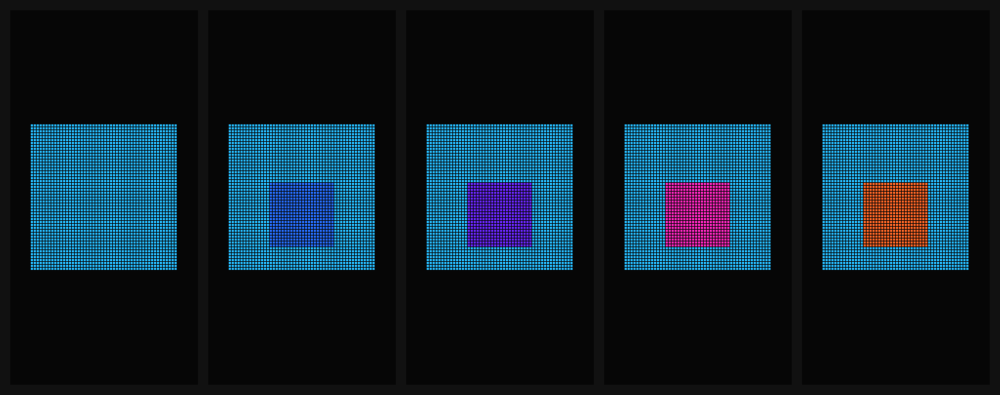
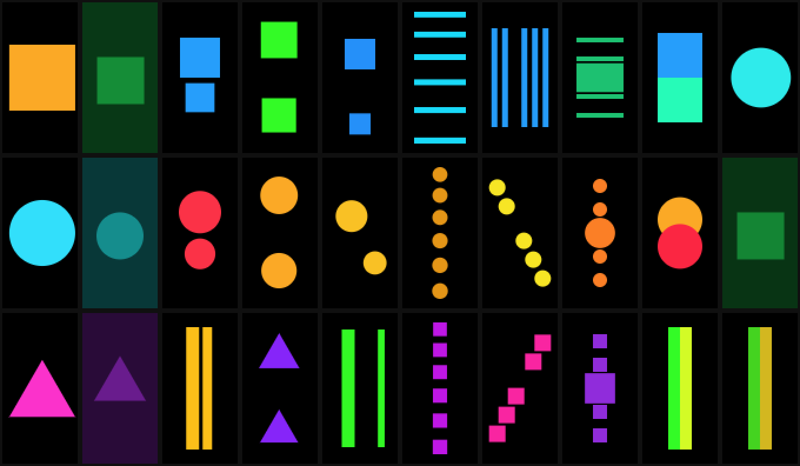

# 기초도형 연구, 다음 열 바퀴

140판부터 147판까지 여덟 바퀴가 패턴 스물네 개를 만들었어요. 연구 페이지가 여는 자리 그대로 나란히 놓으면 이래요.

첫 줄이 Slab, Disc, Bars, Stroke, Triangle, Ring, Sector, Trapezoid 이고, 둘째 줄이 Polygon, Lens, Conic, Rhombus, Segment, Sine, Dots, Arc, 셋째 줄이 Frame, Pill, Parallelogram, Ellipse, Spiral, Steps, Eccentric, Angle 이에요. 스물네 장이 카드 한 벌처럼 보여요. 11월 16일 저녁에 창작자가 「패턴 그렇게 만든것들 계속 똑같이만 하면 의미가 없어」라고 한 것이 이 그림이에요.

고를 것은 아래 「갈래 넷」에 있고 추천은 갈래 1 이에요. 패턴은 하나도 만들지 않았어요. 갈래마다 붙인 그림은 패턴 파일 없이 따로 그린 스케치예요.

## 무엇이 같았나

스물네 개 모두 꺼진 바탕에 색 하나이고 K1 이 Hue 예요. 나머지 노브 일흔둘을 하는 일로 나누면 이래요.

| 노브가 하는 일 | 개수 | 예 |
| --- | --- | --- |
| 길이 하나를 늘이고 줄여요 | 37 | Slab 의 Width, Frame 의 Wall |
| 도형을 돌려요 | 12 | Polygon 의 Turn, Stroke 의 Angle |
| 도형 안의 비나 각을 바꿔요 | 13 | Ring 의 Squash, Sector 의 Opening |
| 개수를 바꿔요 | 5 | Bars 의 Count, Polygon 의 Sides |
| 도형을 패널 위에서 옮겨요 | 3 | Disc 의 Across 와 Down, Stroke 의 Place |
| 간격을 바꿔요 | 2 | Bars 의 Gap, Dots 의 Reach |

길이가 반을 넘고, 스물네 패턴 가운데 열둘이 돌림 노브를 들고 있어요. Slab 을 돌려 본 손은 Pill 에서도 Frame 에서도 같은 일을 해요. 도형이 길어지거나 돌아요. 도형끼리의 사이를 정하는 노브는 간격 둘이 전부이고, 도형과 틀의 사이를 묻는 노브는 없어요.

바퀴가 새로 고른 것은 도형의 이름이었어요. README 의 계열 줄에 140판이 「이 바퀴부터는 계열이 아니라 서로 다른 기본 도형을 골라요」라고 적었고, 147판은 「140판에서 145판까지의 열여덟 도형과 같이 도는 146판의 셋 어디에도 없는 기본 도형 셋」이라고 적었어요. 이름이 앞 판에 없으면 새 패턴이었어요.

이름은 바닥을 보이고 있어요. Lens 는 K3 을 끝까지 돌리면 원이 돼서 Disc 와 같은 그림이에요. Rhombus 는 Triangle 이 되지 않게 대각선이 만나는 자리를 5분의 1 에서 멈췄고, Polygon 은 변이 셋과 넷인 자리를 뺐어요. Eccentric 의 Shift 는 -1 에서 Ring 과 같은 그림이에요. 147판이 다음 바퀴에 넘긴 후보는 점선과 꺾은선과 동심원인데, 셋 다 Bars 나 Sine 이나 Ring 과 갈리는지부터 재라는 말이 붙어 있어요.

같이 도는 바퀴끼리도 부딪혔어요. 141판 바퀴는 Slab 과 Disc 를 짰다가 140판이 먼저 들어와서 버렸어요. 142판 바퀴는 삼각형과 고리를 짜서 전체 검사까지 돌린 뒤에 141판에 내줬어요. 고를 것이 짧은 목록 한 줄이면 두 바퀴가 같은 것을 집어요.

### 앞의 열 바퀴는 반대쪽으로 넘쳤어요

130판의 바퀴 128 부터 139판까지 서른 개는 11월 15일 방향으로 만들었어요.

그때 바퀴가 고른 것은 원리의 이름이었어요. 139판의 계열 줄은 앞 바퀴와 겹치지 않는다는 낱말을 스물넷 늘어놓아요. 낱말이 떨어지자 화면을 채우는 타일(Tumbling Blocks, Over Under, Kagome Tiles, Running Bond, Tatami)로 갔고, 137판부터는 이름 붙은 정리(Varignon Nest, Viviani Wedges, Thales Lens, Napoleon Triangle, Cavalieri Chords, Fagnano Orbit, Ptolemy Split, Ceva Walk, Radical Axis)로 갔어요. 정리를 그리려면 원과 선과 점이 여럿 서야 해요.

열 때 켜진 LED 의 몫을 재면 두 묶음이 갈려요. 가장 밝은 채널이 48 이상인 LED 를 셌어요. 앞의 서른 개는 열다섯이 패널의 80퍼센트 넘게 켜요. 뒤의 스물네 개는 7퍼센트에서 38퍼센트 사이이고 가운데값이 19퍼센트예요. 11월 16일에 창작자가 「촌스럽고 지저분」하다고 한 것이 앞의 서른 개이고, 같은 날 저녁에 「똑같이만」이라고 한 것이 뒤의 스물네 개예요.

### 세 번 다 이름으로 새로움을 쟀어요

11월 10일에 창작자가 「매번 새롭게」를 바랐을 때 바퀴는 물리 현상의 이름이 겹치지 않게 골랐어요. 129판이 Martensite Tweed, Burridge-Knopoff, Quasipattern 이에요. 11월 15일 뒤에는 원리의 이름을, 11월 16일 뒤에는 도형의 이름을 그렇게 골랐어요. 이름은 끝없이 나오는데 그림은 닮아 가요. ROUND.md 도 「주제 여섯은 바닥나지 않아서, 고를 것이 없어 서는 바퀴는 없어요」라고 적어요. 그래서 아래 차례표에는 끝이 있어요. 열 바퀴를 돌면 바퀴는 다음 이름을 지어내지 않고 서요.

### 검사가 정한 것이 둘 있어요

스물네 개 모두 천천히 숨을 쉬어요. 방향은 멈춘 그림이어도 된다는 것인데 `study.ts` 의 움직임 문턱 0.004 가 멈춘 그림을 막아서 넣은 숨이에요. Triangle 은 5퍼센트 숨이 0.0036 으로 문턱 아래여서 밑변을 28 에서 33 LED 로 넓혔어요. 삼각형의 크기를 검사가 정했어요.

Lab 의 기본 노브 값은 0, 2, 0, 0.06 이에요. K4 가 0.06 에서 열려서, K4 에 돌림을 둔 도형은 조금 기운 채 열려요. Slab 이 9.0도, Polygon 이 8.6도, Lens 와 Conic 이 10.8도예요. 9도 기운 변은 LED 여섯 줄을 내려갈 때마다 옆으로 한 칸 밀려요.

### 스물네 개에서 건질 것

돌리다가 멈추게 되는 자리가 있는 노브가 몇 있어요. Triangle 의 Top 은 꼭대기를 옆으로 밀어도 넓이가 그대로이고, 꼭대기가 밑변 끝 위에 서는 자리에서 직각삼각형이 돼요. Ring 의 Squash 는 넓이를 지키면서 0.5 에서 정확한 원이 돼요. Conic 의 Eccentricity 는 노브 하나로 원에서 타원, 포물선, 쌍곡선을 차례로 지나가요. 길이 노브에서는 이런 자리가 표시 없이 지나가요. Slab 의 가로와 세로가 같아져 정사각형이 되는 자리가 그래요. 다음 열 바퀴는 이런 자리를 찾는 일이에요.

### 쓰는 사이에 149판이 들어왔어요

149판은 README 에 「이름 붙은 기본 도형은 거의 다 나왔어요」라고 적고, 나온 도형을 고쳐서 셋을 만들었어요. Reuleaux 는 변이 호로 부푼 삼각형이고 Chamfer 는 모서리를 깎은 사각형이에요. 셋째인 Tangent 는 원 하나와 선 하나예요. K3 Gap 이 0 에서 선이 원에 닿고, 왼쪽으로 돌리면 선이 원을 가로질러요. 도형 둘의 사이를 노브 하나가 지나가는 첫 패턴이고, 닿는 자리에서 열려요. 아래 지도의 2단이 이런 그림이에요. 같이 도는 148판(#428)은 점선과 동심원과 갈라 벌린 원을 맡았어요.

## 지도

패턴 하나를 도형과 물음으로 나눠요. 도형은 사각형, 원, 삼각형, 선 넷으로 닫고 새 이름을 더 고르지 않아요. 바퀴가 고르는 것은 물음이에요. 물음은 화면에 몇 개가 서느냐로 단을 나눠요.

| 단 | 화면에 서는 것 | 물음 | 지금까지 |
| --- | --- | --- | --- |
| 1 | 도형 하나와 틀 | 닿음과 잘림, 도형과 바탕 | 스물네 개가 이 단인데 틀은 묻지 않았어요 |
| 2 | 같은 도형 둘 | 사이, 몫, 무게, 두 색 | Lens 가 원 둘이 겹친 곳이고, 149판의 Tangent 가 원과 선이 닿는 자리예요 |
| 3 | 같은 도형 다섯에서 일곱이 한 줄 | 간격의 규칙, 묶음, 하나만 다름 | Bars, Dots, Steps 가 고른 줄이에요 |
| 4 | 면을 채우는 배열 | 격자, 타일 | 11월 16일 방향이 닫았고 여기서도 열지 않아요 |

스물네 개는 모두 틀을 피했어요. Disc 는 「지름을 키워도 원이 패널 밖으로 나가지 않아요」라고 적었고 Sector 는 「어느 쪽을 가리켜도 도형이 패널 안에 다 들어와요」라고 적었어요. 열 때 패널 가장자리의 LED 를 켜는 패턴은 처음부터 패널을 가로지르는 Stroke 와 Sine 둘이에요. 도형이 하나일 때 도형의 상대는 틀이에요. 그 사이를 아직 아무도 묻지 않았어요.

틀은 64 × 128 LED 예요. 지름 64 LED 인 원은 양쪽 옆벽에 닿고, 한 변이 64 LED 인 정사각형은 패널의 꼭 절반이에요. 모서리에서 맞은편 모서리로 가는 선은 가로 한 칸에 세로 두 칸씩 가요.

## 갈래 넷

### 갈래 1. 사이

단을 하나씩 올라가요. 도형 하나와 틀에서 두 바퀴, 도형 둘에서 세 바퀴, 한 줄에서 세 바퀴를 돌아요. 남은 두 바퀴는 색과 움직임을 한 번씩 해 봐요. 한 바퀴는 물음 하나를 도형 셋에 물어요.

1단의 첫 물음이에요. 원이 커져서 지름 64 LED 에서 양쪽 벽에 닿고, 더 커지면 틀이 원을 잘라요. 셋째 자리가 멈추는 자리예요.

2단의 첫 물음이에요. 사각형 둘이 다가와서 닿아요. 더 가면 겹친 곳이 꺼지고, 끝에서는 작은 것이 큰 것 안에 들어가 틀이 돼요. 노브 하나가 이 그림을 다 지나가요.

3단의 물음이에요. 왼쪽부터 고른 줄, 간격이 아래로 갈수록 좁아지는 줄, 틈 하나로 둘과 넷이 된 줄, 하나만 짧은 줄, 하나가 빠진 줄이에요.

바퀴마다 손이 하는 일이 달라져요. 열 바퀴 뒤에는 물음 열 개마다 도형 셋의 답이 있어서, 어느 물음이 이 패널에서 서는지 알아요. 걸리는 것은 11월 16일 방향의 「한 패턴은 도형 하나예요」예요. 3바퀴부터는 같은 도형 둘이 서고 6바퀴부터는 일곱까지 한 줄이 서요. 그 줄을 풀지는 창작자가 정해요. 풀지 않으면 갈래 1 은 2바퀴에서 끝나요.

### 갈래 2. 사각형 하나로 열 바퀴

도형을 사각형에 못 박고 물음만 바꿔요. 요제프 알베르스의 「정사각형에 바치는 경의」가 간 길이고, 133판의 Sunk Squares 가 그 연작에서 왔어요.

왼쪽부터 변의 비, 틀에 잘림, 벽의 두께, 모서리의 둥글기, 선 하나로 나눔이에요. 한 바퀴가 물음 하나에 노브 짜임이 다른 답 셋을 내고, 셋을 견줘 하나를 골라 README 에 적어요. 열 바퀴 뒤에 한 묶음으로 내놓을 사각형 열 개가 남아요. 걸리는 것은 연구 페이지예요. 사각형 서른 개가 나란히 서서 지금보다 더 닮아 보여요.

### 갈래 3. 두 색

모양을 큰 사각형 안의 작은 사각형에 못 박고 두 색의 사이만 물어요.

작은 사각형의 색이 큰 사각형의 색에서 멀어져요. 첫 자리는 같은 색이라 사각형이 하나로 보여요. 이 패널은 종이가 아니라 빛이에요. 펌웨어가 채도를 1.62배 올리고, 20/255 아래는 거의 안 보이고, 어두운 주황은 갈색으로 보여요. 열 바퀴 뒤에 이 패널에서 서는 두 색의 짝을 적은 표가 남고, 그 표는 다른 패턴도 써요. 걸리는 것은 눈이에요. 색은 실제 패널에서 봐야 아는데 바퀴는 `look.ts` 가 그린 `led.png` 로만 봐요.

### 갈래 4. 움직임 하나

도형 하나에 움직임 하나를 줘요. 11월 15일의 말은 「계속 움직일 필요는 없어」였고, 움직이지 말라는 말은 아니었어요. 창작자의 기본 프리셋은 움직임 가운데값이 0.66 인데([README](README.md) 의 「추려 보기」) 스물네 개는 0.005 에서 0.027 사이예요. K2 가 빠르기이고 0 에서 멈춰요. 넷 가운데 기기에 올라갈 패턴과 가장 가까워요. 걸리는 것은 11월 8일에 창작자가 싫다고 한 「한 사이클이 돌아가는」 그림이에요. 오가는 움직임은 사이클이 되기 쉬워요.

### 추천은 갈래 1 이에요

되풀이를 끊으려면 바퀴마다 손이 하는 일이 달라야 하고, 페이지에 나란히 선 그림도 달라야 해요. 갈래 1 은 물음과 같이 화면에 서는 수가 바뀌어요. 나머지 셋은 하나를 못 박아서 깊어지는 대신 페이지에서는 더 닮아 보여요. 갈래 1 의 9바퀴와 10바퀴가 갈래 3 과 갈래 4 를 한 번씩 해 보니, 열 바퀴 뒤에 어느 쪽을 깊게 팔지는 그림을 보고 골라요.

## 갈래 1 의 열 바퀴

방향이 ROUND.md 에 들어간 뒤 첫 바퀴가 차례 1 이고, 그 뒤로 바퀴 번호를 따라 하나씩 가요. 같이 도는 바퀴도 번호가 달라서 같은 물음을 집지 않아요.

| 차례 | 단 | 물음 | 도형 셋 | 멈추는 자리 |
| --- | --- | --- | --- | --- |
| 1 | 1 | 닿음과 잘림 | 사각형, 원, 삼각형 | 도형이 옆벽에 닿는 자리. 원은 지름 64 LED |
| 2 | 1 | 도형과 바탕 | 사각형, 원, 삼각형 | 도형과 바탕의 밝기가 같아져 도형이 사라지는 자리 |
| 3 | 2 | 사이 | 사각형 둘, 원 둘, 선 둘 | 둘이 닿는 자리, 한쪽이 다른 쪽 안에 다 드는 자리 |
| 4 | 2 | 몫 | 사각형 둘, 원 둘, 삼각형 둘 | 둘의 넓이가 같아지는 자리 |
| 5 | 2 | 무게 | 사각형 둘, 원 둘, 선 둘 | 켜진 LED 의 무게중심이 패널 한가운데 오는 자리 |
| 6 | 3 | 간격의 규칙 | 선, 원, 사각형의 줄 | 간격이 고른 자리, 가장 좁은 간격이 0 이 되는 자리 |
| 7 | 3 | 묶음 | 선, 원, 사각형의 줄 | 벌린 틈이 꼭 한 칸이 되어 하나가 빠진 줄과 같아지는 자리 |
| 8 | 3 | 하나만 다름 | 선, 원, 사각형의 줄 | 다른 하나가 이웃에 닿는 자리 |
| 9 | 2 | 두 색 | 3바퀴의 셋 | 같은 색이라 둘이 하나로 붙는 자리, 보색 |
| 10 | | 움직임 하나 | 앞 아홉 바퀴에서 고른 셋 | 움직임이 그 패턴의 멈추는 자리를 지날 때 느려져요 |

노브는 이렇게 걸어요. K1 은 열 바퀴 모두 색이에요.

| 차례 | K2 | K3 | K4 |
| --- | --- | --- | --- |
| 1 | 크기. 틀보다 작은 데서 틀을 넘는 데까지 | 세로 자리 | 가로로 치우친 정도 |
| 2 | 크기 | 뒤집기. 켜진 도형에서 켜진 바탕의 꺼진 구멍으로 | 가운데에서 치우친 정도 |
| 3 | 크기 | 둘의 거리. 떨어진 데서 한쪽이 다른 쪽에 드는 데까지 | 둘의 크기 차 |
| 4 | 둘의 넓이를 더한 값 | 한쪽의 몫. 한쪽이 커지면 다른 쪽이 작아져요 | 맞춤. 가운데 맞춤에서 한 변 맞춤으로 |
| 5 | 큰 도형의 크기 | 작은 도형이 가운데에서 떨어진 거리 | 작은 도형의 크기 |
| 6 | 개수 | 이웃 간격의 비. 0 에서 고른 줄 | 크기가 같은 비를 따라가는 정도 |
| 7 | 개수 | 벌어지는 틈의 자리 | 틈이 벌어진 정도 |
| 8 | 개수 | 다른 하나의 자리 | 다른 정도 |
| 9 | 크기 | 둘째 색이 첫 색에서 떨어진 각 | 둘째 색의 밝기 |
| 10 | 빠르기. 0 에서 멈춰요 | 오가는 폭 | 그 패턴의 K4 그대로 |

2바퀴는 바탕을 켜요. 패널을 흰색으로 다 켜면 펌웨어가 2.4 A 예산에 맞춰 밝기를 절반쯤으로 낮춰요. 켜진 바탕은 어둡게, 도형은 밝게 둬요.

3바퀴에서 겹친 곳은 꺼요. 켜 두면 둘이 한 덩어리가 돼서 둘로 읽히지 않아요. 선 둘은 나란히만 놓아요. 147판의 Angle 이 위를 향했을 때 「^」 로 읽혀서 고친 일이 있고, 엇갈린 선 둘도 글자로 읽혀요.

5바퀴의 무게중심은 재는 값이에요. 켜진 LED 의 자리를 밝기만큼 무게를 줘서 평균해요.

10바퀴는 앞 아홉 바퀴에서 멈추는 자리가 가장 또렷했던 패턴 셋을 골라, 시간이 K3 을 천천히 돌리게 해요. 빠르기 둘을 서로 나누어떨어지지 않게 써요. ROUND.md 의 11월 8일 글에 있는 방법이에요.

바퀴는 패턴 셋과 같이 README 의 판 절 끝에 한 줄을 남겨요. 그 물음이 어느 도형에서 가장 또렷했는지와 멈추는 자리가 몇 LED 였는지예요. 열 줄이 모이면 창작자가 다음을 고를 때 보는 표가 돼요.

열 바퀴가 끝나면 바퀴는 서요. 창작자가 서른 개를 보고 물음을 고르면, 그 물음을 갈래 2 처럼 깊게 파는 표를 그때 새로 짜요.

## 노브 넷의 짜임

지금은 K1 이 Hue 이고 남은 셋에 그 도형의 값을 채웠어요. 다음부터는 노브마다 맡는 일을 못 박아요. 흐르는 장 때 ROUND.md 가 K2 를 흐름 세기에, K3 을 크기에 못 박은 것과 같은 방식이에요.

| 노브 | 맡는 일 | 범위와 열리는 자리 |
| --- | --- | --- |
| K1 | 색 | 0 에서 열려요. 색상에 덧셈을 넣어 빨강이 아닌 색에서 열어요 |
| K2 | 크기나 개수 | 0..3 으로 잡으면 2 에서 열려요. 범위의 3분의 2 자리예요 |
| K3 | 그 바퀴의 물음 | -1..1 로 잡으면 한가운데 0 에서 열려요 |
| K4 | 어긋남 | 0..1 로 잡으면 0.06 에서 열려요. 거의 반듯한 자리예요 |

패턴을 바꿔도 K3 을 돌리면 그 패턴의 물음이 움직이고, K4 를 올리면 반듯하던 것이 어긋나요. Lab 의 기본값 0, 2, 0, 0.06 이 이 짜임에 그대로 맞아요.

여기에 넷을 더 지켜요.

1. 길이 노브는 한 패턴에 둘까지예요. Trapezoid 와 Sine 과 Frame 은 K2, K3, K4 가 모두 길이였어요.
2. 돌림은 물음이 돌림일 때만 써요. Polygon 의 Turn 은 범위를 144도로 늘리고 채도를 내린 뒤에야 반응이 0.032 가 됐어요. 쓴다면 가로, 세로, 45도와 패널의 대각선에서 서게 해요.
3. K3 은 멈추는 자리를 지나가요. 기기의 노브는 딸깍 48칸에 범위 전체를 가요. 멈추는 자리에 두 칸을 붙여 둬서 손이 지나치지 않게 하고, 열 때는 그 자리 바로 앞에서 열어요.
4. 노브 하나가 값 둘을 맞바꿔도 돼요. 한쪽이 커지면 다른 쪽이 작아지고 합은 그대로예요. Triangle 의 Top 과 Rhombus 의 Cross 가 넓이를 그렇게 지켰어요.

## 단순함을 재는 법

잣대는 11월 16일 방향의 「더 뺄 것이 없나」 그대로예요. 바퀴는 이 말을 도형 이름 하나로 읽었어요. 물음을 놓고 읽으면 달라져요. 사각형 둘이 닿는 그림에서 하나를 빼면 닿음이 없어져요. 뺄 것이 없으니 둘이 가장 적은 수예요.

패턴마다 넷을 봐요.

1. 한 문장으로 말해요. 「원이 커져서 벽에 닿는다」처럼 도형과 물음이 한 문장에 들어가고, 그 문장에 「그리고」가 없어요.
2. 하나씩 빼 봐요. 도형 하나나 노브 하나를 뺐을 때 그 문장이 그대로면 빼요.
3. 세어져요. 화면에 선 것이 일곱을 넘지 않고 색은 바탕 말고 둘까지예요.
4. 손이 멈춰요. K3 을 끝에서 끝까지 돌리는 동안 멈추게 되는 자리가 하나는 있어요.

새로운지는 이름으로 재지 않아요. 앞 판에 물음도 같고 도형도 같은 패턴이 있으면 새롭지 않아요. README 의 계열 줄에는 판마다 `물음 · 도형 셋 · K2 K3 K4 가 하는 일` 을 적어서 다음 바퀴가 그 줄로 견줘요.

## 창작자가 정할 것

[ROUND.md](ROUND.md) 와 `tools/` 는 창작자 몫이라 고치지 않았어요. 정할 것이 넷이에요.

1. 갈래. 추천은 갈래 1 이에요.
2. 「한 패턴은 도형 하나예요」를 풀지. 갈래 1 은 3바퀴부터 같은 도형 둘이, 6바퀴부터 일곱까지 한 줄이 서요.
3. 숨. 멈춘 그림이라고 머리에 적은 패턴은 `study.ts` 가 움직임 문턱을 재지 않게 하면 숨이 빠져요. 그대로 두면 바퀴는 지금처럼 숨을 넣어요.
4. 열 바퀴 뒤에 세울지. 차례표가 끝난 바퀴가 새 물음을 지어내면 이름 고르기가 다시 시작돼요.

## 다음 서른 바퀴

「사이」 열 바퀴는 150판부터 159판까지 패턴 서른 개를 남겼어요. 연구 페이지가 여는 자리 그대로 놓으면 이래요. 세로 한 칸이 한 바퀴이고, 왼쪽이 150판이에요.

차례표가 열째에서 끝나서 158바퀴와 159바퀴는 새 패턴 없이 섰어요. 11월 18일에 창작자가 「그냥 패턴 더 많이 새로운거 만들게 시켜봐」라고 했어요. 아래가 160바퀴부터 쓰는 표예요. 패턴은 하나도 만들지 않았고, 붙인 그림은 패턴 파일 없이 따로 그린 스케치예요.

### 서른 개에서 본 것

세로 칸을 내려 읽으면 셋이 같은 그림이에요. 한 바퀴가 물음 하나를 도형 셋에 물었고, 셋은 도형만 바꿨어요. 153판의 Quota 와 Moiety 와 Allot 는 README 의 한 줄이 도형 이름 말고는 글자까지 같아요. 155판부터 157판까지 아홉 개는 다섯이나 여섯 개가 선 줄이에요.

서른 개 모두 패널 한가운데에 서요. 열 때 그림의 가운데가 패널 가운데에서 가로로 2 LED, 세로로 9 LED 안에 있어요. 그림이 차지하는 몫은 11퍼센트에서 39퍼센트 사이예요. 틀의 구석과 가장자리는 비어 있고, 패널보다 큰 그림도 없어요.

멈추는 자리는 둘로 갈렸어요. K3 을 48칸 훑으며 화면에 선 덩어리를 셌어요. 152판은 닿는 칸에서 둘이 하나가 되고 157판은 다섯이 셋이 돼요. 151판은 한 칸에 도형이 통째로 사라지고 158판은 이음새가 사라져요. 153판과 154판과 156판은 끝에서 끝까지 돌려도 덩어리 수가 그대로예요. 그 세 판의 멈추는 자리는 길이 둘이 같아지는 자리예요. 넓이가 같아지거나, 무게중심이 가운데 오거나, 틈이 한 칸이 돼요. 화면에서는 아무 일도 일어나지 않아서 그 판들도 README 에 「눈으로 가려내기는 어렵고」라고 적었어요.

노브 한 칸이 작았어요. 156판과 157판은 한 칸에 0.3 LED 쯤 움직였어요. 덩어리가 붙는 157판도 그래서 눈이 못 가려냈어요.
