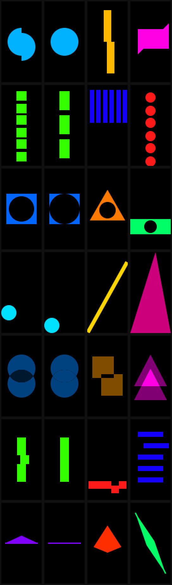
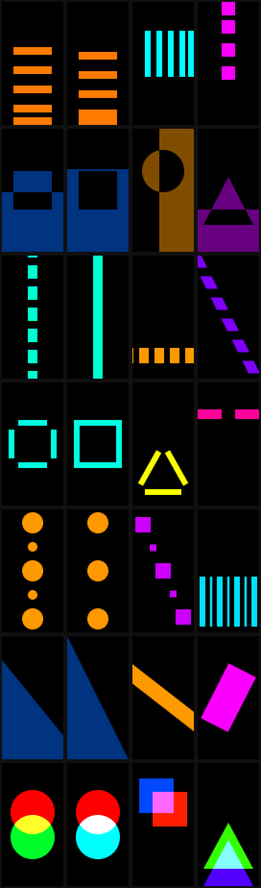
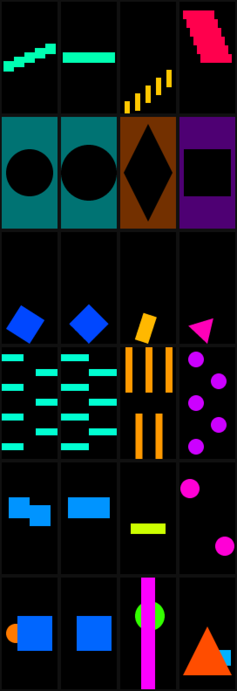

# 기초도형 연구, 다음 열 바퀴

160바퀴부터 쓰는 표는 맨 아래 「다음 스물여섯 바퀴」에 있어요. 그 위는 148바퀴부터 157바퀴까지 쓴 표와 그 표를 고른 까닭이에요.

140판부터 147판까지 여덟 바퀴가 패턴 스물네 개를 만들었어요. 연구 페이지가 여는 자리 그대로 나란히 놓으면 이래요.

첫 줄이 Slab, Disc, Bars, Stroke, Triangle, Ring, Sector, Trapezoid 이고, 둘째 줄이 Polygon, Lens, Conic, Rhombus, Segment, Sine, Dots, Arc, 셋째 줄이 Frame, Pill, Parallelogram, Ellipse, Spiral, Steps, Eccentric, Angle 이에요. 스물네 장이 카드 한 벌처럼 보여요. 11월 16일 저녁에 창작자가 「패턴 그렇게 만든것들 계속 똑같이만 하면 의미가 없어」라고 한 것이 이 그림이에요.

고를 것은 아래 「갈래 넷」에 있고 추천은 갈래 1 이에요. 패턴은 하나도 만들지 않았어요. 갈래마다 붙인 그림은 패턴 파일 없이 따로 그린 스케치예요.

## 무엇이 같았나

스물네 개 모두 꺼진 바탕에 색 하나이고 K1 이 Hue 예요. 나머지 노브 일흔둘을 하는 일로 나누면 이래요.

| 노브가 하는 일 | 개수 | 예 |
| --- | --- | --- |
| 길이 하나를 늘이고 줄여요 | 37 | Slab 의 Width, Frame 의 Wall |
| 도형을 돌려요 | 12 | Polygon 의 Turn, Stroke 의 Angle |
| 도형 안의 비나 각을 바꿔요 | 13 | Ring 의 Squash, Sector 의 Opening |
| 개수를 바꿔요 | 5 | Bars 의 Count, Polygon 의 Sides |
| 도형을 패널 위에서 옮겨요 | 3 | Disc 의 Across 와 Down, Stroke 의 Place |
| 간격을 바꿔요 | 2 | Bars 의 Gap, Dots 의 Reach |

길이가 반을 넘고, 스물네 패턴 가운데 열둘이 돌림 노브를 들고 있어요. Slab 을 돌려 본 손은 Pill 에서도 Frame 에서도 같은 일을 해요. 도형이 길어지거나 돌아요. 도형끼리의 사이를 정하는 노브는 간격 둘이 전부이고, 도형과 틀의 사이를 묻는 노브는 없어요.

바퀴가 새로 고른 것은 도형의 이름이었어요. README 의 계열 줄에 140판이 「이 바퀴부터는 계열이 아니라 서로 다른 기본 도형을 골라요」라고 적었고, 147판은 「140판에서 145판까지의 열여덟 도형과 같이 도는 146판의 셋 어디에도 없는 기본 도형 셋」이라고 적었어요. 이름이 앞 판에 없으면 새 패턴이었어요.

이름은 바닥을 보이고 있어요. Lens 는 K3 을 끝까지 돌리면 원이 돼서 Disc 와 같은 그림이에요. Rhombus 는 Triangle 이 되지 않게 대각선이 만나는 자리를 5분의 1 에서 멈췄고, Polygon 은 변이 셋과 넷인 자리를 뺐어요. Eccentric 의 Shift 는 -1 에서 Ring 과 같은 그림이에요. 147판이 다음 바퀴에 넘긴 후보는 점선과 꺾은선과 동심원인데, 셋 다 Bars 나 Sine 이나 Ring 과 갈리는지부터 재라는 말이 붙어 있어요.

같이 도는 바퀴끼리도 부딪혔어요. 141판 바퀴는 Slab 과 Disc 를 짰다가 140판이 먼저 들어와서 버렸어요. 142판 바퀴는 삼각형과 고리를 짜서 전체 검사까지 돌린 뒤에 141판에 내줬어요. 고를 것이 짧은 목록 한 줄이면 두 바퀴가 같은 것을 집어요.

### 앞의 열 바퀴는 반대쪽으로 넘쳤어요

130판의 바퀴 128 부터 139판까지 서른 개는 11월 15일 방향으로 만들었어요.

그때 바퀴가 고른 것은 원리의 이름이었어요. 139판의 계열 줄은 앞 바퀴와 겹치지 않는다는 낱말을 스물넷 늘어놓아요. 낱말이 떨어지자 화면을 채우는 타일(Tumbling Blocks, Over Under, Kagome Tiles, Running Bond, Tatami)로 갔고, 137판부터는 이름 붙은 정리(Varignon Nest, Viviani Wedges, Thales Lens, Napoleon Triangle, Cavalieri Chords, Fagnano Orbit, Ptolemy Split, Ceva Walk, Radical Axis)로 갔어요. 정리를 그리려면 원과 선과 점이 여럿 서야 해요.

열 때 켜진 LED 의 몫을 재면 두 묶음이 갈려요. 가장 밝은 채널이 48 이상인 LED 를 셌어요. 앞의 서른 개는 열다섯이 패널의 80퍼센트 넘게 켜요. 뒤의 스물네 개는 7퍼센트에서 38퍼센트 사이이고 가운데값이 19퍼센트예요. 11월 16일에 창작자가 「촌스럽고 지저분」하다고 한 것이 앞의 서른 개이고, 같은 날 저녁에 「똑같이만」이라고 한 것이 뒤의 스물네 개예요.

### 세 번 다 이름으로 새로움을 쟀어요

11월 10일에 창작자가 「매번 새롭게」를 바랐을 때 바퀴는 물리 현상의 이름이 겹치지 않게 골랐어요. 129판이 Martensite Tweed, Burridge-Knopoff, Quasipattern 이에요. 11월 15일 뒤에는 원리의 이름을, 11월 16일 뒤에는 도형의 이름을 그렇게 골랐어요. 이름은 끝없이 나오는데 그림은 닮아 가요. ROUND.md 도 「주제 여섯은 바닥나지 않아서, 고를 것이 없어 서는 바퀴는 없어요」라고 적어요. 그래서 아래 차례표에는 끝이 있어요. 열 바퀴를 돌면 바퀴는 다음 이름을 지어내지 않고 서요.

### 검사가 정한 것이 둘 있어요

스물네 개 모두 천천히 숨을 쉬어요. 방향은 멈춘 그림이어도 된다는 것인데 `study.ts` 의 움직임 문턱 0.004 가 멈춘 그림을 막아서 넣은 숨이에요. Triangle 은 5퍼센트 숨이 0.0036 으로 문턱 아래여서 밑변을 28 에서 33 LED 로 넓혔어요. 삼각형의 크기를 검사가 정했어요.

Lab 의 기본 노브 값은 0, 2, 0, 0.06 이에요. K4 가 0.06 에서 열려서, K4 에 돌림을 둔 도형은 조금 기운 채 열려요. Slab 이 9.0도, Polygon 이 8.6도, Lens 와 Conic 이 10.8도예요. 9도 기운 변은 LED 여섯 줄을 내려갈 때마다 옆으로 한 칸 밀려요.

### 스물네 개에서 건질 것

돌리다가 멈추게 되는 자리가 있는 노브가 몇 있어요. Triangle 의 Top 은 꼭대기를 옆으로 밀어도 넓이가 그대로이고, 꼭대기가 밑변 끝 위에 서는 자리에서 직각삼각형이 돼요. Ring 의 Squash 는 넓이를 지키면서 0.5 에서 정확한 원이 돼요. Conic 의 Eccentricity 는 노브 하나로 원에서 타원, 포물선, 쌍곡선을 차례로 지나가요. 길이 노브에서는 이런 자리가 표시 없이 지나가요. Slab 의 가로와 세로가 같아져 정사각형이 되는 자리가 그래요. 다음 열 바퀴는 이런 자리를 찾는 일이에요.

### 쓰는 사이에 149판이 들어왔어요

149판은 README 에 「이름 붙은 기본 도형은 거의 다 나왔어요」라고 적고, 나온 도형을 고쳐서 셋을 만들었어요. Reuleaux 는 변이 호로 부푼 삼각형이고 Chamfer 는 모서리를 깎은 사각형이에요. 셋째인 Tangent 는 원 하나와 선 하나예요. K3 Gap 이 0 에서 선이 원에 닿고, 왼쪽으로 돌리면 선이 원을 가로질러요. 도형 둘의 사이를 노브 하나가 지나가는 첫 패턴이고, 닿는 자리에서 열려요. 아래 지도의 2단이 이런 그림이에요. 같이 도는 148판(#428)은 점선과 동심원과 갈라 벌린 원을 맡았어요.

## 지도

패턴 하나를 도형과 물음으로 나눠요. 도형은 사각형, 원, 삼각형, 선 넷으로 닫고 새 이름을 더 고르지 않아요. 바퀴가 고르는 것은 물음이에요. 물음은 화면에 몇 개가 서느냐로 단을 나눠요.

| 단 | 화면에 서는 것 | 물음 | 지금까지 |
| --- | --- | --- | --- |
| 1 | 도형 하나와 틀 | 닿음과 잘림, 도형과 바탕 | 스물네 개가 이 단인데 틀은 묻지 않았어요 |
| 2 | 같은 도형 둘 | 사이, 몫, 무게, 두 색 | Lens 가 원 둘이 겹친 곳이고, 149판의 Tangent 가 원과 선이 닿는 자리예요 |
| 3 | 같은 도형 다섯에서 일곱이 한 줄 | 간격의 규칙, 묶음, 하나만 다름 | Bars, Dots, Steps 가 고른 줄이에요 |
| 4 | 면을 채우는 배열 | 격자, 타일 | 11월 16일 방향이 닫았고 여기서도 열지 않아요 |

스물네 개는 모두 틀을 피했어요. Disc 는 「지름을 키워도 원이 패널 밖으로 나가지 않아요」라고 적었고 Sector 는 「어느 쪽을 가리켜도 도형이 패널 안에 다 들어와요」라고 적었어요. 열 때 패널 가장자리의 LED 를 켜는 패턴은 처음부터 패널을 가로지르는 Stroke 와 Sine 둘이에요. 도형이 하나일 때 도형의 상대는 틀이에요. 그 사이를 아직 아무도 묻지 않았어요.

틀은 64 × 128 LED 예요. 지름 64 LED 인 원은 양쪽 옆벽에 닿고, 한 변이 64 LED 인 정사각형은 패널의 꼭 절반이에요. 모서리에서 맞은편 모서리로 가는 선은 가로 한 칸에 세로 두 칸씩 가요.

## 갈래 넷

### 갈래 1. 사이

단을 하나씩 올라가요. 도형 하나와 틀에서 두 바퀴, 도형 둘에서 세 바퀴, 한 줄에서 세 바퀴를 돌아요. 남은 두 바퀴는 색과 움직임을 한 번씩 해 봐요. 한 바퀴는 물음 하나를 도형 셋에 물어요.

1단의 첫 물음이에요. 원이 커져서 지름 64 LED 에서 양쪽 벽에 닿고, 더 커지면 틀이 원을 잘라요. 셋째 자리가 멈추는 자리예요.

2단의 첫 물음이에요. 사각형 둘이 다가와서 닿아요. 더 가면 겹친 곳이 꺼지고, 끝에서는 작은 것이 큰 것 안에 들어가 틀이 돼요. 노브 하나가 이 그림을 다 지나가요.

3단의 물음이에요. 왼쪽부터 고른 줄, 간격이 아래로 갈수록 좁아지는 줄, 틈 하나로 둘과 넷이 된 줄, 하나만 짧은 줄, 하나가 빠진 줄이에요.

바퀴마다 손이 하는 일이 달라져요. 열 바퀴 뒤에는 물음 열 개마다 도형 셋의 답이 있어서, 어느 물음이 이 패널에서 서는지 알아요. 걸리는 것은 11월 16일 방향의 「한 패턴은 도형 하나예요」예요. 3바퀴부터는 같은 도형 둘이 서고 6바퀴부터는 일곱까지 한 줄이 서요. 그 줄을 풀지는 창작자가 정해요. 풀지 않으면 갈래 1 은 2바퀴에서 끝나요.

### 갈래 2. 사각형 하나로 열 바퀴

도형을 사각형에 못 박고 물음만 바꿔요. 요제프 알베르스의 「정사각형에 바치는 경의」가 간 길이고, 133판의 Sunk Squares 가 그 연작에서 왔어요.

왼쪽부터 변의 비, 틀에 잘림, 벽의 두께, 모서리의 둥글기, 선 하나로 나눔이에요. 한 바퀴가 물음 하나에 노브 짜임이 다른 답 셋을 내고, 셋을 견줘 하나를 골라 README 에 적어요. 열 바퀴 뒤에 한 묶음으로 내놓을 사각형 열 개가 남아요. 걸리는 것은 연구 페이지예요. 사각형 서른 개가 나란히 서서 지금보다 더 닮아 보여요.

### 갈래 3. 두 색

모양을 큰 사각형 안의 작은 사각형에 못 박고 두 색의 사이만 물어요.

작은 사각형의 색이 큰 사각형의 색에서 멀어져요. 첫 자리는 같은 색이라 사각형이 하나로 보여요. 이 패널은 종이가 아니라 빛이에요. 펌웨어가 채도를 1.62배 올리고, 20/255 아래는 거의 안 보이고, 어두운 주황은 갈색으로 보여요. 열 바퀴 뒤에 이 패널에서 서는 두 색의 짝을 적은 표가 남고, 그 표는 다른 패턴도 써요. 걸리는 것은 눈이에요. 색은 실제 패널에서 봐야 아는데 바퀴는 `look.ts` 가 그린 `led.png` 로만 봐요.

### 갈래 4. 움직임 하나

도형 하나에 움직임 하나를 줘요. 11월 15일의 말은 「계속 움직일 필요는 없어」였고, 움직이지 말라는 말은 아니었어요. 창작자의 기본 프리셋은 움직임 가운데값이 0.66 인데([README](README.md) 의 「추려 보기」) 스물네 개는 0.005 에서 0.027 사이예요. K2 가 빠르기이고 0 에서 멈춰요. 넷 가운데 기기에 올라갈 패턴과 가장 가까워요. 걸리는 것은 11월 8일에 창작자가 싫다고 한 「한 사이클이 돌아가는」 그림이에요. 오가는 움직임은 사이클이 되기 쉬워요.

### 추천은 갈래 1 이에요

되풀이를 끊으려면 바퀴마다 손이 하는 일이 달라야 하고, 페이지에 나란히 선 그림도 달라야 해요. 갈래 1 은 물음과 같이 화면에 서는 수가 바뀌어요. 나머지 셋은 하나를 못 박아서 깊어지는 대신 페이지에서는 더 닮아 보여요. 갈래 1 의 9바퀴와 10바퀴가 갈래 3 과 갈래 4 를 한 번씩 해 보니, 열 바퀴 뒤에 어느 쪽을 깊게 팔지는 그림을 보고 골라요.

## 갈래 1 의 열 바퀴

방향이 ROUND.md 에 들어간 뒤 첫 바퀴가 차례 1 이고, 그 뒤로 바퀴 번호를 따라 하나씩 가요. 같이 도는 바퀴도 번호가 달라서 같은 물음을 집지 않아요.

| 차례 | 단 | 물음 | 도형 셋 | 멈추는 자리 |
| --- | --- | --- | --- | --- |
| 1 | 1 | 닿음과 잘림 | 사각형, 원, 삼각형 | 도형이 옆벽에 닿는 자리. 원은 지름 64 LED |
| 2 | 1 | 도형과 바탕 | 사각형, 원, 삼각형 | 도형과 바탕의 밝기가 같아져 도형이 사라지는 자리 |
| 3 | 2 | 사이 | 사각형 둘, 원 둘, 선 둘 | 둘이 닿는 자리, 한쪽이 다른 쪽 안에 다 드는 자리 |
| 4 | 2 | 몫 | 사각형 둘, 원 둘, 삼각형 둘 | 둘의 넓이가 같아지는 자리 |
| 5 | 2 | 무게 | 사각형 둘, 원 둘, 선 둘 | 켜진 LED 의 무게중심이 패널 한가운데 오는 자리 |
| 6 | 3 | 간격의 규칙 | 선, 원, 사각형의 줄 | 간격이 고른 자리, 가장 좁은 간격이 0 이 되는 자리 |
| 7 | 3 | 묶음 | 선, 원, 사각형의 줄 | 벌린 틈이 꼭 한 칸이 되어 하나가 빠진 줄과 같아지는 자리 |
| 8 | 3 | 하나만 다름 | 선, 원, 사각형의 줄 | 다른 하나가 이웃에 닿는 자리 |
| 9 | 2 | 두 색 | 3바퀴의 셋 | 같은 색이라 둘이 하나로 붙는 자리, 보색 |
| 10 | | 움직임 하나 | 앞 아홉 바퀴에서 고른 셋 | 움직임이 그 패턴의 멈추는 자리를 지날 때 느려져요 |

노브는 이렇게 걸어요. K1 은 열 바퀴 모두 색이에요.

| 차례 | K2 | K3 | K4 |
| --- | --- | --- | --- |
| 1 | 크기. 틀보다 작은 데서 틀을 넘는 데까지 | 세로 자리 | 가로로 치우친 정도 |
| 2 | 크기 | 뒤집기. 켜진 도형에서 켜진 바탕의 꺼진 구멍으로 | 가운데에서 치우친 정도 |
| 3 | 크기 | 둘의 거리. 떨어진 데서 한쪽이 다른 쪽에 드는 데까지 | 둘의 크기 차 |
| 4 | 둘의 넓이를 더한 값 | 한쪽의 몫. 한쪽이 커지면 다른 쪽이 작아져요 | 맞춤. 가운데 맞춤에서 한 변 맞춤으로 |
| 5 | 큰 도형의 크기 | 작은 도형이 가운데에서 떨어진 거리 | 작은 도형의 크기 |
| 6 | 개수 | 이웃 간격의 비. 0 에서 고른 줄 | 크기가 같은 비를 따라가는 정도 |
| 7 | 개수 | 벌어지는 틈의 자리 | 틈이 벌어진 정도 |
| 8 | 개수 | 다른 하나의 자리 | 다른 정도 |
| 9 | 크기 | 둘째 색이 첫 색에서 떨어진 각 | 둘째 색의 밝기 |
| 10 | 빠르기. 0 에서 멈춰요 | 오가는 폭 | 그 패턴의 K4 그대로 |

2바퀴는 바탕을 켜요. 패널을 흰색으로 다 켜면 펌웨어가 2.4 A 예산에 맞춰 밝기를 절반쯤으로 낮춰요. 켜진 바탕은 어둡게, 도형은 밝게 둬요.

3바퀴에서 겹친 곳은 꺼요. 켜 두면 둘이 한 덩어리가 돼서 둘로 읽히지 않아요. 선 둘은 나란히만 놓아요. 147판의 Angle 이 위를 향했을 때 「^」 로 읽혀서 고친 일이 있고, 엇갈린 선 둘도 글자로 읽혀요.

5바퀴의 무게중심은 재는 값이에요. 켜진 LED 의 자리를 밝기만큼 무게를 줘서 평균해요.

10바퀴는 앞 아홉 바퀴에서 멈추는 자리가 가장 또렷했던 패턴 셋을 골라, 시간이 K3 을 천천히 돌리게 해요. 빠르기 둘을 서로 나누어떨어지지 않게 써요. ROUND.md 의 11월 8일 글에 있는 방법이에요.

바퀴는 패턴 셋과 같이 README 의 판 절 끝에 한 줄을 남겨요. 그 물음이 어느 도형에서 가장 또렷했는지와 멈추는 자리가 몇 LED 였는지예요. 열 줄이 모이면 창작자가 다음을 고를 때 보는 표가 돼요.

열 바퀴가 끝나면 바퀴는 서요. 창작자가 서른 개를 보고 물음을 고르면, 그 물음을 갈래 2 처럼 깊게 파는 표를 그때 새로 짜요.

## 노브 넷의 짜임

지금은 K1 이 Hue 이고 남은 셋에 그 도형의 값을 채웠어요. 다음부터는 노브마다 맡는 일을 못 박아요. 흐르는 장 때 ROUND.md 가 K2 를 흐름 세기에, K3 을 크기에 못 박은 것과 같은 방식이에요.

| 노브 | 맡는 일 | 범위와 열리는 자리 |
| --- | --- | --- |
| K1 | 색 | 0 에서 열려요. 색상에 덧셈을 넣어 빨강이 아닌 색에서 열어요 |
| K2 | 크기나 개수 | 0..3 으로 잡으면 2 에서 열려요. 범위의 3분의 2 자리예요 |
| K3 | 그 바퀴의 물음 | -1..1 로 잡으면 한가운데 0 에서 열려요 |
| K4 | 어긋남 | 0..1 로 잡으면 0.06 에서 열려요. 거의 반듯한 자리예요 |

패턴을 바꿔도 K3 을 돌리면 그 패턴의 물음이 움직이고, K4 를 올리면 반듯하던 것이 어긋나요. Lab 의 기본값 0, 2, 0, 0.06 이 이 짜임에 그대로 맞아요.

여기에 넷을 더 지켜요.

1. 길이 노브는 한 패턴에 둘까지예요. Trapezoid 와 Sine 과 Frame 은 K2, K3, K4 가 모두 길이였어요.
2. 돌림은 물음이 돌림일 때만 써요. Polygon 의 Turn 은 범위를 144도로 늘리고 채도를 내린 뒤에야 반응이 0.032 가 됐어요. 쓴다면 가로, 세로, 45도와 패널의 대각선에서 서게 해요.
3. K3 은 멈추는 자리를 지나가요. 기기의 노브는 딸깍 48칸에 범위 전체를 가요. 멈추는 자리에 두 칸을 붙여 둬서 손이 지나치지 않게 하고, 열 때는 그 자리 바로 앞에서 열어요.
4. 노브 하나가 값 둘을 맞바꿔도 돼요. 한쪽이 커지면 다른 쪽이 작아지고 합은 그대로예요. Triangle 의 Top 과 Rhombus 의 Cross 가 넓이를 그렇게 지켰어요.

## 단순함을 재는 법

잣대는 11월 16일 방향의 「더 뺄 것이 없나」 그대로예요. 바퀴는 이 말을 도형 이름 하나로 읽었어요. 물음을 놓고 읽으면 달라져요. 사각형 둘이 닿는 그림에서 하나를 빼면 닿음이 없어져요. 뺄 것이 없으니 둘이 가장 적은 수예요.

패턴마다 넷을 봐요.

1. 한 문장으로 말해요. 「원이 커져서 벽에 닿는다」처럼 도형과 물음이 한 문장에 들어가고, 그 문장에 「그리고」가 없어요.
2. 하나씩 빼 봐요. 도형 하나나 노브 하나를 뺐을 때 그 문장이 그대로면 빼요.
3. 세어져요. 화면에 선 것이 일곱을 넘지 않고 색은 바탕 말고 둘까지예요.
4. 손이 멈춰요. K3 을 끝에서 끝까지 돌리는 동안 멈추게 되는 자리가 하나는 있어요.

새로운지는 이름으로 재지 않아요. 앞 판에 물음도 같고 도형도 같은 패턴이 있으면 새롭지 않아요. README 의 계열 줄에는 판마다 `물음 · 도형 셋 · K2 K3 K4 가 하는 일` 을 적어서 다음 바퀴가 그 줄로 견줘요.

## 창작자가 정할 것

[ROUND.md](ROUND.md) 와 `tools/` 는 창작자 몫이라 고치지 않았어요. 정할 것이 넷이에요.

1. 갈래. 추천은 갈래 1 이에요.
2. 「한 패턴은 도형 하나예요」를 풀지. 갈래 1 은 3바퀴부터 같은 도형 둘이, 6바퀴부터 일곱까지 한 줄이 서요.
3. 숨. 멈춘 그림이라고 머리에 적은 패턴은 `study.ts` 가 움직임 문턱을 재지 않게 하면 숨이 빠져요. 그대로 두면 바퀴는 지금처럼 숨을 넣어요.
4. 열 바퀴 뒤에 세울지. 차례표가 끝난 바퀴가 새 물음을 지어내면 이름 고르기가 다시 시작돼요.

## 다음 스물여섯 바퀴

「사이」 열 바퀴는 150판부터 159판까지 패턴 서른 개를 남겼어요. 연구 페이지가 여는 자리 그대로 놓으면 이래요. 세로 한 칸이 한 바퀴이고, 왼쪽이 150판이에요.

차례표가 열째에서 끝나서 158바퀴와 159바퀴는 새 패턴 없이 섰어요. 11월 18일에 창작자가 「그냥 패턴 더 많이 새로운거 만들게 시켜봐」라고 했어요. 아래가 160바퀴부터 쓰는 표예요. 스물여섯 줄이고 185바퀴에서 끝나요. 패턴은 하나도 만들지 않았고, 붙인 그림은 패턴 파일 없이 따로 그린 스케치예요.

### 서른 개에서 본 것

세로 칸을 내려 읽으면 셋이 같은 그림이에요. 한 바퀴가 물음 하나를 도형 셋에 물었고, 셋은 도형만 바꿨어요. 153판의 Quota 와 Moiety 와 Allot 는 README 의 한 줄이 도형 이름 말고는 글자까지 같아요. 155판부터 157판까지 아홉 개는 다섯이나 여섯 개가 선 줄이에요.

서른 개 모두 패널 한가운데에 서요. 열 때 그림의 가운데가 패널 가운데에서 가로로 2 LED, 세로로 9 LED 안에 있어요. 그림이 차지하는 몫은 11퍼센트에서 39퍼센트 사이예요. 틀의 구석과 가장자리는 비어 있고, 패널보다 큰 그림도 없어요.

멈추는 자리는 둘로 갈렸어요. K3 을 48칸 훑으며 화면에 선 덩어리를 셌어요. 가장 밝은 채널이 48 이상인 LED 가 위아래와 옆으로 이어진 것이 한 덩어리예요. 152판은 닿는 칸에서 둘이 하나가 되고 157판은 다섯이 셋이 돼요. README 가 적은 대로 151판은 한 칸에 도형이 통째로 사라지고 158판은 이음새가 사라져요. 153판과 154판과 156판은 끝에서 끝까지 돌려도 덩어리 수가 그대로예요. 그 세 판의 멈추는 자리는 길이 둘이 같아지는 자리예요. 넓이가 같아지거나, 무게중심이 가운데 오거나, 틈이 한 칸이 돼요. 화면에서는 아무 일도 일어나지 않아요. 154판은 README 에 그 자리를 「그림에서 가려내기 어렵고」라고 적었고 156판은 「눈으로 가려내기는 어렵고」라고 적었어요.

노브 한 칸이 작았어요. 156판과 157판은 한 칸에 0.3 LED 쯤 움직였어요. 157판은 덩어리가 붙는데도 README 에 붙는 칸을 「눈으로 가려내기는 어렵고」라고 적었어요.

### 이번 표가 바꾸는 것

멈추는 자리는 화면에서 무엇이 일어나는 자리예요. 이 패널에서 눈이 알아본 일은 셋이었어요. 둘이 닿는 것, 곧던 변에 1 LED 턱이 서거나 사라지는 것, 화면에 선 조각의 수가 바뀌는 것이에요. 표의 멈추는 자리는 모두 이 셋 가운데 하나예요.

셋은 도형만 바꾼 같은 그림이 아니에요. 표가 줄마다 만들 셋을 따로 적었어요. 서는 자리나 방향이나 화면에 서는 수가 달라요. 셋이 서로 다른 도형이 아닌 줄도 있어요. 차례 10 의 셋은 모두 선이에요.

틀이 일을 해요. 150판에서 벽은 도형을 자르기만 했어요. 이번 표에서 벽은 도형이 타고 가는 길이에요(차례 4). 줄을 막아요(차례 8). 도형이 딛고 넘어가는 바닥이에요(차례 17). 막대가 자라 나오는 자리예요(차례 18). 스물여섯 줄 가운데 아홉 줄이 벽을 써요.

그림이 가운데를 떠나요. 이번 표에는 바닥에 선 것과 구석에 붙은 것이 있고, 패널의 반을 덮는 것과 패널보다 긴 것이 있어요.

K3 한 칸은 1 LED 넘게 가요. 길이나 자리를 옮기는 K3 은 48칸에 48 LED 넘게 가게 범위를 잡아요. 그러려면 도형이 커야 해요. 157판의 원은 지름 12 LED 였고 차례 12 의 원은 22 LED 예요.

앞쪽 줄이 강해요. 후보를 세 갈래에서 따로 모았어요. 조형 교육의 기본 원리가 한 갈래, 이 패널과 손이 한 갈래, 다른 도형끼리의 사이와 시간이 한 갈래예요. 여러 갈래에서 겹쳐 나온 물음을 앞쪽에 뒀어요. 앞 판과 닮은 데가 있거나 읽힘이 걸리는 물음은 뒤에 두고, 걸리는 것을 줄마다 적었어요.

### 차례표

차례는 작업 글의 바퀴 번호에서 159 를 뺀 수예요. 160바퀴가 차례 1 이고 162판이에요. 185바퀴가 차례 26 이고 187판이에요. 같이 도는 바퀴는 번호가 달라서 물음이 겹치지 않아요. K1 은 스물여섯 줄 모두 색이에요.

| 차례 | 물음 | 만들 셋 | 멈추는 자리 |
| --- | --- | --- | --- |
| 1 | 미끄러짐. 둘로 가른 도형의 한쪽이 금을 따라 미끄러져요 | 세로 금으로 가른 원 · 가운데에서 끊은 굵은 세로선 · 대각선으로 가른 정사각형 | 밀림이 0 이 되어 금 양쪽의 턱이 사라지고 도형 하나가 되는 자리. 선은 굵기만큼 밀려 두 토막이 모서리 한 점으로만 닿는 자리에서 한 번 더 서요 |
| 2 | 짝. 줄의 이웃이 둘씩 다가가 붙어요 | 세로 줄의 사각형 여섯 · 가로로 늘어선 세운 선 여섯 · 세로 줄의 원 여섯 | 짝이 닿아 여섯이 셋이 되는 자리. 반대로 돌리면 가운데 둘씩 닿아 넷이 되는 자리. 원은 닿은 채 머물지 않고 포개진 자리에서 서요 |
| 3 | 끼움. 도형에 뚫린 둥근 구멍이 커져서 변에 안에서 닿아요 | 정사각형 속 원 구멍 · 정삼각형 속 원 구멍 · 벽에서 벽까지 가는 띠 속 원 구멍 | 구멍이 변에 닿아 하나가 여러 조각이 되는 자리. 변 48 LED 정사각형은 지름 48 LED 에서 모서리 조각 넷이 되고, 굵기 24 LED 띠는 지름 24 LED 에서 둘로 끊겨요 |
| 4 | 틀을 따라. 도형 하나가 벽에 붙은 채 틀의 가장자리를 따라 돌아요 | 벽을 타는 원 · 한 끝을 구석에 박은 선 · 바닥에 밑변을 두고 꼭대기가 벽을 따라가는 삼각형 | 구석. 원은 두 벽에 한꺼번에 닿아요. 선은 맞은편 구석에 꽂혀 패널의 대각선이 돼요. 삼각형은 패널의 반을 덮는 직각삼각형이 돼요 |
| 5 | 겹친 곳. 겹쳐 선 두 도형에서 겹친 곳의 밝기만 달라져요 | 겹친 원 둘 · 모서리로 겹친 사각형 둘 · 같은 쪽을 보며 겹친 삼각형 둘 | 겹친 곳이 한 겹과 같은 밝기가 되어 안쪽 금이 사라지고 둘이 한 덩어리가 되는 자리. 양 끝은 겹친 곳이 꺼진 자리와 두 빛을 더한 자리예요 |
| 6 | 비켜 섬. 틈 없이 붙어 선 줄에서 하나가 옆으로 비켜서요 | 세로로 붙어 선 사각형 다섯 · 바닥 가까이 가로로 붙어 선 사각형 다섯 · 떨어져 쌓인 가로 막대 다섯 | 비켜 선 거리가 0 이 되어 이음새가 사라지고 띠 하나가 되는 자리. 도형의 너비만큼 비켜서 이웃과 모서리로만 닿는 자리. 막대는 끝이 옆벽에 닿는 자리 |
| 7 | 펴짐. 꼭짓점 하나가 두 이웃을 잇는 선 위로 내려앉아요 | 꼭대기가 밑변으로 내려앉는 삼각형 · 아래 꼭짓점이 올라오는 연 · 짧은 대각선이 눌리는 마름모 | 거리가 0 이 되는 자리. 삼각형은 LED 두 줄의 선이 돼요. 연은 삼각형이 돼요. 마름모는 패널의 대각선을 따라 누운 선이 돼요 |
| 8 | 막힘. 줄이 벽으로 밀려 벽 쪽부터 차례로 붙어요 | 바닥으로 밀리는 가로 막대 다섯 · 오른쪽 벽으로 밀리는 세운 선 다섯 · 천장으로 밀리는 사각형 넷 | 첫 도형이 벽에 닿는 자리. 틈이 하나씩 닫혀 덩어리가 하나씩 줄어드는 자리 |
| 9 | 맞바꿈. 밝은 반과 어두운 반의 경계가 도형을 지나가며 넘은 만큼 뒤집어요 | 사각형과 가로 경계 · 원과 세로 경계 · 삼각형과 가로 경계 | 경계가 도형에 닿는 자리. 도형을 다 지나 도형이 온전한 구멍이 되는 자리 |
| 10 | 흐름. 흐르는 점선의 틈이 닫히면 움직임이 사라져요 | 가운데를 세로로 흐르는 가는 선 · 바닥 가까이 가로로 흐르는 굵은 선 · 패널의 대각선을 따라 흐르는 선 | 틈이 닫혀 토막들이 벽에서 벽까지 가는 선 하나가 되고 흐름이 안 보이게 되는 자리 |
| 11 | 닫힘. 떨어진 변들이 만나 테 하나가 돼요 | 네 변이 모서리에서 떨어진 사각형 테 · 세 변이 떨어진 삼각형 테 · 양쪽 벽에서 나와 가운데에서 만나는 선 둘 | 틈이 닫혀 조각들이 하나가 되는 자리 |
| 12 | 교대. 줄에서 하나 걸러 하나가 작아져 사라져요 | 세로 줄의 원 다섯 · 패널의 대각선 줄의 사각형 다섯 · 가로로 늘어선 세운 선 일곱 | 하나 걸러 하나가 사라져 개수가 줄어드는 양 끝. 모두 같아지는 가운데 |
| 13 | 턱. 곧은 변이 돌면서 LED 턱이 한 칸에 하나씩 생겨요 | 패널을 둘로 가르는 경계 하나 · 패널을 가로지르는 띠 · 32 × 64 LED 직사각형 | 턱이 없는 0. 턱이 고른 자리는 가로 2칸에 세로 1칸, 45도, 가로 1칸에 세로 2칸이에요. 경계와 띠는 패널의 대각선에서 두 끝이 모서리에 꽂히고, 직사각형은 36.9도에서 두 모서리가 양쪽 벽에 닿아요 |
| 14 | 빛의 덧셈. 겹친 두 빛의 색이 멀어지다가 보색에서 겹친 곳이 흰색이 돼요 | 차례 5 의 셋 | 두 색이 보색이 되어 겹친 곳이 흰색이 되는 자리 |
| 15 | 층짐. 옆으로 붙어 선 도형들이 이웃보다 한 단씩 올라서요 | 가로로 붙어 선 사각형 다섯 · 떨어져 선 세운 막대 다섯 · 붙어 쌓인 가로 막대 여섯 | 단 차가 0 이 되어 띠 하나가 되는 자리. 단 차가 도형의 크기와 같아져 모서리끼리만 닿는 자리 |
| 16 | 뚫림. 켜진 패널에 뚫린 구멍이 커져서 벽에 닿아요 | 원 구멍 · 마름모 구멍 · 사각형 구멍 | 구멍의 너비가 64 LED 가 되어 켜진 바탕이 위아래 둘로 갈리는 자리. 원과 마름모는 높이 128 LED 에서 바탕이 구석 넷으로 갈려요. 길쭉함이 1:2 인 마름모는 네 벽에 한꺼번에 닿아요 |
| 17 | 기욺. 도형이 바닥에 댄 모서리를 딛고 넘어가요 | 정사각형 · 1:2 막대 · 정삼각형 | 변이 바닥에 붙는 자리. 대각선이 수직으로 서는 자리는 사각형이 45도, 막대가 26.6도예요. 삼각형은 60도에서 꼭짓점으로 서요 |
| 18 | 엇물림. 양쪽 벽에서 번갈아 나온 막대들이 서로 엇갈려 지나가요 | 양 옆벽에서 번갈아 나온 가로 막대 일곱 · 천장과 바닥에서 번갈아 나온 세운 막대 다섯 · 양 옆벽 가까이 번갈아 선 원 다섯 | 양쪽의 끝이 한 줄에 서서 가운데 골이 닫히는 자리. 맞은편 벽에 닿는 자리 |
| 19 | 두 시계. 나란한 두 도형이 저마다의 빠르기로 흘러가요 | 옆으로 붙은 사각형 둘 · 윗변과 아랫변이 따로 흐르는 사각형 하나 · 틀을 따라 도는 원 둘 | 두 빠르기가 같아져 둘이 한 도형으로 흘러가는 자리 |
| 20 | 숨음. 작은 도형이 다른 색의 큰 도형 뒤로 들어가 사라져요 | 사각형 뒤를 지나는 원 · 천장에서 바닥까지 가는 띠 뒤를 지나는 원 · 삼각형 뒤를 지나는 사각형 | 작은 것이 다 가려져 큰 도형 하나만 남는 자리. 띠는 원보다 좁아서 원의 한가운데를 가려 조각 둘을 남기는 자리 |
| 21 | 모임. 줄이 한 자리로 모여 도형 하나로 포개져요 | 세로에서 모였다가 가로로 펴지는 원 다섯 · 패널의 대각선을 따라 모이는 사각형 넷 · 가로로 모이는 세운 선 여섯 | 이웃끼리 닿아 한 덩어리가 되는 자리. 모두 포개져 하나만 보이는 자리 |
| 22 | 기댐. 길이가 그대로인 선이 두 끝을 벽과 바닥에 대고 미끄러져요 | 길이 64 LED 선 · 대각선이 64 LED 인 구석의 직사각형 · 빗변이 64 LED 인 구석의 직각삼각형 | 바닥에 누워 LED 몇 줄이 되고 양쪽 벽에 한꺼번에 닿는 자리. 벽에 곧게 서는 자리 |
| 23 | 바탕색. 켜진 바탕의 색이 도형의 색으로 돌아와 도형이 바탕에 묻혀요 | 가운데의 사각형 · 구석 가까이의 원 · 위쪽의 삼각형 | 바탕과 도형이 같은 색이 되어 도형이 통째로 사라지는 자리 |
| 24 | 지나감. 틀보다 긴 줄이 제 길을 따라 밀려 틀을 지나가요 | 세로로 지나가는 큰 원의 줄 · 가로로 지나가는 사각형의 줄 · 패널의 대각선으로 지나가는 사각형의 줄 | 양 끝의 도형이 벽에 꼭 맞아 잘린 것이 없는 자리. 벽이 양 끝의 도형을 꼭 반으로 가르는 자리 |
| 25 | 스침. 흘러가는 도형이 서 있는 도형 곁을 스쳐 지나가요 | 사각형 곁을 지나는 원 · 사각형 곁을 지나는 사각형 · 천장에서 바닥까지 가는 띠 곁을 지나는 원 | 둘이 닿은 채 미끄러지는 자리. 한 칸 안쪽이면 겹친 곳이 꺼져 패임이 따라가고 한 칸 바깥이면 1 LED 틈이 남아요 |
| 26 | 감김. 한쪽 벽으로 나간 도형이 맞은편 벽에서 들어와요 | 옆벽을 넘는 원 · 천장과 바닥을 넘는 사각형 · 옆벽을 넘는 삼각형 | 도형이 벽에 닿는 자리. 다음 칸에 맞은편에서 조각이 나타나 하나가 둘이 돼요. 벽이 도형을 꼭 반으로 가르는 자리 |

스케치는 한 줄이 한 물음이고 위에서부터 차례대로예요. 왼쪽 두 칸은 첫째 답이에요. 멈추는 자리 바로 앞과 멈추는 자리예요. 오른쪽 두 칸은 둘째 답과 셋째 답이 멈추는 자리 앞에 있을 때예요. 시간을 쓰는 차례 10 과 19 와 25 는 한 순간을 그렸어요.

차례 1 부터 7 까지예요. 미끄러짐, 짝, 끼움, 틀을 따라, 겹친 곳, 비켜 섬, 펴짐이에요.

차례 8 부터 14 까지예요. 막힘, 맞바꿈, 흐름, 닫힘, 교대, 턱, 빛의 덧셈이에요.

차례 15 부터 20 까지예요. 층짐, 뚫림, 기욺, 엇물림, 두 시계, 숨음이에요.

차례 21 부터 26 까지예요. 모임, 기댐, 바탕색, 지나감, 스침, 감김이에요.

노브는 이렇게 걸어요.

| 차례 | K2 | K3 | K4 |
| --- | --- | --- | --- |
| 1 | 크기 | 밀린 거리. 0 에서 한 도형 | 금의 자리. 가운데에서 한쪽으로 |
| 2 | 크기 | 짝이 다가간 정도. 0 에서 고른 줄이고, 오른쪽은 첫째와 둘째부터, 왼쪽은 둘째와 셋째부터 짝이에요 | 짝의 한쪽이 작은 정도 |
| 3 | 겉 도형의 크기. 띠는 굵기 | 구멍의 지름. 한 칸에 2 LED | 구멍이 가운데에서 비낀 정도. 비끼면 한 변에 먼저 닿아 구멍이 밖으로 열려요 |
| 4 | 원의 지름, 선의 굵기, 삼각형의 밑변 | 가장자리 위의 자리. 틀 한 바퀴 384 LED 가 48칸이라 한 칸에 8 LED | 벽에서 떨어진 정도 |
| 5 | 크기 | 겹친 곳의 밝기. 꺼짐에서 두 빛의 합까지 | 둘이 포개진 정도 |
| 6 | 개수. 셋에서 일곱 | 비켜 선 거리. 양쪽으로, 한 칸에 1 LED | 어느 것인지 |
| 7 | 크기 | 꼭짓점이 두 이웃을 잇는 선에서 떨어진 거리 | 꼭짓점이 옆으로 벗어난 정도 |
| 8 | 개수 | 미는 정도. 0 에서 고른 줄이고 끝에서 벽에 다 붙은 한 덩어리 | 틈이 차례로 닫히는 데서 한꺼번에 닫히는 데까지 |
| 9 | 도형의 크기 | 경계의 자리 | 켜진 반의 밝기가 도형의 밝기에서 벗어난 정도 |
| 10 | 빠르기. 0 에서 멈춰요 | 토막 사이의 틈. 0 에서 닫혀요 | 토막의 길이가 하나 걸러 달라지는 정도 |
| 11 | 크기. 선 둘은 굵기 | 변이 물러난 길이. 0 에서 닫혀요 | 틈의 자리. 모서리에서 변의 가운데로, 선 둘은 가운데에서 한쪽 벽으로 |
| 12 | 크기 | 하나 걸러 하나의 크기. 가운데에서 모두 같고 양 끝에서 0 | 작아지는 쪽이 줄 옆으로 비낀 정도 |
| 13 | 띠의 굵기, 직사각형의 크기. 경계는 가운데에서 옮겨 간 자리 | 변의 한 끝이 오른 LED 수. 0 에서 턱이 없고 한 칸에 턱 하나 | 도는 축이 가운데에서 비낀 정도 |
| 14 | 크기 | 둘째 빛의 색이 첫째에서 돈 각 | 둘이 포개진 정도 |
| 15 | 개수 | 이웃 사이의 단 차. 한 칸에 1 LED | 한 단만 더 어긋난 정도 |
| 16 | 구멍의 길쭉함. 가로와 세로가 1:1 에서 1:2 까지 | 구멍의 크기 | 구멍이 가운데에서 비낀 정도 |
| 17 | 크기 | 기운 각. 차례 13 처럼 변의 한 끝이 오른 LED 수로 | 바닥에서 뜬 높이 |
| 18 | 개수 | 내민 길이 | 한쪽 벽의 것이 덜 내민 정도 |
| 19 | 빠르기. 0 에서 멈춰요 | 둘째 시계가 첫째보다 빠른 정도. 끝에서 1.618배 | 같은 빠르기일 때 둘이 어긋난 거리 |
| 20 | 큰 도형의 크기 | 작은 도형이 길을 따라 간 자리 | 길이 큰 도형의 가운데에서 비낀 정도 |
| 21 | 크기 | 펴진 정도. 원은 한쪽 끝이 세로 줄이고 다른 끝이 가로 줄 | 크기가 차례로 달라지는 정도 |
| 22 | 길이. 직사각형은 대각선, 삼각형은 빗변 | 선 높이와 누운 길이의 맞바꿈 | 구석에서 떨어진 정도 |
| 23 | 크기 | 바탕의 색이 도형의 색에서 돈 각 | 바탕이 도형보다 어두운 정도 |
| 24 | 크기 | 줄이 밀린 거리. 한 걸음 밀면 같은 그림 | 걸음이 벌어진 정도 |
| 25 | 빠르기. 0 에서 멈춰요 | 비껴 가는 거리. 한 칸에 1 LED | 지나가는 쪽의 크기 |
| 26 | 크기 | 넘어가는 쪽의 자리. 양 끝이 같은 그림 | 다른 쪽 자리 |

「노브 넷의 짜임」과 「단순함을 재는 법」은 그대로예요. 거기에 일곱을 더 지켜요.

1. 멈추는 자리의 값은 노브 값에 못 박지 않고 도형의 크기에서 셈해요. 차례 3 의 닿는 지름은 K2 가 정해요.
2. 멈추는 자리에서 그림이 기본 도형 하나가 되는 줄은 열린 자리를 서너 칸 떼요. 차례 1 과 6 과 15 가 그래요. 바로 앞에서 열면 원이나 띠 하나로 열려요.
3. K4 가 0 이어야 멈추는 자리가 서는 줄은 158판처럼 K4 의 범위를 0.06 에서 시작해요. 0 에서 1 로 잡으면 0.06 이 1 LED 안팎을 미리 어긋나게 해요.
4. 되돌아오는 노브는 `study.ts` 가 재는 다섯 점이 같은 그림이 되지 않게 범위를 잡아요. 차례 4 와 24 와 26 의 K3 이 그래요. 그 검사는 노브마다 범위의 0, 4분의 1, 반, 4분의 3, 1 에서 그림을 견줘요.
5. 시간을 쓰는 줄은 빠르기 둘을 서로 나누어떨어지지 않게 써요. `study.ts` 가 노브를 재는 때는 처음 2초에서 3초 사이예요. 159판의 Wane 은 그 사이에 멈추는 자리를 지나서 K3 반응이 0.0039 였어요.
6. 켜진 바탕을 쓰는 차례 9 와 13 과 16 과 23 은 바탕을 어둡게 둬요. 151판이 그렇게 했어요.
7. 돌림은 각을 고르게 나누지 않아요. 차례 13 과 17 의 K3 한 칸은 변의 한 끝을 LED 하나 올려요.

앞 서른 개와 무엇이 다른지, 무엇이 걸리는지예요.

| 차례 | 앞 서른 개와 다른 점 | 걸리는 것 |
| --- | --- | --- |
| 1 | 150판부터 159판까지는 도형을 통째로 옮기거나 둘의 거리를 바꿨어요. 한 도형 안이 어긋나는 패턴은 없었어요 | 세로로 가른 사각형은 반쯤 밀리면 테트리스 조각이에요. 원은 지름만큼 밀리면 S 라서 반지름까지만 가요. 대각선으로 가른 사각형은 변의 3분의 1 까지만 가요 |
| 2 | 155판은 간격이 한쪽으로 차츰 달라졌고 156판은 틈이 하나였어요. 틈이 하나 걸러 닫히는 줄은 없었어요 | 닿은 원 둘은 8 이에요. 둘씩 붙는 가로 막대는 등호예요 |
| 3 | 152판부터 158판까지 둘은 늘 같은 도형이었어요. Frame 의 구멍은 벽이 2 LED 남는 데서, Eccentric 의 구멍은 3 LED 남는 데서 멈췄어요 | 원에 뚫린 사각 구멍은 엽전이라 뺐어요. 삼각형 속 원은 표지판으로 읽힐 수 있어요. 구멍의 지름은 짝수로 가요. 홀수면 목이 반 LED 로 흐려져요 |
| 4 | 150판은 크기가 벽에 닿는 자리를 물었고 자리는 세로와 가로 노브 둘이었어요. 노브 하나가 틀을 길로 삼은 패턴은 없었어요 | 원은 Graze 를 벽에 붙여 옮긴 그림과 닮았어요. 굵기 6 LED 선은 바닥에 누우면 켜진 몫이 4.7퍼센트예요 |
| 5 | 겹친 곳을 152판은 늘 껐고 Bifoil 은 늘 덮었고 Lens 는 겹친 곳만 켰어요. 그 셋을 잇는 노브는 없었어요 | 멈추는 원리는 151판과 같아요. 밝기 둘이 겹친 투명판으로 보일 수 있어요 |
| 6 | 157판은 하나가 줄 위에서 커졌고 156판은 줄을 따라 틈을 벌렸어요. 줄 밖으로 나간 것은 없었어요 | 노브 짜임이 157판과 같아요. 원의 줄은 곧은 변이 없어 1 LED 어긋남이 안 보여서 뺐어요 |
| 7 | Triangle 의 Height 는 12 LED 에서, Rhombus 의 Down 은 30 LED 에서 멈췄어요. 도형이 납작해져 다른 것이 되는 자리는 아무도 안 지났어요 | 꺾인 선이 펴지는 답은 부등호로 읽혀서 뺐어요. 연은 오목한 쪽으로 넘기지 않아요. 넘기면 화살촉이에요 |
| 8 | 150판의 벽은 도형을 잘랐어요. 벽이 자르지 않고 막는 패턴은 없었어요 | 머무는 칸이 열 칸쯤 돼요. 쌓이는 물건으로 읽힐 수 있어요 |
| 9 | 151판은 밝기를 바꿔서 도형 전체가 한 칸에 사라졌어요. 여기는 밝기가 그대로이고 경계의 자리가 바뀌어요 | 패널의 반이 켜져요. 원과 가로 경계는 수평선에 걸린 해라서 원은 세로 경계에 둬요 |
| 10 | 159판의 셋은 제자리에서 오갔어요. 한쪽으로 흘러 틀을 지나가는 패턴은 없었어요 | 한 걸음 흐르면 같은 그림이에요. K4 가 토막의 길이를 달리해서 그 되풀이를 늦춰요 |
| 11 | Frame 과 Ring 은 처음부터 닫혀 있었고 Arc 는 340도에서 멈춰 닫히지 않았어요 | 변이 모서리를 넘어가면 # 이에요. 한 변이 통째로 빠진 사각형은 ㄷ 이에요 |
| 12 | 157판은 하나만 달랐고 155판은 한쪽으로 차츰 달라졌어요. 하나 걸러 하나가 달라지는 줄은 없었어요 | 157판처럼 한 칸이 0.3 LED 가 되지 않게 원의 지름은 22 LED 넘게 잡아요. 길이를 번갈아 줄인 막대는 음량계라서 선은 굵기를 줄여요 |
| 13 | 140판부터 147판까지 돌림 노브 열둘은 각을 고르게 나눴고 서는 자리가 없었어요. 150판부터 159판까지는 돌림을 쓰지 않았어요 | 서는 자리 사이는 톱니예요. 턱이 고른지는 `led.png` 로 봐요. 직사각형은 36.9도를 넘으면 벽이 모서리를 잘라요 |
| 14 | 158판의 두 색은 나란히 붙어 섰고 겹치지 않았어요. Overlap Discs(130판)는 세 빛 사이의 각이 3분의 1 바퀴로 못 박혀 있었어요 | 화면에 두 빛과 그 합이 보여서 색이 셋으로 세어져요. 11월 16일 방향의 「많아야 두 색」에 가장 가까이 가는 줄이에요 |
| 15 | 155판부터 157판까지 줄은 모두 한 선 위에 섰어요. Steps 는 속이 찬 계단 하나였어요 | 차례 1 과 6 의 한 식구예요. 단 차가 크면 Lacuna 의 대각선 줄과 같은 그림이에요 |
| 16 | 150판은 켜진 도형이 벽에 닿았고 닿아도 덩어리는 하나였어요. 꺼진 구멍이 닿으면 켜진 쪽의 조각 수가 바뀌어요 | 150판을 뒤집은 물음이에요. 패널이 거의 다 켜져요 |
| 17 | 돌림 노브 열둘은 모두 도형의 가운데를 축으로 돌았어요 | 넘어지는 상자로 읽힐 수 있어요. 도형이 패널 아래쪽에만 있어서 켜진 몫이 낮아요 |
| 18 | 150판부터 159판까지 줄은 모두 틀 가운데에 떠 있었어요. 벽에서 자라는 줄은 없었어요 | 빗이나 지퍼로 읽힐 수 있어요. 다 내밀면 줄무늬예요 |
| 19 | 159판은 시계 둘을 더해 값 하나를 돌려서 같은 그림이 되돌아왔어요. 도형마다 시계가 하나씩인 패턴은 없었어요 | 빠르기의 비가 2 나 1.5 면 늘 같은 자리에서 만나는 고리가 돼요. 반쯤 어긋난 사각형 둘은 테트리스 조각이에요 |
| 20 | 152판은 겹친 곳을 꺼서 작은 쪽이 구멍으로 남았어요. Bifoil 은 둘 다 늘 보였어요 | 앞뒤가 생겨 입체로 읽힐 수 있어요. 원이 원 뒤로 가면 달의 위상이라 뺐어요 |
| 21 | Bars 의 간격은 1 LED 에서 멈췄고 Dots 는 닿으면 붙었어요. 닿는 자리를 지나 한 자리에 포개지는 줄은 없었어요 | 간격 노브를 끝까지 민 물음이에요. 겹친 원의 사슬은 애벌레로 읽힐 수 있어요 |
| 22 | 넓이를 지킨 맞바꿈은 Triangle 의 Top 과 153판에 있었어요. 길이를 지키며 두 벽을 타는 것은 없었어요 | 차례 4 의 선과 닮았어요. 직사각형과 삼각형은 누운 자리에서 켜진 LED 가 거의 없어서 열린 자리를 여남은 칸 떼요 |
| 23 | 151판은 같은 색의 밝기만 바꿨고 158판은 꺼진 바탕 위에서 색을 돌렸어요. 바탕이 다른 색으로 켜진 패턴은 없었어요 | 151판과 158판을 더한 물음이에요. 패널이 다 켜져요. 어두운 주황은 갈색으로 보여서 파랑이나 초록 쪽에서 골라요 |
| 24 | 150판부터 159판까지 줄은 모두 틀 안에 다 들어와 있었어요 | 150판의 닿음을 줄에 물은 것이에요 |
| 25 | 159판은 시계가 K3 의 값을 대신 돌렸어요. 여기서는 시계가 세로를 맡고 손이 가로를 맡아요 | 멈추는 자리가 지나가는 동안에만 보여요. 원 곁에 선 짧은 선은 d 로 읽혀서 뺐어요 |
| 26 | 150판은 벽이 도형을 잘랐고 잘린 쪽은 사라졌어요 | 패널은 이어져 있지 않아요. 오락실 화면으로 읽히면 조형에서 벗어나요 |

### 후보에서 뺀 것

고른 것보다 뺀 것이 많아요. 다시 나올 만한 것만 적어 둬요.

| 뺀 물음 | 까닭 |
| --- | --- |
| 선이 굽어 고리로 닫힘 | 닫히기 전이 C 이고 닫히면 O 예요. 149판은 원 여럿이 둘러선 고리가 꽃 장식으로 읽힐 것 같다고 적었어요 |
| 한쪽에서 들어온 홈이 도형을 가름 | 홈이 굵으면 U 이고, 원에 낸 가로 홈은 진입 금지 표지예요 |
| 반쪽 둘이 틈을 좁혀 붙음 | 노브가 152판의 거리예요. 가운데가 갈라진 원은 금지 표지로 읽혀요 |
| 크기순으로 선 줄, 윗줄 맞춤 | 막대그래프와 신호 세기 표시예요 |
| 한 줄이 같은 박자로 흔들림 | 물결과 로딩 표시로 읽히고 Pendulum Wave(24판)가 같은 원리예요 |
| 넓이나 지름이 같아지는 원과 사각형, 가운데 맞춤 | 153판과 154판이 본 안 보이는 같음이에요 |
| 다른 도형 둘을 위아래로 세움 | 원 아래 사각형은 사람이고 삼각형 아래 사각형은 집이에요. 원 아래 선은 i 예요 |
| 돌려 겹친 사각형 둘, 삼각형 둘 | 팔각별과 육각별이에요 |
| 격자의 알이 굵어짐 | 픽셀 그림으로 보여요 |
| 한 점에서 뻗는 선, 모이는 두 선 | 별표와 V 예요 |

### 표가 끝나면

차례 26 이 끝나면 바퀴는 서요. 다음 바퀴는 새 물음을 지어내지 않고 새 패턴 없이 [BLOCKED] 로 서요. 그때 화면에는 일흔여덟 개가 더 있어요. 창작자가 그 가운데 물음을 고르면 그 물음을 깊게 파는 표를 그때 새로 짜요.
